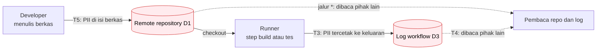
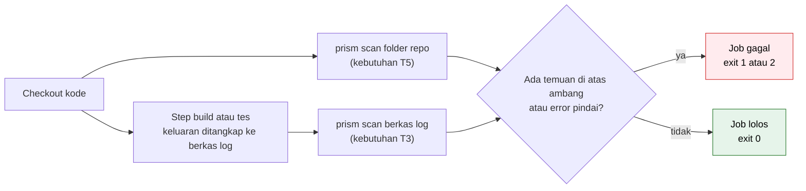
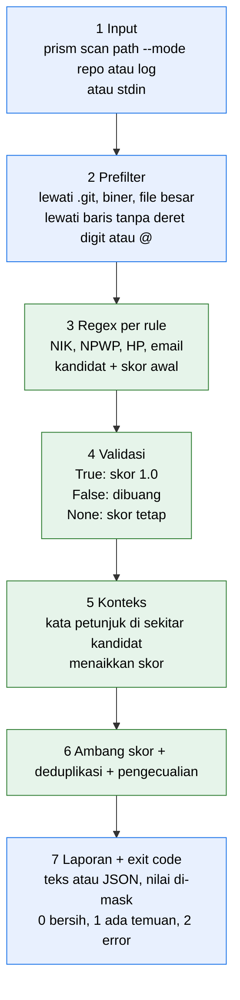

# Metode Gabungan: Fitur CI Betterleaks + Deteksi PII Presidio

**Dasar** (di `docs/research/`):
- [riset-privacy-scanner-cicd.md](../research/riset-privacy-scanner-cicd.md): DFD, LINDDUN, requirement
- [perbandingan-betterleaks-presidio.md](../research/perbandingan-betterleaks-presidio.md)
- [tool-betterleaks.md](../research/tool-betterleaks.md)
- [tool-presidio.md](../research/tool-presidio.md)

**Catatan:**
- Dokumen ini rancangan (analisis sendiri). Belum ada kode dan belum diuji terhadap kedua tool.
- Urutan: (1) ancaman T3 dan T5, (2) kebutuhan dari ancaman itu, (3) pendekatan yang memenuhinya.
- **Fokus: menilai confidence temuan** (bagian 4.1).
- **Severity: batasan, bukan fokus** (bagian 2.5).
- Keputusan yang dipakai:
  - Python dan regex (bukan AI/ML)
  - pindai working tree dan berkas log saja
  - exit code 0, 1, 2
  - laporan di-mask 4 karakter terakhir
  - temuan di atas ambang confidence menggagalkan pipeline
  - **data yang dicari: PII menurut UU PDP Pasal 4** (secret dan kredensial tidak difokuskan, lihat 2.5 dan bagian 10)
- ⚠️ = belum diverifikasi atau belum diuji.

---

## 1. Landasan: ancaman T3 dan T5

- T3 dan T5 adalah **fokus utama scanner** (riset utama bagian 7.5).
- Ancaman lain tidak dipakai sebagai dasar: T1, T2, T6 (konteks supply chain), T8, T9 (opsional), T7 (diabaikan).

### 1.1 Ringkasan kedua ancaman

Sumber: riset utama bagian 5.4, 7.2, 7.3, dan 10.5.

| Aspek | **T3**: PII tercetak di log | **T5**: PII atau token ter-push ke repositori |
|---|---|---|
| Lokasi di DFD | Alur 6a: P4 (eksekusi step) ke D3 (log workflow) | Alur 2: P1 (commit dan push) ke D1 (remote repository) |
| Batas kepercayaan | Runner (C) ke GitHub (B) | Mesin lokal (A) ke GitHub (B) |
| Penyebab | Aplikasi atau tes mencetak data nyata | Developer menyimpan PII atau token di berkas yang di-commit |
| Yang membuatnya parah | GitHub hanya menyamarkan nilai yang terdaftar sebagai secret. PII biasa tetap tercetak | Riwayat git tetap menyimpan data walau berkas dihapus. Nama dan email di commit bisa mengidentifikasi developer |
| LINDDUN utama | Data disclosure, Identifying | Linking, Identifying, Data disclosure, Non-compliance |
| LINDDUN sekunder | Linking, Unawareness, Non-compliance | - |
| Dampak lanjutan | T4: pembaca log (termasuk pengguna login di repo publik) melihat PII | Jalur `*`: pembaca repositori (terutama repo publik) melihat PII atau token |
| Kasus nyata | Belum ada yang terverifikasi | Belum ada yang terverifikasi |
| Privacy requirement | PR-01, PR-03, PR-04, PR-05 | PR-01, PR-03, PR-05 |
| FR dan NFR terkait | FR-02, FR-03 sampai FR-06. NFR-03, NFR-04, NFR-07 | FR-01, FR-03 sampai FR-06. NFR-03, NFR-04 |

- Pemetaan LINDDUN dan requirement masih usulan awal yang perlu divalidasi.
- T5 di riset utama mencakup PII dan token. Dokumen ini hanya mengerjakan PII (2.5).

### 1.2 Hubungan keduanya



- Diagram ini penyederhanaan DFD riset utama bagian 7.4.
- Dua simpul merah adalah tempat data pribadi tersimpan dan bisa dibaca.
- Kesamaan: PII atau token berada di teks yang bisa dibaca pihak lain.
- Perbedaan:
  - T5 terjadi saat commit dan push (di repositori)
  - T3 terjadi saat job berjalan (di log)

---

## 2. Analisis kebutuhan dari T3 dan T5

- Bagian ini **tidak memakai skenario S1–S3**.
- Kebutuhan diturunkan langsung dari ancaman.

### 2.1 Cara menurunkan kebutuhan

- Tiap ancaman diajukan enam pertanyaan:
  1. Apa yang bocor?
  2. Dalam bentuk apa datanya?
  3. Kapan bocor?
  4. Kapan masih bisa dicegat?
  5. Siapa yang terpapar?
  6. Apa akibatnya bila scanner salah?
- Jawabannya menjadi kebutuhan (K-xx).
- Tiap K-xx dipetakan ke FR, NFR, dan PR yang sudah ada.

### 2.2 Analisis per ancaman

| Pertanyaan | T3 (log) | T5 (repositori) |
|---|---|---|
| Apa yang bocor? | PII yang dicetak program atau tes (NIK, email, HP) | PII di isi berkas. Metadata commit (nama, email) |
| Bentuk datanya | Aliran teks keluaran step (stdout, stderr) yang tersimpan sebagai log | Berkas teks di working tree (kode, konfigurasi, data uji, CSV, JSON) dan salinannya di riwayat git |
| Sifat data | Teks bebas per baris. Banyak angka lain (waktu, ID, jumlah) | Banyak berkas dengan format beragam. Ada yang biner |
| Kapan bocor? | Saat job berjalan, ketika step mencetak | Saat commit dan push, **sebelum** pipeline jalan |
| Kapan bisa dicegat? | Hanya sebelum tercetak. Baris yang sudah masuk log tidak bisa ditarik scanner ⚠️ (kemampuan GitHub menghapus log belum dicek) | Pipeline jalan **sesudah** push, jadi data sudah di remote. Scanner CI hanya mendeteksi. Pencegahan sebelum push (hook lokal) di luar pipeline |
| Siapa terpapar? | Pembaca log (T4) | Pembaca repositori (jalur `*`) |
| Bila scanner salah | Gagal mendeteksi: PII tetap terbuka. Terlalu banyak peringatan palsu: pipeline sering gagal tanpa alasan dan diabaikan | Sama |

### 2.3 Kebutuhan yang diturunkan

| ID | Kebutuhan | Dari | Alasan | Terkait |
|---|---|---|---|---|
| K-01 | Memeriksa isi berkas teks di working tree hasil checkout | T5 | Data ada di isi berkas yang di-commit | FR-01 |
| K-02 | Memeriksa teks keluaran program atau tes yang masuk ke log | T3 | Data muncul sebagai aliran teks saat job jalan | FR-02 |
| K-03 | Mengenali PII Indonesia berformat tetap (NIK, NPWP, HP, email) di teks bebas | T3, T5 | Datanya teks biasa dan formatnya jelas | FR-03, NFR-03 |
| K-04 | **Menilai seberapa yakin sebuah temuan benar-benar PII** | T3, T5 | Teks penuh angka lain. Peringatan palsu membuat pemeriksaan diabaikan | NFR-03 |
| K-05 | Menunjukkan lokasi temuan (berkas dan baris) | T3, T5 | Developer perlu menelusuri dan memperbaiki | FR-04, NFR-05 |
| K-06 | Memberi status pipeline: gagal bila ada temuan, dan **membedakan gagal pindai dari bersih** | T3, T5 | Tidak ada peninjau manusia di tengah pipeline | FR-06, NFR-07 |
| K-07 | Melapor tanpa menampilkan PII utuh | T3, T5 | Laporan scanner sendiri bisa jadi jalur kebocoran baru | NFR-04, PR-01, PR-03 |
| K-08 | Merangkum hasil (jumlah dan jenis temuan) | T3, T5 | Untuk evaluasi dan keterbacaan | FR-05 |
| K-09 | Berjalan di runner lewat konfigurasi workflow, ringan dan cepat | T3, T5 | T3 terjadi di runner. T5 hanya bisa dideteksi di pipeline | NFR-01, NFR-02 |
| K-10 | Hasil sama untuk input yang sama | T3, T5 | Hasil pemeriksaan harus bisa dipercaya dan diulang | NFR-07 |
| K-11 | Tidak mengirim data ke layanan luar | T3, T5 | Mengirim PII keluar menambah kebocoran baru | NFR-04 |
| K-12 | (Tambahan) Mengecualikan temuan yang sudah ditinjau, dan mengatur cakupan | T3, T5 | Mengurangi temuan berulang | FR-07, FR-08 |

### 2.4 Kebutuhan yang muncul tetapi dibatasi

Kebutuhan ini nyata, tetapi tidak dikerjakan karena keputusan cakupan.

| Kebutuhan | Dari | Alasan dibatasi |
|---|---|---|
| Memeriksa riwayat git | T5 | Keputusan cakupan: working tree saja |
| Memeriksa metadata commit (nama, email) | T5 | Di luar cakupan |
| Mencegah sebelum push (hook lokal) | T5 | Di luar pipeline. CI hanya mendeteksi |
| Menghapus log yang sudah tercetak | T3 | Di luar kendali scanner ⚠️ |
| Mendeteksi token dan kredensial | T5 | Di luar fokus: bukan data pribadi menurut UU PDP Pasal 4 (bagian 10) |
| Membedakan dampak per jenis data (severity) | T3, T5 | Batasan (2.5) |

### 2.5 Fokus dan batasan (constraint)

| | Isi |
|---|---|
| **Fokus** | Menilai confidence temuan (K-04). Rancangan di bagian 4.1 |
| **Batasan: jenis data** | Hanya PII menurut UU PDP Pasal 4 (bagian 6.1). Secret, token, dan kredensial tidak dicakup (bagian 10) |
| **Batasan: severity** | Tidak ada penilaian dampak per jenis data. Tidak ada level keparahan di laporan |
| **Aturan gagal** | Semua temuan di atas ambang confidence menggagalkan pipeline (exit code 1). Sesuai keputusan 2 Nov di [rencana-harian-11-nov.md](rencana-harian-11-nov.md) |

**Alasan severity jadi batasan:**
- Kedua tool pembanding juga hanya menilai confidence pada mode pindai biasa.
  - Presidio: skor angka.
  - Betterleaks: label `low`, `medium`, `high`.
- Severity Betterleaks hanya muncul lewat analisis `-a` untuk kredensial valid. Tidak berlaku untuk PII.
- Kontribusi PRISM ada di deteksi PII Indonesia yang bisa dipercaya, bukan di penilaian dampak.

**Konsekuensi:**
- Ambang confidence adalah satu-satunya penentu pipeline gagal atau lolos.
- Kalibrasi ambang jadi penting (uji U5, bagian 8).
- NIK dan email diperlakukan sama bila skornya sama.
- Pemetaan severity per jenis data (misalnya NIK tinggi, email rendah) hanya dicatat sebagai pengembangan lanjutan. Sejalan dengan daftar "Jangan dikerjakan dulu" di [sebelum-implementasi.md](sebelum-implementasi.md).

---

## 3. Pendekatan: fitur CI Betterleaks + deteksi PII Presidio

### 3.1 Ide pendekatan

- Kebutuhan terbagi dua:
  - **Kebutuhan pipeline** (K-01, K-02, K-06, K-07, K-09, K-10, K-11, K-12): mengikuti cara Betterleaks bekerja sebagai CLI di runner.
  - **Kebutuhan PII** (K-03, K-04): mengikuti cara Presidio mendeteksi dan menilai PII.
- Dari Betterleaks diambil: cara dipanggil di pipeline, cara melapor, exit code, cara mengecualikan temuan.
- Dari Presidio diambil: kandidat dari regex, validasi, kata konteks, skor.
- Dibuang: NER/spaCy, BPE, Aho-Corasick, validasi ke server penyedia.
- Hasil diperkirakan mirip karena untuk PII berformat jelas, keputusan akhir diambil oleh regex + validasi + konteks, bukan model AI.

### 3.2 Fitur yang diambil

| Dari | Fitur | Gunanya |
|---|---|---|
| **Betterleaks** (jalan di pipeline CI/CD) | CLI/binary yang dipanggil lewat satu step `run` | Tidak butuh layanan atau Action khusus |
| | Sumber pindai `fs <folder>` dan `stdin` | Memeriksa berkas repo dan keluaran/log |
| | Prefilter dan keyword | Saringan murah dulu, regex belakangan |
| | Exit code `1` saat ada temuan. `pipefail` untuk pipa `stdin` | Status pipeline. Gagal pindai tidak terbaca bersih |
| | `--redact`, keluaran JSON, fingerprint HMAC | Laporan tanpa PII utuh |
| | `betterleaks:allow`, `.betterleaksignore` | Dasar FR-08 |
| | Fixture uji rule (`[[rules.tests]]`, `config check`) | Cara menguji rule PII |
| **Presidio** (deteksi PII) | `PatternRecognizer`: regex dengan skor awal | Mengenali format PII |
| | `validate_result` `True`/`False`/`None` | Cek tanggal lahir dan wilayah NIK. Kandidat salah dibuang |
| | Kata konteks | Membedakan angka kebetulan dari NIK |
| | `score_threshold`, `remove_duplicates`, `allow_list` | Menyaring, merapikan, mengecualikan |
| | Hasil berupa tipe, posisi, skor (tanpa nilai PII) | Sesuai NFR-04 |

**Tidak diambil:**
- NER/spaCy: berat, di luar keputusan regex
- BPE dan entropi: untuk secret, di luar fokus
- Validasi HTTP ke penyedia: PII tidak punya penyedia, dan melanggar K-11
- Anonymizer, Image Redactor, Structured, REST API Presidio

### 3.3 Dari kebutuhan ke fitur

| Kebutuhan | Betterleaks (CI) | Presidio (PII) | Versi PRISM |
|---|---|---|---|
| K-01 berkas repo | `fs <folder>` | Menganalisis string | `prism scan <folder> --mode repo` |
| K-02 keluaran/log | `stdin`, `fs` pada berkas log | Log = teks biasa | `prism scan <berkas log>` atau `prism scan -` |
| K-03 PII Indonesia | Tidak ada rule PII bawaan ⚠️ | `PatternRecognizer` | Rule NIK, NPWP, HP, email (bagian 6) |
| K-04 menilai confidence | Label `low`/`medium`/`high` | Skor, `validate_result`, konteks, `score_threshold` | Skor 0 sampai 1 (bagian 4.1) |
| K-05 lokasi | Path dan baris | Offset karakter (perlu dikonversi) | `file:baris:kolom` |
| K-06 status pipeline | Exit code `1` | Tidak ada | Exit 0 bersih, 1 temuan, 2 error |
| K-07 tanpa PII utuh | `--redact` | Hasil tanpa nilai | Mask 4 karakter terakhir, selalu aktif |
| K-08 ringkasan | Metadata `scan` di JSON | Buat sendiri | Blok `scan` di keluaran |
| K-09 ringan | Binary tunggal | Berat (model NLP) ⚠️ | CLI Python tanpa NER |
| K-10 konsisten | Deterministik | Deterministik (hash bawaan bergaram acak) | Fingerprint HMAC berkunci tetap |
| K-11 tanpa kirim keluar | Validasi mati default | Model jalan lokal | Tanpa panggilan jaringan |
| K-12 pengecualian | `:allow`, `.betterleaksignore` | `allow_list` | `prism:allow` (ditunda) |

### 3.4 Posisi di pipeline

- Dua pindai berjalan di runner:
  - isi repo hasil checkout (kebutuhan T5)
  - keluaran step tes (kebutuhan T3)



Ilustrasi workflow (belum ada implementasi, perintah tes masih placeholder):

```yaml
steps:
  - uses: actions/checkout@v4
  - name: Pindai berkas repositori
    run: python -m prism scan . --mode repo
  - name: Jalankan tes dan simpan keluarannya
    run: <perintah tes> > test-output.log 2>&1
  - name: Pindai log keluaran
    run: python -m prism scan test-output.log --mode log
```

**Keputusan yang belum diambil:**
- Keluaran tes dialihkan ke berkas saja:
  - log GitHub tidak menampilkannya
  - tes yang gagal jadi lebih sulit ditelusuri
- Keluaran tes juga ditampilkan (misalnya lewat `tee`):
  - PII sudah tercetak sebelum dipindai
  - pindai hanya mendeteksi
- Pindai log sebaiknya tetap jalan walau step tes gagal (`if: always()`).

---

## 4. Alur gabungan (7 langkah)



Biru = dari Betterleaks (pipeline). Hijau = dari Presidio (deteksi PII).

| No | Langkah | Asal | Cara | Output | Memenuhi |
|---|---|---|---|---|---|
| 1 | Input | Betterleaks (`fs`, `stdin`) | `prism scan <path> --mode repo\|log`, atau baca stdin bila path `-`. Folder dibaca dengan `os.walk` | Daftar (file, isi teks) | K-01, K-02, K-09 |
| 2 | Prefilter | Betterleaks (prefilter, keyword) | Lewati `.git`, file biner, dan file terlalu besar. Per baris, lanjut hanya bila ada ≥ 8 digit berurutan atau `@` | Baris yang layak diperiksa | K-09 |
| 3 | Regex | Keduanya | Tiap rule punya regex yang dikompilasi sekali. Hasilnya kandidat (rule, nilai, baris, kolom, skor awal) | Daftar kandidat | K-03 |
| 4 | Validasi | Presidio (`validate_result`) | Fungsi per rule. `True` = skor 1.0, `False` = buang, `None` = skor tetap | Kandidat valid atau berskor tetap | K-04 |
| 5 | Konteks | Presidio (context enhancer) | Cari kata petunjuk (`nik`, `ktp`, `telp`, `hp`) di ±N karakter sekitar kandidat. Bila ada, skor naik ke minimal 0,4 (atau +0,35) | Skor yang disesuaikan | K-04 |
| 6 | Ambang, dedup, pengecualian | Presidio (`score_threshold`, `remove_duplicates`, `allow_list`), Betterleaks (`:allow`) | Buang skor < ambang. Bila dua temuan beririsan: skor lebih tinggi menang, lalu yang lebih panjang. Abaikan baris berkomentar `prism:allow` (FR-08, opsional) | Daftar akhir | K-04, K-12 |
| 7 | Laporan dan exit code | Betterleaks (teks, JSON, `--redact`, exit code) | Cetak `rule_id`, `file:baris:kolom`, nilai di-mask, skor. Opsi `--json`. Exit 1 bila ada temuan, 2 bila error, 0 bila bersih | Laporan + status CI | K-05 sampai K-08, K-10, K-11 |

### 4.1 Penilaian confidence (inti metode)

**Yang dinilai:**
- Seberapa yakin sebuah potongan teks benar-benar jenis data yang dicari (misalnya NIK).
- Bukan: seberapa parah dampaknya (2.5).
- Skor angka 0 sampai 1, dirancang sendiri (heuristik), bukan probabilitas dari model.
- Dokumentasi Presidio juga tidak menjelaskan kalibrasi skornya.

**Mengapa wajib dinilai (K-04):**
- Simulasi 1.000.000 angka 16 digit acak:
  - 100% lolos regex
  - 7,3% lolos tanggal lahir valid
  - 2,8% lolos tanggal dan kode provinsi (bagian 6, ⚠️ daftar provinsi belum diverifikasi)
- Percobaan Presidio 2.2.366: kartu kredit tanpa spasi (`4111111111111111`) lolos sebagai NIK valid. Muncul dua temuan berskor 1,00 pada angka yang sama.
- Tanpa penilaian confidence, kebetulan seperti ini ikut menggagalkan pipeline.

**Sumber confidence:**

| Sumber | Langkah | Efek pada skor | Contoh dari percobaan Presidio |
|---|---|---|---|
| Skor awal rule | 3 | Pola longgar = skor kecil. Pola spesifik = lebih besar | Pola 6 sampai 16 digit: 0,01. Pola email: 0,5 |
| Validasi | 4 | `True` = 1,0. `False` = dibuang. `None` = tetap | NIK valid: 1,00. NIK bertanggal 78: dibuang |
| Konteks | 5 | Kata petunjuk menaikkan skor | Email 0,5 jadi 1,0 ⚠️ efek konteks dan validasi tidak terpisah di trace |
| Ambang | 6 | Skor di bawah ambang tidak dilaporkan | `--min-score` |

**Usulan level confidence di laporan** (⚠️ batas angka belum dikalibrasi, ditentukan lewat uji U5):

| Level | Syarat (usulan) | Dilaporkan? |
|---|---|---|
| Tinggi | Validasi lolos (`True`), skor 1,0 | Ya |
| Sedang | Skor antara ambang dan 1,0 | Ya |
| Rendah | Skor di bawah ambang | Tidak |

- Laporan memuat skor dan level tiap temuan, tanpa nilai PII utuh.

**Fungsi confidence:**
1. Menyaring kandidat yang kemungkinan kebetulan (ambang).
2. Menyelesaikan irisan antar temuan (langkah 6).
   - Pada percobaan Presidio, dua tipe berbeda di span yang sama sama-sama bertahan.
   - PRISM perlu aturan pemenang antar-rule, misalnya NIK vs kartu kredit. ⚠️ Belum diputuskan.
3. Mengevaluasi hasil: precision dan recall per level confidence (bagian 8).

---

## 5. Pemetaan: fitur asli → versi di PRISM → seberapa mirip

| Fitur asli | Tool | Versi di PRISM | Mirip? | Beda yang diterima |
|---|---|---|---|---|
| `betterleaks fs <folder>` | Betterleaks | `prism scan <folder>` | ✅ | Tidak membaca riwayat git (di luar cakupan) |
| `betterleaks stdin` | Betterleaks | `prism scan -` | ✅ | Tidak ada mode `--git-diff` |
| Prefilter path | Betterleaks | Daftar folder dan ekstensi yang dilewati | ✅ untuk kasus umum | Tanpa bahasa ekspresi Expr |
| Keyword Aho-Corasick | Betterleaks | Cek "ada deret digit atau `@`" per baris | ✅ hasil sama | Lebih lambat pada korpus raksasa. Tidak relevan untuk repo kecil |
| Regex RE2 | Betterleaks | `re` Python, pola tanpa kuantifier bersarang | ✅ untuk pola PII pendek | RE2 menjamin waktu linear, Python tidak. Pola dijaga bounded (`\d{16}`, bukan `.*`). ⚠️ Flavor regex belum diputuskan |
| `PatternRecognizer` | Presidio | Dataclass `Rule(id, regex, base_score, context, validate)` | ✅ | Tanpa deny list dan YAML |
| `validate_result` | Presidio | `validate(value) -> True/False/None`, semantik sama | ✅ | Tanpa `invalidate_result` terpisah |
| Context enhancer berbasis lemma | Presidio | Cari kata petunjuk (huruf kecil) di jendela sekitar kandidat | ⚠️ mirip | Tanpa spaCy dan lemma. Kata petunjuk Indonesia pendek dan tetap |
| `score_threshold` | Presidio | `--min-score`, default 0,4 ⚠️ | ✅ | Default perlu dikalibrasi |
| `remove_duplicates` | Presidio | Skor tertinggi, lalu terpanjang | ✅ | Tidak menggabungkan irisan sebagian |
| `allow_list` | Presidio | Daftar nilai yang diabaikan | ✅ | Ditunda (FR-08) |
| `betterleaks:allow` | Betterleaks | Komentar `prism:allow` di baris yang sama | ✅ | Ditunda (FR-08) |
| `.betterleaksignore` (hash nilai) | Betterleaks | Nanti: HMAC(nilai) berkunci, bukan SHA-256 polos | ⚠️ sengaja beda | SHA-256 polos pada NIK atau HP bisa ditebak (ruang nilai kecil) |
| `--redact` | Betterleaks | **Selalu aktif**: 4 karakter terakhir, sisanya `*` | ✅ lebih ketat | Betterleaks tidak menyamarkan secara default |
| Format JSON | Betterleaks | `{schema_version, findings[], scan{}}`, nilai sudah di-mask | ✅ | Tanpa SARIF (juga dihapus di Betterleaks v2) |
| Exit code 1 saat ada temuan | Betterleaks | Sama, plus 2 untuk error (NFR-07) | ✅ | Betterleaks tidak membedakan error secara terdokumentasi ⚠️ |
| NER | Presidio | **Tidak ditiru** | ❌ | Nama tanpa pola tetap tidak terdeteksi. Sesuai keputusan regex |
| Validasi ke penyedia | Betterleaks | **Tidak ditiru** | ❌ | PII tidak punya penyedia. Sesuai NFR-04 |
| BPE dan entropi | Betterleaks | Di luar fokus (untuk secret) | - | Tidak perlu untuk PII berformat jelas |

---

## 6. Data yang dicakup dan rule PII Indonesia v1

### 6.1 Data yang dicakup: PII menurut UU PDP Pasal 4

Daftar kategori dari riset utama bagian 6.1 dan 6.2. Kolom "bisa dideteksi regex?" adalah analisis sendiri.

| Kategori Pasal 4 | Contoh di pipeline | Bisa dideteksi regex? | Dalam rule v1? |
|---|---|---|---|
| **Data pribadi umum** | | | |
| Nama lengkap | Nama di data uji, log, metadata commit | Tidak. Nama tidak berpola tetap (butuh NER) | Tidak |
| Jenis kelamin | Kolom di skema atau data uji | Lemah. Nilai pendek seperti "L" dan "P" terlalu ambigu | Tidak ⚠️ |
| Kewarganegaraan | Kolom di data uji atau konfigurasi | Lemah. Bergantung nama kolom | Tidak ⚠️ |
| Agama | Kolom di data uji | Lemah. Ambigu tanpa konteks kolom | Tidak ⚠️ |
| Status perkawinan | Kolom di data uji | Lemah. Ambigu tanpa konteks kolom | Tidak ⚠️ |
| **Data pribadi yang dikombinasikan untuk mengidentifikasi seseorang** | NIK, NPWP, nomor telepon, email | **Ya.** Format tetap | **Ya**: NIK, NPWP, HP, email |
| **Data pribadi spesifik** | | | |
| Kesehatan | Diagnosis, nomor rekam medis | Sebagian. Format nomor rekam medis beda tiap institusi. Diagnosis berupa teks bebas | Tidak ⚠️ |
| Biometrik | Templat sidik jari dan wajah | Tidak. Data biner, dilewati prefilter | Tidak |
| Genetika | Hasil tes genetika | Tidak | Tidak |
| Catatan kejahatan | Riwayat pidana | Tidak. Teks bebas | Tidak |
| Data anak | Data pribadi anak | Tidak. Bergantung usia dan konteks | Tidak |
| Keuangan pribadi | Nomor rekening, nomor kartu, saldo, transaksi | Sebagian. Nomor kartu bisa dicek dengan Luhn. Format nomor rekening beda tiap bank | Usulan: nomor kartu. ⚠️ Belum diputuskan |

**Catatan:**
- NIK, NPWP, nomor telepon, dan email tidak disebut satu per satu di Pasal 4. Keempatnya masuk kategori "data pribadi yang dikombinasikan untuk mengidentifikasi seseorang". ⚠️ Ringkasan pasal di riset utama bagian 6.4 masih kosong, jadi cocokkan dengan teks pasal aslinya.
- Kategori lain tidak berpola tetap. Mendeteksinya butuh NER atau daftar kata, di luar keputusan regex. Dicatat sebagai batasan, bukan dikerjakan.
- Nomor kartu kredit adalah usulan tambahan. Pada percobaan Presidio, angka kartu tanpa spasi juga lolos sebagai NIK, jadi bila ditambahkan perlu aturan pemenang antar-rule (4.1).

### 6.2 Rule v1

⚠️ Format di bawah dari pengetahuan umum, **belum diverifikasi ke sumber resmi**. Rencana harian 4–5 Nov meminta sumber resmi untuk NIK, NPWP, dan HP.

| Rule | Regex (arah umum) | Kata konteks | Skor awal |
|---|---|---|---|
| **NIK** | `(?<!\d)\d{16}(?!\d)` (16 digit, tidak menempel pada digit lain) | `nik`, `ktp`, `identitas`, `kependudukan` | 0,3 |
| **NPWP** | 15 digit bertitik (`XX.XXX.XXX.X-XXX.XXX`) dan 16 digit (sama dengan NIK, format baru) ⚠️ | `npwp`, `pajak` | 0,5 bertitik, 0,3 polos |
| **HP** | `(?:\+62\|62\|0)8\d{8,11}`, pemisah opsional (spasi, `-`) ⚠️ | `hp`, `telp`, `telepon`, `wa`, `whatsapp`, `kontak` | 0,4 |
| **Email** | Pola email umum | `email`, `surel`, `mail` | 0,5 |

**Validasi per rule** (`True` / `False` / `None`):
- **NIK:**
  - digit 7–8 bernilai 1–31 (laki-laki) atau 41–71 (perempuan)
  - digit 9–10 bernilai bulan 01–12
  - 2 digit pertama ada di daftar kode provinsi
  - 4 digit terakhir bukan `0000`
  - semua lolos = `True`, ada yang gagal = `False`
- **NPWP:**
  - 15 digit: cek panjang dan pola pemisah
  - 16 digit: ikut aturan NIK
  - tidak ada checksum yang diketahui ⚠️
- **HP:** cek panjang total dan awalan operator `08xx` (daftar prefiks belum diverifikasi ⚠️). Hasil `True` atau `None`.
- **Email:** `None` (tanpa validasi). Opsional: buang domain contoh (`example.com`, `test.com`).

**Mengapa validasi NIK penting.** Simulasi 1.000.000 angka 16 digit acak (seed 7):

| Pemeriksaan | Angka acak yang masih lolos |
|---|---|
| Hanya 16 digit | 100% |
| + tanggal lahir valid | **7,3%** |
| + kode provinsi dikenal (38 kode ⚠️) | **2,8%** |
| + nomor urut bukan `0000` | 2,8% (efek hampir nol) |

- Cek tanggal membuang ±93% angka acak. Cek provinsi membuang ±97%.
- Angka ini dari angka acak seragam. Nomor rekening dan ID transaksi nyata tidak acak seragam.
- False positive sebenarnya harus diukur pada dataset berlabel.
- Daftar kode provinsi (termasuk provinsi baru Papua) perlu dicocokkan ke sumber resmi Kemendagri.

**Peran kata konteks:**
- Angka 16 digit yang lolos validasi tetapi tanpa `nik` atau `ktp` di dekatnya berskor 0,3. Ini di bawah ambang 0,4, jadi tidak dilaporkan.
- Cara ini sama dengan Presidio pada kode pos 5 digit (0,01 naik ke 0,4 bila ada kata konteks).
- Konsekuensi: **NIK tanpa kata petunjuk tidak dilaporkan**. Ini trade-off precision dan recall.
- Opsi lain: validasi lolos langsung berskor 1,0, seperti `validate_result = True` di Presidio.
- Pilihan ditentukan lewat uji U5 (bagian 8).

---

## 7. Contoh keluaran

Teks (default):

```
data/synthetic/users.csv:12:34  nik  skor=1.00  ************3456
logs/test-output.log:88:15      hp   skor=0.75  ********7890
2 temuan. exit code 1
```

JSON (`--json`), bentuknya meniru Betterleaks v2:

```json
{
  "schema_version": 1,
  "findings": [
    {"rule_id": "nik", "score": 1.0,
     "location": {"file": "data/synthetic/users.csv", "line": 12, "column": 34},
     "match": {"value": "************3456"}}
  ],
  "scan": {"mode": "repo", "files": 41, "findings": 1, "errors": 0}
}
```

- Nilai PII utuh **tidak pernah** ditulis ke laporan maupun log (NFR-04).
- Presidio: hasilnya tanpa nilai. Pengecualian: bila `log_decision_process=True`, trace mencetak token teks asli ke stdout (terbukti di percobaan).
- Betterleaks: nilai baru disamarkan bila memakai `--redact`.

---

## 8. Cara membuktikan "hasilnya mirip"

- Presidio sudah dicoba sebagian lewat percobaan manual (versi 2.2.366).
- Betterleaks belum dicoba.
- Klaim "mirip" di bagian 5 masih hipotesis.
- Buktinya: uji kesesuaian pada dataset sintetis berlabel yang sama.

| No | Uji | Cara | Yang diukur |
|---|---|---|---|
| U1 | Kesesuaian dengan Presidio | Buat `PatternRecognizer` NIK + `validate_result` dengan logika sama. Jalankan Presidio dan PRISM pada dataset yang sama | Overlap temuan, selisih precision dan recall. Target: beda kecil |
| U2 | Kesesuaian dengan Betterleaks | Tulis rule NIK/HP custom (regex + keywords + filter Expr). Jalankan `betterleaks fs <folder>` dan `prism scan <folder>` | Overlap temuan. Catat apakah Expr mampu cek tanggal lahir (jika tidak, bedanya = gap G2) |
| U3 | Perilaku CLI | Folder bersih, folder bertemuan, file tak terbaca | Exit code 0/1/2 benar. JSON terbaca. PII tidak muncul di keluaran |
| U4 | False positive angka 16 digit | Dataset berisi nomor rekening, ID transaksi, timestamp | FPR PRISM vs Presidio vs Betterleaks |
| U5 | Konteks vs tanpa konteks | Variasikan ambang dan aturan "validasi lolos = 1,0" | Trade-off precision/recall NIK. Kalibrasi ambang confidence |
| U6 | Biaya | Waktu instal dan jalan di runner GitHub Actions | NFR-01, NFR-02. Klaim "ringan" vs Presidio (model NLP) |

**Dataset:**
- Data sintetis dengan Faker `id_ID`, plus label ground truth di `data/labels/` (rencana 8 Nov).
- ⚠️ Faker `id_ID` mungkin menghasilkan NIK yang tidak lolos validasi sendiri. Periksa dulu agar label tidak keliru.

---

## 9. Yang sengaja berbeda dari kedua tool

| Hal | Alasan |
|---|---|
| Laporan selalu di-mask, bukan opsional | NFR-04 (K-07). Laporan sendiri tidak boleh membocorkan PII (T9) |
| Fingerprint HMAC, bukan SHA-256 polos | Ruang nilai NIK dan HP kecil, hash polos bisa ditebak |
| Exit code 2 untuk error | NFR-07 (K-06). Gagal pindai tidak boleh terlihat bersih |
| Tanpa NER | Keputusan metode: regex. Nama orang di luar cakupan |
| Aturan PII Indonesia bawaan | Kontribusi yang tidak ada di Betterleaks maupun Presidio (gap G1 dan P1) |
| Tanpa penilaian severity | Batasan (2.5). Hanya confidence |

---

## 10. Di luar cakupan: secret dan kredensial

- Tidak difokuskan. Token dan kredensial bukan data pribadi menurut UU PDP Pasal 4 (riset utama bagian 6.3: "di luar UU PDP").
- Betterleaks sudah matang untuk token (rule provider).
- Bila suatu saat dibutuhkan, cukup menambah rule di mesin yang sama. Alur tidak berubah.

Catatan bila dibutuhkan nanti:

| Komponen | Cara | Mirip dengan |
|---|---|---|
| Rule token | Regex berawalan khas (`ghp_`, `AKIA`, dst.) | Rule provider Betterleaks |
| Prefilter keyword | Kata kunci rule (sudah ada di langkah 2) | Keyword Aho-Corasick |
| Filter keacakan | Entropi Shannon (±10 baris kode) | Filter entropi Betterleaks |
| BPE | Ditunda | Klaim Betterleaks: BPE lebih baik dari entropi untuk recall ⚠️ (klaim non-resmi, pembandingnya entropi) |

- Posisi PRISM untuk token: **pembanding** terhadap Betterleaks, bukan pesaing.

---

## 11. Urutan pengerjaan yang disarankan

| Urutan | Pekerjaan | Mendukung |
|---|---|---|
| 1 | Verifikasi format NIK, NPWP, HP dari sumber resmi, tulis rule v1 | Bagian 6 |
| 2 | Kerangka CLI: argumen, penelusuran folder, prefilter, exit code | FR-01, FR-06 |
| 3 | Mesin rule: regex → validasi → konteks → ambang | FR-03, NFR-03 |
| 4 | Laporan teks dan JSON dengan masking | FR-04, FR-05, NFR-04 |
| 5 | Dataset sintetis dan label | NFR-03 |
| 6 | Workflow GitHub Actions yang gagal saat ada temuan | NFR-01 |
| 7 | Uji kesesuaian U1–U6 | Bagian 8 |

---

## 12. Risiko dan hal yang belum pasti

- Kemiripan dengan Presidio dan Betterleaks belum diuji (bagian 8).
- Severity jadi batasan, jadi ambang confidence satu-satunya penentu pipeline gagal.
  - Ambang terlalu rendah: pipeline gagal pada kebetulan.
  - Ambang terlalu tinggi: PII sungguhan lolos.
  - Nilai 0,4 hanya titik awal.
- Aturan "NIK tanpa kata konteks tidak dilaporkan" bisa menurunkan recall pada log yang hanya mencetak angka.
- Pindai di CI hanya mendeteksi, bukan mencegah (2.2):
  - T5: data sudah di remote
  - T3: data sudah tercetak
- Perlu sumber resmi untuk kode provinsi, awalan operator HP, dan format NPWP.
- Flavor regex (Python `re` vs RE2) belum diputuskan. Python rawan backtracking bila pola ceroboh.
- Apakah `AnalyzerEngine` Presidio bisa jalan ringan tanpa NER belum dicek (E4 di dokumen perbandingan).
