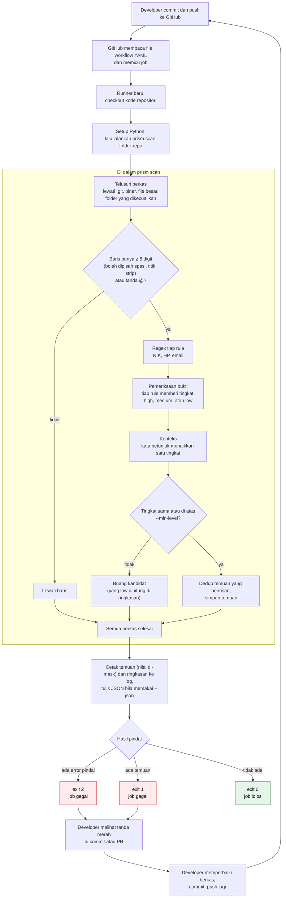
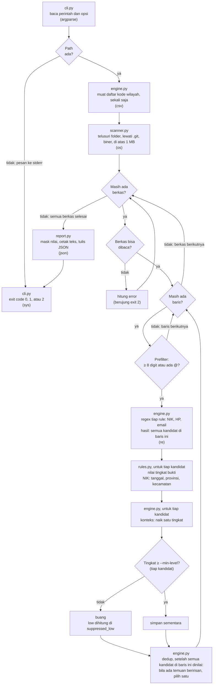
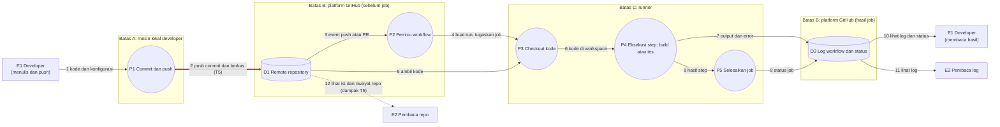
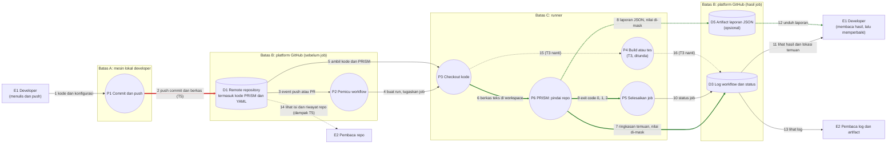

# SRS: PRISM MVP T5 (Pemindai PII di Repositori)

**Produk:** PRISM (*Privacy Inspection & Scanning Module*)
**Jenis dokumen:** Spesifikasi Kebutuhan Perangkat Lunak (SRS)
**Status:** draf, 16 Nov. 2026
**Penyusun:** Maritza Vania Adelia. **Dosen pembimbing:** Warsun Najib.
**Tanda:** ⚠️ = belum diverifikasi, belum diuji, atau belum disetujui.

**Cara membaca dokumen ini:**
- Bagian 1 dan 2: PRISM itu apa, untuk siapa, dan di mana ia dijalankan.
- Bagian 3: daftar kebutuhan (apa yang **harus** bisa dilakukan PRISM) dan cara mengujinya. Ini inti dokumen.
- Bagian 4: keputusan beserta alasannya.
- Bagian 5: risiko dan hal yang belum selesai.
- Bagian 6: pemetaan kebutuhan MVP ke kebutuhan di riset utama.
- Lampiran A: diagram alur data sebelum dan sesudah ada PRISM.
- Lampiran B: rencana pengerjaan langkah demi langkah.

---

## 1. Pendahuluan

### 1.1 Tujuan dokumen

Dokumen ini menjelaskan apa yang harus bisa dilakukan PRISM pada versi MVP, apa yang tidak dikerjakan, dan bagaimana setiap kebutuhan dibuktikan lewat pengujian.

Pembaca: penulis (sebagai pegangan saat membuat program), dosen pembimbing, dan penguji.

Struktur dokumen mengikuti pola umum SRS: pendahuluan, deskripsi umum, lalu kebutuhan spesifik. ⚠️ Belum merujuk standar resmi (misalnya IEEE 830 atau ISO/IEC/IEEE 29148). Bila ingin dikutip di laporan, baca standarnya dan tambahkan ke [referensi.md](../research/referensi.md).

### 1.2 Cakupan produk

- PRISM adalah kependekan dari *Privacy Inspection & Scanning Module*.
- PRISM adalah program baris perintah (CLI) berbahasa Python.
- Tugasnya: memindai berkas teks di repositori, mencari data pribadi (PII) Indonesia, dan membuat job GitHub Actions **gagal (merah)** bila ada temuan.
- Tujuannya: developer tahu sejak push atau pull request bila ada PII yang tertulis di berkas repositori.
- PRISM **tidak** menolak push, tidak menghapus PII, dan tidak membersihkan riwayat git. PRISM hanya mendeteksi dan melapor.

**Ancaman yang dikerjakan:**
- **T5:** PII di berkas repositori. Dikerjakan di MVP.
- **T3:** PII di log keluaran tes. Dikerjakan **setelah** MVP.

**Data yang dicari** (keputusan 12 Nov. 2026):

| Jenis data | Keterangan | Jenis di laporan |
|---|---|---|
| NIK | 16 digit. Termasuk NPWP orang pribadi (sama dengan NIK sejak PMK 112/2022) dan nomor Kartu Keluarga (KK), yang strukturnya mirip NIK | `nik` |
| Nomor HP | Nomor seluler Indonesia (`08…`, `62…`, `+62…`) | `hp` |
| Email | Alamat email | `email` |

**Dasar hukum:** Pasal 4 ayat (3) huruf f UU PDP ("dikombinasikan untuk mengidentifikasi seseorang").
- **Hanya nomor HP yang disebut di teks** (Penjelasan: "antara lain nomor telepon seluler dan IP Address").
- NIK (termasuk NPWP orang pribadi dan KK) dan email adalah **tafsiran** dari Pasal 1 butir 1.
- Rincian: [dasar-hukum-uu-pdp.md](../research/dasar-hukum-uu-pdp.md).

**Belum dicakup:** data umum butir a sampai e (nama lengkap, jenis kelamin, kewarganegaraan, agama, status perkawinan), yang direncanakan sebagai tahap 2 setelah MVP, dan data pribadi spesifik. Secret dan token juga tidak dicakup.

### 1.3 Kriteria MVP selesai

| No | MVP selesai bila | Kebutuhan |
|---|---|---|
| 1 | Perintah `prism scan <folder>` mendeteksi NIK (termasuk NPWP orang pribadi dan KK), HP, dan email di berkas teks | KF-01 sampai KF-13 |
| 2 | Nilai PII tidak pernah tampil utuh di laporan | KF-20 |
| 3 | Exit code benar: 0 bersih, 1 ada temuan, 2 error pindai | KF-21 |
| 4 | Workflow GitHub Actions jalan saat push dan pull request. Job merah bila ada temuan, hijau bila bersih. Ada tangkapan layar sebagai bukti | KF-22, KF-23 |
| 5 | Laporan JSON tersedia sebagai artifact | KF-18, KF-22 |
| 6 | Ada data uji sintetis berlabel. Precision, recall, F1, FPR, dan waktu pindai tercatat | KF-25, KF-26 |
| 7 | Tes otomatis lulus | KF-27 |

### 1.4 Definisi dan singkatan

| Istilah | Arti |
|---|---|
| PRISM | *Privacy Inspection & Scanning Module*, nama program yang dibuat |
| PII | Data pribadi, yaitu data yang bisa dipakai untuk mengenali seseorang |
| NIK | Nomor Induk Kependudukan, 16 digit |
| KK | Kartu Keluarga. Nomornya 16 digit dan strukturnya mirip NIK |
| NPWP | Nomor Pokok Wajib Pajak. Untuk orang pribadi sekarang sama dengan NIK |
| HP | Nomor telepon seluler |
| CI | Pemeriksaan otomatis yang berjalan setiap ada push atau pull request |
| GitHub Actions | Layanan CI milik GitHub |
| Workflow | Berkas YAML yang mengatur apa yang dijalankan GitHub Actions |
| Job | Satu rangkaian langkah di dalam workflow. Berstatus hijau (lolos) atau merah (gagal) |
| Runner | Mesin sementara milik GitHub yang menjalankan job |
| Artifact | Berkas hasil job yang bisa diunduh dari halaman run |
| CLI | Program yang dijalankan lewat perintah di terminal |
| Regex | *Regular expression*. Pola teks untuk mencari bentuk tertentu, misalnya 16 digit |
| Berkas | *File*. Folder (direktori) berisi berkas. Pindai memeriksa berkas, sedangkan folder hanya ditelusuri |
| Rule | Aturan deteksi untuk satu jenis PII: regex, fungsi penilaian, dan kata konteks. Tersimpan di `rules.py` |
| Penilaian bukti (`assess`) | Fungsi per rule yang memberi tingkat (`high`, `medium`, `low`) pada kandidat, memakai arti isi kandidat (misalnya tanggal dan kode wilayah NIK) |
| Kandidat | Teks yang cocok dengan regex tetapi belum dinilai |
| Temuan | Kandidat yang tingkatnya lolos ambang dan dilaporkan |
| Tingkat bukti | `high`, `medium`, atau `low`. Menunjukkan seberapa kuat bukti bahwa kandidat benar PII. **Bukan probabilitas** |
| Konteks | Kata petunjuk (misalnya `nik`) di baris yang sama dengan kandidat |
| Ambang | Tingkat terendah yang dilaporkan (`--min-level`) |
| Prefilter | Penyaringan cepat baris sebelum regex dijalankan |
| Dedup | *Deduplication*. Bila dua temuan menempati teks yang sama atau saling tumpang tindih, hanya satu yang disimpan. Cara kerja di bawah KF-16 |
| Mask | Menyamarkan sebagian nilai dengan tanda `*` |
| Exit code | Angka yang dikembalikan program saat selesai. Bukan 0 berarti job gagal |
| Data sintetis | Data buatan, bukan milik orang sungguhan |
| TP | *True Positive*. PII sungguhan yang dilaporkan PRISM. Contoh: NIK sintetis yang dilaporkan sebagai `nik` |
| FP | *False Positive*. Bukan PII, tetapi dilaporkan (alarm palsu). Contoh: nomor rekening 16 digit yang dilaporkan sebagai `nik` |
| FN | *False Negative*. PII sungguhan yang tidak dilaporkan (terlewat). Contoh: NIK yang bulannya salah, jatuh ke `low`, lalu dibuang oleh ambang |
| TN | *True Negative*. Bukan PII, dan memang tidak dilaporkan. Contoh: ID transaksi 16 digit yang tidak dilaporkan |
| Precision | TP dibagi (TP + FP). Dari semua temuan, berapa yang benar ⚠️ definisi belum dikutip dari sumber |
| Recall | TP dibagi (TP + FN). Dari semua PII, berapa yang ditemukan ⚠️ belum dikutip |
| F1 | Ringkasan satu angka dari precision dan recall: 2 × precision × recall / (precision + recall). Rata-rata harmonik, jadi rendah bila salah satunya rendah. Tidak memakai TN, jadi alarm palsu tetap dilihat lewat FPR ⚠️ definisi belum dikutip |
| FPR | *False Positive Rate*. FP dibagi (FP + TN). Dari semua bukan-PII, berapa yang salah dilaporkan. Contoh: 100 pengecoh, 2 salah dilaporkan, FPR = 2/100 = 2% ⚠️ belum dikutip |
| T3, T5 | Ancaman di riset utama: T3 PII di log, T5 PII di berkas repositori |

### 1.5 Rujukan

| Dokumen | Isi |
|---|---|
| [implementasi.md](implementasi.md) | Rancangan metode. Tidak diubah, masih memakai skor angka (lihat 4.4) |
| [riset-privacy-scanner-cicd.md](../research/riset-privacy-scanner-cicd.md) | Daftar FR dan NFR, DFD, analisis ancaman LINDDUN |
| [sebelum-implementasi.md](sebelum-implementasi.md) | Persiapan awal |
| [format-pii-indonesia.md](../research/format-pii-indonesia.md) | Format dan aturan NIK, HP, email, serta hitungan peluang kebetulan |
| [format-pii-parkir.md](../research/format-pii-parkir.md) | Jenis data yang diparkir |
| [dasar-hukum-uu-pdp.md](../research/dasar-hukum-uu-pdp.md) | Dasar hukum cakupan data |
| [referensi.md](../research/referensi.md) | Semua sumber, format IEEE |
| [kode-wilayah/README.md](../../data/reference/kode-wilayah/README.md) | Data kode provinsi dan kecamatan |

---

## 2. Deskripsi umum

### 2.1 Perspektif produk

PRISM berdiri sendiri. Ia dijalankan oleh workflow GitHub Actions di runner, atau oleh developer di mesin lokal. Tidak ada server, database, atau layanan luar.

| Hal | Sebelum ada PRISM | Sesudah ada PRISM |
|---|---|---|
| PII di berkas yang ter-push | Tidak diperiksa | Diperiksa di CI setiap push dan PR |
| Status job | Hijau | Merah bila ada temuan (exit 1) atau error pindai (exit 2) |
| Developer tahu ada PII | Tidak | Ya, lokasi (berkas, baris) ada di log job |
| Bukti terstruktur | Tidak ada | Laporan JSON sebagai artifact |

Alur dari push sampai developer memperbaiki:



**Yang perlu diingat dari alur ini:**
- Log dan JSON ditulis pada **semua hasil** (0, 1, atau 2). JSON hanya ada bila `--json` dipakai.
- Push **tidak ditolak** oleh GitHub. Push sudah terjadi sebelum CI berjalan.
- CI hanya **mendeteksi**: job menjadi merah dan lokasi temuan ada di log.
- PII yang sudah ter-push tetap ada di riwayat git. Memperbaiki lewat commit baru tidak menghapusnya dari riwayat (di luar cakupan).
- Merge PR baru terblokir bila repo mengaktifkan *required status checks* ⚠️ (cek dokumentasi GitHub).
- Workflow perlu jalan juga saat push ke branch (`on: push`), bukan hanya saat PR dibuka. Dengan begitu developer tahu sebelum membuat PR.

DFD yang lebih rinci ada di Lampiran A.

### 2.2 Fungsi utama

1. Menelusuri berkas teks di folder.
2. Mencari kandidat NIK, HP, dan email dengan regex.
3. Menilai tingkat bukti tiap kandidat (`high`, `medium`, `low`).
4. Menyaring kandidat dengan ambang tingkat.
5. Melapor ke log dan JSON dengan nilai yang disamarkan.
6. Memberi exit code yang menentukan job merah atau hijau.

Fungsi pendukung penelitian: membuat data uji sintetis berlabel, dan menghitung precision, recall, F1, FPR, serta waktu pindai.

**Proses di dalam PRISM** (rancangan). Tiap kotak menyebut modul (nama berkas di Lampiran B.1) dan library bawaan Python yang dipakai.



**Cara membaca diagram:**
- Kotak persegi = proses. Belah ketupat = pertanyaan, dan tulisan di panah adalah jawabannya.
- Ada dua perulangan. Perulangan **per baris** (kembali ke "Masih ada baris?") dan perulangan **per berkas** (kembali ke "Masih ada berkas?").
- "Untuk tiap kandidat" berarti: satu baris bisa punya beberapa kandidat (misalnya NIK dan email), dan tiap kandidat dinilai sendiri-sendiri.
- Dedup baru dikerjakan **setelah semua kandidat di baris itu dinilai**, karena ia membandingkan kandidat satu dengan yang lain.
- Daftar kode wilayah dimuat **sekali di awal**, bukan tiap baris.
- Laporan dan exit code baru dicapai setelah semua berkas selesai, atau langsung bila path tidak ada.

**Library yang dibutuhkan** (semua bawaan Python, tanpa `pip install`):

| Library | Dipakai untuk | Contoh pemakaian (ilustrasi) |
|---|---|---|
| `argparse` | Membaca perintah dan opsi | `parser.add_argument("--min-level", choices=["low", "medium", "high"], default="medium")` |
| `sys` | Exit code | `sys.exit(2)` |
| `os` | Menelusuri folder, mengecek ukuran berkas | `for dirpath, dirnames, filenames in os.walk(path):` dan `os.path.getsize(berkas) > 1_000_000` |
| `re` | Mencari kandidat dengan regex | `re.compile(r"(?<!\d)\d{16}(?!\d)").finditer(baris)` |
| `csv` | Memuat daftar kode provinsi dan kecamatan sekali per pindai | `{row["kode"] for row in csv.DictReader(f)}` |
| `dataclasses` | Struktur `Rule` dan temuan | `Rule(id="nik", regex=pola, assess=assess_nik, context=["nik", "ktp"])` |
| `json` | Menulis laporan JSON | `json.dump(laporan, f, indent=2)` |
| `calendar` ⚠️ | Jumlah hari per bulan untuk pemeriksaan tanggal NIK. Belum diputuskan: bisa juga tabel hari per bulan buatan sendiri | `calendar.monthrange(2000, bulan)[1]` (tahun kabisat dipakai supaya 29 Februari diterima) |

- Hanya saat pengembangan, bukan di runner: `pytest` (tes) dan `Faker` (bahan nama dan email untuk data uji).
- Penjelasan tiap library: [library-bawaan-python.md](../research/library-bawaan-python.md).

**Contoh dua baris dari awal sampai akhir** (nilai sintetis, ambang bawaan `medium`):

| Tahap | Baris `nik: 3171011503900001` | Baris `ref: 1234567890123456` |
|---|---|---|
| Prefilter | 16 digit, lolos | 16 digit, lolos |
| Regex | Kandidat NIK `3171011503900001` | Kandidat NIK `1234567890123456` |
| Penilaian | Tanggal 15-03 sah, provinsi `31` terdaftar, kecamatan `317101` (Gambir) terdaftar: `high` | Digit 7–8 bernilai `78` (bukan hari yang sah): `low` |
| Konteks | Ada kata `nik`. `high` tetap `high` | Tidak ada kata konteks. Tetap `low` |
| Ambang | Lolos | Dibuang. `suppressed_low` bertambah 1 |
| Dedup | Tidak ada irisan | Tidak ikut |
| Mask dan laporan | `************0001`, jenis `nik`, tingkat `high` | Tidak dicetak. Hanya terhitung di ringkasan |
| Hasil | Ada 1 temuan, exit code 1 | Tidak jadi temuan. Bila tidak ada temuan lain, exit code 0 |

**Urutan tahap per baris** (setelah berkas bisa dibaca):

| Urut | Tahap | Pertanyaan yang dijawab | Hasil |
|---|---|---|---|
| 1 | Prefilter | Apakah baris ini layak diperiksa? | Lanjut atau lewati |
| 2 | Regex | Apakah ada bentuk NIK, HP, atau email di baris ini? | Kandidat |
| 3 | Penilaian bukti (`assess`) | Seberapa kuat buktinya? | `high`, `medium`, atau `low` |
| 4 | Konteks | Adakah kata petunjuk di dekatnya? | Tingkat naik satu, atau tetap |
| 5 | Ambang | Apakah tingkatnya cukup untuk dilaporkan? | Dilaporkan atau dibuang |
| 6 | Dedup | Apakah ada temuan yang beririsan? | Satu pemenang per irisan |

**Prefilter** hanya memeriksa dua hal tentang baris: jumlah karakter digit **≥ 8**, atau ada tanda `@`. Ia tidak menemukan kandidat dan tidak tahu jenis datanya. Tugasnya menghemat waktu, supaya regex tidak dijalankan pada baris yang jelas tidak mungkin berisi NIK, HP, atau email. Baris yang tidak lolos dilewati.

| Baris (sintetis) | Prefilter | Selanjutnya |
|---|---|---|
| `# komentar biasa` | Tidak lolos (0 digit, tanpa `@`) | Dilewati |
| `versi 3.13` | Tidak lolos (3 digit) | Dilewati |
| `nik: 3171011503900001` | Lolos (16 digit) | Lanjut ke regex |
| `budi@perusahaan.co.id` | Lolos (ada `@`) | Lanjut ke regex |

**`rules.py` dan `engine.py`:**

| | `rules.py` | `engine.py` |
|---|---|---|
| Peran | Menyimpan **isi** aturan, tiap jenis PII satu rule | **Menjalankan** semua rule pada baris |
| Isinya | Regex, fungsi `assess` (misalnya `assess_nik`), dan kata konteks tiap rule | Mencari kandidat dengan regex, memanggil `assess`, menerapkan konteks, ambang, dan dedup |
| Sifatnya | Data dan aturan khusus tiap jenis | Logika umum yang sama untuk semua jenis |
| Bila menambah jenis PII baru | Ditambah satu rule di sini | Tidak perlu diubah (KN-07) |
| Bentuk | `Rule(id, regex, assess, context)` | Fungsi yang menerima daftar `Rule` dan sebuah baris |

Contoh (ilustrasi, bukan kode PRISM):

```python
# rules.py: isi aturan
NIK = Rule(id="nik", regex=POLA_NIK, assess=assess_nik, context=["nik", "ktp"])
HP = Rule(id="hp", regex=POLA_HP, assess=assess_hp, context=["hp", "telp", "wa"])
RULES = [NIK, HP]  # urutan ini juga dipakai dedup saat tingkat dan panjang sama

# engine.py: menjalankan aturan
def periksa_baris(baris, rules, min_level):
    for rule in rules:                                   # rule yang sama, cara kerja yang sama
        for m in rule.regex.finditer(baris):             # regex
            tingkat = rule.assess(m.group())             # penilaian bukti
            ...                                          # konteks, ambang, lalu dedup
```

**Regex dan penilaian bukti adalah dua langkah terpisah:**

| | Regex | Penilaian bukti (`assess_nik`) |
|---|---|---|
| Pertanyaan | Apakah ada 16 digit berurutan? | Seberapa kuat bukti bahwa 16 digit ini NIK? |
| Cara kerja | Mencocokkan **bentuk** teks | Memakai **arti** digit: tanggal, kode provinsi, kode kecamatan |
| Yang diketahui | Hanya "ini 16 digit". Tidak tahu `3171` itu Jakarta | Mencari kode di CSV wilayah dan mengecek tanggal |
| Hasil | Kandidat, belum bertingkat | `high`, `medium`, atau `low` |

Regex tidak bisa membuka CSV atau menghitung jumlah hari dalam sebulan, jadi pemeriksaan arti digit dikerjakan fungsi Python terpisah yang dipanggil setelah regex menemukan kandidat.

```python
# Regex: hanya mencari 16 digit
POLA_NIK = re.compile(r"(?<!\d)\d{16}(?!\d)")
kandidat = [m.group() for m in POLA_NIK.finditer(baris)]

# Penilaian bukti: memakai arti digit
def assess_nik(nilai):
    if tanggal_valid(nilai) and kecamatan_valid(nilai):
        return "high"
    if tanggal_valid(nilai) and provinsi_valid(nilai):
        return "medium"
    return "low"
```

Hasil nyata dari skrip ilustrasi (dijalankan 16 Nov. 2026 dengan CSV wilayah di repo, bukan kode PRISM):

| Baris | Regex | Tanggal | Provinsi | Kecamatan | Penilaian |
|---|---|---|---|---|---|
| `nik: 3171011503900001` | kandidat | sah | ya | ya | `high` |
| `kode: 3171991503900001` | kandidat | sah | ya | tidak | `medium` |
| `x: 3171011513900001` (bulan 13) | kandidat | tidak | ya | ya | `low` |
| `ref: 1234567890123456` | kandidat | tidak | ya | tidak | `low` |
| `z: 4171011503900001` | kandidat | sah | tidak | tidak | `low` |
| `pendek: 317101150390001` (15 digit) | tidak ada kandidat | - | - | - | tidak dipanggil |

Kelima baris pertama punya bentuk yang sama di mata regex (16 digit). Hanya penilaian bukti yang membedakan tingkatnya.

### 2.3 Pengguna

| Pengguna | Peran | Yang dibutuhkan dari PRISM |
|---|---|---|
| Developer | Push kode, membaca hasil di halaman Actions, memperbaiki berkas | Job merah saat ada PII. Lokasi, jenis, dan tingkat temuan |
| Pembaca repositori dan log | Tidak memakai PRISM, tetapi terdampak bila PII ada di repo atau di laporan | PII tidak muncul di laporan PRISM |
| Peneliti (penulis) | Menjalankan evaluasi | Laporan JSON dan data berlabel |

### 2.4 Lingkungan operasi

- Python 3.13, sama di lokal dan di CI.
- Runner GitHub Actions untuk pemindaian di CI. Pengembangan lokal di macOS.
- PRISM sendiri hanya memakai library standar Python.
- Hanya saat pengembangan: `pytest` (tes) dan `Faker` (bahan nama dan email untuk data uji). Keduanya tidak ikut dipasang untuk menjalankan PRISM di CI. Lihat [library-bawaan-python.md](../research/library-bawaan-python.md).
- Tidak ada panggilan jaringan saat memindai.

### 2.5 Batasan desain

- Hanya library standar Python: `argparse`, `re`, `os`, `sys`, `csv`, `json`, `dataclasses` (daftar lengkap dan contohnya ada di bagian 2.2).
- NER, Presidio, dan Betterleaks tidak dipakai sebagai dependensi. Keduanya hanya pembanding.
- **Tidak ada skor angka.** Penilaian memakai tingkat bukti `high`, `medium`, `low`.
- Hanya PII menurut Pasal 4 UU PDP. Secret dan token tidak dicakup. Severity hanya batasan, bukan fokus.
- GitHub tidak menolak push. Push sudah terjadi sebelum CI berjalan, jadi CI hanya mendeteksi.
- Cara menjalankan: `PYTHONPATH=src python -m prism scan <folder>`. `pyproject.toml` ditunda.

### 2.6 Asumsi dan ketergantungan

- Format PII mengikuti [format-pii-indonesia.md](../research/format-pii-indonesia.md). Langkah 1 harus selesai sebelum langkah 6 dan 7. ⚠️ Belum semua aturan diverifikasi dari sumber resmi.
- Daftar kode wilayah (Kepmendagri 2025) cukup mewakili kode di NIK. NIK lama bisa memuat kode yang tidak ada di daftar. Diterima sebagai batasan.
- Berkas di repositori berupa teks. Berkas biner dilewati.
- Merge PR terblokir hanya bila repositori mengaktifkan *required status checks* ⚠️ (cek dokumentasi GitHub).

### 2.7 Di luar MVP

| Bagian | Dikerjakan kapan |
|---|---|
| Pindai log keluaran tes (T3) | Setelah MVP |
| Riwayat git dan metadata commit | Di luar cakupan |
| Secret, token, kredensial | Di luar cakupan |
| Severity | Batasan |
| Pengecualian per temuan (`prism:allow`, allow list) dan konfigurasi (FR-07, FR-08) | Setelah MVP |
| Kartu kredit dan debit | **Diparkir** (12 Nov. 2026). Formatnya sudah diriset di `format-pii-parkir.md` bagian P2 dan tinggal diputuskan tingkat buktinya. Kredit disebut eksplisit di UU PDP, debit lewat tafsiran |
| NPWP 15 digit (format lama, orang pribadi) | **Diparkir** (12 Nov. 2026). Struktur segmen belum bersumber resmi. NPWP 16 digit orang pribadi sama dengan NIK dan sudah tercakup |
| Nomor rekening, virtual account, paspor, NIP, BPJS, SIM | **Diparkir.** Belum diriset (`format-pii-parkir.md` bagian P3) |
| IP Address | **Tidak dikerjakan dulu** (keputusan 11 Nov. 2026). Disebut eksplisit di Penjelasan Pasal 4 ayat (3) huruf f UU PDP, tetapi risiko temuan palsu tinggi |
| Rule terpisah untuk nomor Kartu Keluarga (KK) | Tidak. KK terdeteksi sebagai `nik` |
| Data umum butir a–e (nama lengkap, jenis kelamin, kewarganegaraan, agama, status perkawinan) | Tahap 2, setelah MVP |
| NER, Presidio atau Betterleaks sebagai dependensi | Tidak dipakai. Keduanya hanya pembanding |
| Package atau GitHub Action yang bisa dipakai ulang | Setelah MVP |
| Mode `--mode log` pada CLI | Ditambah saat T3 |

---

## 3. Kebutuhan spesifik

**Cara membaca tabel:**
- **KF** = kebutuhan fungsional (apa yang dilakukan PRISM). **KN** = kebutuhan non-fungsional (seberapa baik atau dengan batas apa).
- Kolom **Asal** menunjuk ke FR dan NFR di [riset utama](../research/riset-privacy-scanner-cicd.md) dan ke K-xx di [implementasi.md](implementasi.md). Pemetaan lengkap ada di bagian 6.
- Kolom **Cara uji** menyebut bukti yang menyatakan kebutuhan itu terpenuhi.
- Setiap langkah di Lampiran B menyebut kebutuhan mana yang dipenuhinya.

### 3.1 Kebutuhan fungsional

#### A. Penelusuran berkas

| ID | PRISM harus | Asal | Cara uji |
|---|---|---|---|
| KF-01 | menyediakan perintah `prism scan <path>` yang memindai satu berkas atau satu folder | FR-01, K-01 | Tes CLI pada berkas dan pada folder |
| KF-02 | mencetak pesan ke stderr dan keluar dengan kode 2 bila `<path>` tidak ada | FR-06, NFR-07 | Tes CLI dengan path salah, hasilnya kode 2 |
| KF-03 | menelusuri folder beserta semua subfolder | FR-01 | Folder uji kecil, jumlah berkas sama dengan hitungan manual |
| KF-04 | melewati folder `.git`, folder dari `--exclude` (boleh diulang), berkas biner (ekstensi umum, atau ada byte nol di 1 KB pertama), dan berkas di atas 1 MB ⚠️. Jumlah yang dilewati dicatat di ringkasan | FR-01, K-09 | Folder uji berisi tiap jenis berkas, angka ringkasan sesuai |
| KF-05 | membaca berkas sebagai teks UTF-8 dengan karakter tak terbaca diganti (`errors="replace"`). Berkas yang gagal dibaca dihitung sebagai error, dan pindai berlanjut ke berkas berikutnya | FR-01, NFR-07 | Berkas tanpa izin baca: jumlah error 1, exit code 2 |
| KF-06 | memeriksa sebuah baris hanya bila baris itu punya paling sedikit 8 karakter digit (walau dipisah spasi, titik, atau strip) atau tanda `@` | K-09 | Tes: baris `0812-3456-7890`, `+62 812 3456 7890`, dan `01.234.567.8-901.000` lolos prefilter |

#### B. Pencarian kandidat

| ID | PRISM harus | Asal | Cara uji |
|---|---|---|---|
| KF-07 | mencari kandidat NIK: tepat 16 digit berurutan yang tidak diapit digit lain | FR-03, K-03 | Tes unit: 16 digit terdeteksi, 15 dan 17 digit tidak |
| KF-08 | mencari kandidat nomor HP Indonesia (`08…`, `62…`, `+62…`), boleh dipisah spasi, strip, atau titik di antara kelompok digit | FR-03, K-03 | Tes unit pada bentuk bertitik, berstrip, berspasi, dan `+62` |
| KF-09 | mencari kandidat email: subset praktis RFC 5322 | FR-03, K-03 | Tes unit: bentuk sah terdeteksi, bentuk di luar batas panjang tidak |
| KF-10 | melaporkan NPWP orang pribadi (16 digit) dan nomor KK sebagai jenis `nik`, tanpa rule terpisah | FR-03 | Data uji berisi satu NPWP orang pribadi dan satu KK, keduanya dilaporkan sebagai `nik` |

**Pola regex:**
- NIK: `(?<!\d)\d{16}(?!\d)`
- HP: `(?:\+62|62|0)8[1-9]\d{7,10}`, dengan pemisah opsional (spasi, `-`, atau `.`) di antara kelompok digit dan batas bukan-digit di kiri dan kanan (`(?<!\d)` dan `(?!\d)`). Digit kedua `1` sampai `9` menurut Permenkominfo 14/2018. Panjang 9 sampai 12 digit setelah awalan menurut metadata komunitas ⚠️.
- Email: local-part maksimum 64 karakter, domain maksimum 255 karakter, TLD minimal 2 huruf.
- Dasar semua pola: [format-pii-indonesia.md](../research/format-pii-indonesia.md) bagian 2, 6, dan 7. ⚠️ NIK yang ditulis dengan spasi atau strip belum ditangani (bagian 5.2).

#### C. Penilaian tingkat bukti

**KF-11. PRISM harus menilai tiap kandidat NIK** dengan tiga pemeriksaan di bawah, lalu memberi tingkat sesuai tabel. (Asal: K-04, NFR-03. Cara uji: tes unit tiap tingkat.)

| Pemeriksaan | Isi |
|---|---|
| Tanggal | Digit 7–8 (hari) bernilai 01–31 untuk laki-laki atau 41–71 untuk perempuan. Digit 9–10 (bulan) bernilai 01–12. Jumlah hari sesuai bulan, 29 Februari diterima. Tahun dan nomor urut tidak dicek |
| Provinsi | 2 digit pertama ada di `provinsi.csv` (38 kode) |
| Kecamatan | 6 digit pertama ada di `kecamatan.csv` (7.285 kode) |

| Tingkat | Syarat | Peluang lolos kebetulan pada 16 digit acak ⚠️ |
|---|---|---|
| `high` | Tanggal sah **dan** kecamatan terdaftar | ±0,053% |
| `medium` | Tanggal sah dan provinsi terdaftar, tetapi kecamatan tidak ditemukan | ±2,73% (hitungan: [format-pii-indonesia.md](../research/format-pii-indonesia.md) Lampiran B) |
| `low` | Selainnya, termasuk hanya 16 digit acak | - |

- Nomor urut (4 digit terakhir) tidak dicek.
- NIK berawalan `99` (WNI di luar negeri) belum ditangani dan jatuh ke `low`. Lihat [format-pii-parkir.md](../research/format-pii-parkir.md) bagian P4.
- Nomor KK tidak punya rule sendiri. Strukturnya mirip NIK, jadi KK dilaporkan sebagai `nik` (KF-10).
- Uji wajib: `high` (Jakarta Pusat, Gambir, laki-laki dan perempuan), `medium` karena kecamatan tidak terdaftar, `low` karena bulan salah (walau kecamatan terdaftar), `low` karena provinsi tidak terdaftar, dan `low` karena 16 digit acak. Contoh nilai sintetis: [format-pii-indonesia.md](../research/format-pii-indonesia.md) bagian 2.4.

**KF-12. PRISM harus menilai tiap kandidat HP** sesuai tabel. ⚠️ **Usulan, belum disetujui.** (Asal: K-04. Cara uji: tes unit tiap baris tabel.)

| Tingkat | Syarat | Alasan |
|---|---|---|
| `high` | Berawalan `+62`, atau berawalan `0` dengan pemisah di antara kelompok digit (`0812-3456-7890`) | Tanda `+` dan pemisah jarang muncul kebetulan |
| `medium` | Digit polos berawalan `08` atau `62`, panjang sesuai | Peluang kebetulan pada digit acak ±0,9% (`08…`) dan ±0,09% (`62…`) ⚠️ perkiraan |

**KF-13. PRISM harus menilai tiap kandidat email** sesuai tabel. ⚠️ **Usulan, belum disetujui.** (Asal: K-04. Cara uji: tes unit tiap baris tabel.)

| Tingkat | Syarat | Alasan |
|---|---|---|
| `medium` | Bentuk sah, domain bukan domain cadangan RFC 2606, local-part bukan nama peran, bukan bentuk alamat SSH (`user@host:path`) | Butuh `@` dan domain bertitik, jarang kebetulan |
| `low` | Domain cadangan RFC 2606 (`example.com`, `.net`, `.org`, `.test`, `.example`, `.invalid`, `.localhost`), local-part nama peran generik (`info`, `admin`, `support`, `noreply`, `contact`, `sales`), atau bentuk SSH | European Commission: `info@company.com` bukan data pribadi. Daftar nama peran disusun sendiri ⚠️ |

| ID | PRISM harus | Asal | Cara uji |
|---|---|---|---|
| KF-14 | menaikkan tingkat satu tingkat (`low` jadi `medium`, `medium` jadi `high`, `high` tetap) bila ada kata konteks di baris yang sama, dalam jarak ±40 karakter ⚠️ dari kandidat. Kata konteks (tanpa membedakan huruf besar kecil): NIK `nik`, `ktp`. HP `hp`, `telp`, `telepon`, `wa`, `whatsapp`, `kontak`. Email `email`, `surel`, `mail` | K-04 | Tes: NIK `low` dengan dan tanpa kata `nik`. HP dan email dengan dan tanpa kata konteks |
| KF-15 | membuang kandidat yang tingkatnya di bawah `--min-level` (bawaan `medium`). Yang dibuang karena `low` dihitung sebagai `suppressed_low`, nilainya tidak dicetak | K-04, NFR-03 | Tes: tanpa kata konteks `low` dibuang dan terhitung. `--min-level low` melaporkan semuanya |
| KF-16 | bila dua temuan beririsan, memilih tingkat tertinggi, lalu yang terpanjang, lalu urutan rule (NIK lebih dulu) | K-04, K-10 | Tes: dua rule mencocokkan rentang yang sama |

**Cara kerja konteks (KF-14):**
- **Urutan:** konteks dikerjakan **setelah** penilaian bukti dan **sebelum** ambang.
- **Cara:** PRISM mencari kata petunjuk di baris yang sama, dalam jarak ±40 karakter dari kandidat, baik sebelum maupun sesudahnya. Bila ada, tingkat naik satu. `high` tetap `high`.
- **Contoh langkah demi langkah:** baris `nik: 3171011503900001`.
  1. Prefilter: 16 digit, lolos.
  2. Regex: kandidat `3171011503900001`.
  3. Penilaian bukti: tanggal sah, kecamatan terdaftar, hasilnya `high`.
  4. Konteks: ada kata `nik`. Sudah `high`, jadi tidak berubah.
  5. Ambang: `high` lolos.
  6. Dedup: tidak ada irisan, lalu dilaporkan dengan nilai di-mask.

| Baris (sintetis) | Tingkat awal | Konteks | Akhir |
|---|---|---|---|
| `nik: 3171011503900001` | `high` | Ada `nik`, tetapi sudah `high` | `high`, dilaporkan |
| `nik: 1234567890123456` | `low` (tanggal tidak sah) | Ada `nik`, naik satu | `medium`, dilaporkan |
| `ref: 1234567890123456` | `low` | Tidak ada kata petunjuk | `low`, dibuang |

- **Alasan:** regex dan penilaian bukti tidak bisa membedakan NIK yang formatnya salah dari 16 digit acak, misalnya nomor rekening. Kata `nik` di dekatnya menambah bukti.
- **Batas:** aturan "naik satu tingkat" adalah hipotesis tanpa dasar teori, diuji di langkah 13 (U5). Konteks hanya dicari di baris yang sama, jadi judul kolom CSV (`nik`) yang ada di baris lain tidak terjangkau.

**Cara kerja ambang (KF-15):**
- Tingkat berurutan: `low` < `medium` < `high`. Ambang adalah batas bawah yang dilaporkan: `--min-level medium` berarti `medium` dan `high` dilaporkan.
- Ambang tidak mengubah tingkat. Ia hanya menentukan kandidat mana yang dilaporkan dan mana yang dibuang.
- Hanya temuan yang **dilaporkan** yang membuat exit code 1. Kandidat yang dibuang tidak menggagalkan job.
- `suppressed_low` adalah jumlah kandidat `low` yang dibuang. Nilainya tidak dicetak. Angka ini hanya memberi tahu bahwa ada kandidat lemah yang tidak dilaporkan.

Contoh: satu pindai menemukan tiga kandidat NIK sintetis: A `3171011503900001` (`high`), B `3171991503900001` (`medium`, kecamatan tidak terdaftar), C `1234567890123456` (`low`).

| `--min-level` | Dilaporkan | Dibuang | `suppressed_low` | Exit code |
|---|---|---|---|---|
| `medium` (bawaan) | A, B | C | 1 | 1 |
| `low` | A, B, C | tidak ada | 0 | 1 |
| `high` | A | B, C | 1 ⚠️ | 1 |

⚠️ Menurut rumusan sekarang, hanya kandidat `low` yang dihitung. Pada `--min-level high`, kandidat `medium` yang dibuang (B) tidak terhitung di mana pun. Perlu diputuskan apakah ringkasan juga menghitung `medium` yang dibuang.

**Cara kerja dedup (KF-16):**
- **Masalah yang diselesaikan:** dua rule bisa mengenali teks yang sama atau sebagian sama. Tanpa dedup, satu data dilaporkan dua kali dan jumlah temuan membengkak.
- **Kapan:** per baris, **setelah** penilaian tingkat, konteks, dan ambang. Yang diproses hanya temuan yang sudah lolos ambang.
- **"Beririsan":** dua temuan di baris yang sama yang rentang kolomnya berbagi paling sedikit satu karakter. Ini tafsiran penulis ⚠️. Temuan yang tidak beririsan dengan siapa pun tidak disentuh dan tetap dilaporkan semua.
- **Cara memilih pemenang,** berurutan:
  1. Tingkat lebih tinggi menang (`high` di atas `medium`).
  2. Bila tingkat sama, yang lebih panjang menang.
  3. Bila panjang juga sama, urutan rule menentukan (NIK, lalu HP, lalu email). Kasus ini jarang. Aturan ini hanya berjaga-jaga.
- **Langkah:**
  1. Kumpulkan temuan satu baris yang sudah lolos ambang.
  2. Urutkan menurut tiga aturan di atas.
  3. Ambil yang teratas.
  4. Buang temuan lain yang beririsan dengannya.
  5. Ulangi sampai tidak ada yang tersisa.

| Baris (sintetis) | Temuan sebelum dedup | Hasil | Alasan |
|---|---|---|---|
| `hp: 08123456789, email: budi@perusahaan.co.id` | HP `medium`, email `medium` | **2 temuan** | Tidak beririsan, jadi tidak ada yang dibuang |
| `kontak: 08123456789@perusahaan.co.id` | HP `medium` (11 karakter), email `medium` (28 karakter), beririsan | **1 temuan: email** | Tingkat sama, email lebih panjang |
| `kontak: +6281234567890@perusahaan.co.id` | HP `high`, email `medium`, beririsan | **1 temuan: HP** ⚠️ | Tingkat didahulukan daripada panjang, jadi HP menang walau lebih pendek. Bila regex email menerima `+`. Perlu dilihat apakah ini wajar saat pengujian |

#### D. Pelaporan

| ID | PRISM harus | Asal | Cara uji |
|---|---|---|---|
| KF-17 | mencetak tiap temuan ke log dengan bentuk `berkas:baris:kolom  rule  tingkat  nilai-mask`, lalu satu baris ringkasan | FR-04, K-05 | Tes keluaran. Contoh di 3.2.2 |
| KF-18 | menulis laporan JSON bila diberi `--json` dan `--output <berkas>` | FR-05, K-08 | Tes struktur JSON. Contoh di 3.2.3 |
| KF-19 | memuat ringkasan: jumlah berkas diperiksa, dilewati, dan error, jumlah baris, jumlah temuan per jenis, dan `suppressed_low` | FR-05, K-08 | Tes ringkasan pada folder uji |
| KF-20 | menyamarkan nilai di semua keluaran (teks, JSON, pesan error, log) sesuai aturan di bawah tabel, selalu aktif, tanpa opsi menampilkan nilai utuh | NFR-04, K-07 | Tes mask. Tes "nilai utuh tidak muncul di keluaran" |
| KF-21 | keluar dengan exit code 2 bila ada error pindai (didahulukan). Jika tidak, 1 bila ada temuan. Jika tidak, 0 | FR-06, NFR-07, K-06 | Tiga exit code terbukti lewat tes CLI |

**Aturan mask (KF-20):**
- **NIK dan HP:** semua karakter diganti `*` kecuali 4 karakter terakhir. Nilai berpanjang 4 karakter atau kurang disamarkan seluruhnya.
- **Email:** seluruh bagian sebelum `@` diganti `*`. `@` dan domain tetap tampil. Email tanpa `@` (tidak seharusnya terjadi) memakai aturan NIK dan HP.
- Panjang nilai tetap. Alat: fungsi `mask()` buatan sendiri, tanpa library.

| Jenis | Nilai sintetis | Hasil mask |
|---|---|---|
| NIK | `3171011503900001` | `************0001` |
| HP | `081234567890` | `********7890` |
| Email | `budi@example.com` | `****@example.com` |

Alasan dan batas metode ini ada di bagian 4.3.

#### E. Pipeline CI

| ID | PRISM harus | Asal | Cara uji |
|---|---|---|---|
| KF-22 | punya workflow `.github/workflows/privacy-scan.yml` yang jalan pada `push` dan `pull_request`, dengan langkah: checkout, setup Python (versi sama dengan lokal), pindai dengan `--json --output prism-report.json`, dan unggah `prism-report.json` sebagai artifact (`if: always()`) | FR-06, K-09, NFR-01 | Run nyata di GitHub. Tangkapan layar |
| KF-23 | membuat job merah bila exit code bukan 0, dan hijau bila 0 | FR-06, K-06 | Push berkas bersih: hijau. Push berkas berisi NIK sintetis: merah. Hapus berkas itu: hijau lagi |
| KF-24 | mengecualikan folder data uji PII sintetis (`data/synthetic`, `tests`, `evaluation/results`) di perintah CI lewat `--exclude`, supaya data uji tidak ikut dilaporkan | FR-07 (sebagian) | Pindai lokal dengan perintah CI yang sama. Dokumen di `docs/` dicek apakah memicu temuan |

#### F. Pendukung penelitian

| ID | PRISM harus | Asal | Cara uji |
|---|---|---|---|
| KF-25 | punya data uji sintetis berlabel: `data/synthetic/` (CSV, YAML, Markdown, kode berkomentar) dan `data/labels/ground_truth.csv`. Positif: NIK untuk tiap tingkat, HP, email, satu NPWP orang pribadi, satu KK. Negatif pengecoh: 16 digit tidak valid, nomor rekening, ID transaksi, timestamp, UUID | NFR-03 | `assess_nik` memberi tingkat sama dengan `level_diharapkan`. Jumlah positif dan negatif tercatat. Tidak ada data asli orang |
| KF-26 | punya skrip evaluasi `evaluation/scripts/evaluate.py` yang menghitung precision, recall, F1, dan FPR untuk tiap ambang (`low`, `medium`, `high`), precision per tingkat, dan waktu pindai | NFR-02, NFR-03 | Angka keluar dan hasilnya sama bila diulang |
| KF-27 | punya tes otomatis `pytest` untuk validasi NIK, mask, prefilter, dedup, struktur JSON, dan exit code | NFR-07 | `PYTHONPATH=src pytest` hijau |

### 3.2 Kebutuhan antarmuka

#### 3.2.1 Antarmuka baris perintah

Perintah: `PYTHONPATH=src python -m prism scan <path> [opsi]`

| Opsi | Arti | Bawaan |
|---|---|---|
| `<path>` | Berkas atau folder yang dipindai | Wajib |
| `--min-level {low,medium,high}` | Tingkat terendah yang dilaporkan | `medium` |
| `--exclude <folder>` | Folder yang dilewati. Boleh diulang | Tidak ada |
| `--json` | Tulis laporan JSON | Mati |
| `--output <berkas>` | Berkas tujuan laporan JSON | ⚠️ Perilaku `--json` tanpa `--output` belum ditentukan |

| Exit code | Arti |
|---|---|
| 0 | Pindai selesai, tidak ada temuan |
| 1 | Pindai selesai, ada temuan |
| 2 | Ada error pindai (path salah atau berkas gagal dibaca). Didahulukan di atas 1 |

**Perintah dan rule adalah dua hal berbeda:**

| | Perintah (dibaca `argparse` di `cli.py`) | Rule (di `rules.py`) |
|---|---|---|
| Isinya | Instruksi untuk satu kali jalan: folder mana yang dipindai, opsi apa | Definisi tiap jenis PII: regex, fungsi penilaian, kata konteks |
| Siapa yang menentukan | Pengguna atau workflow, setiap menjalankan | Penulis PRISM, di dalam kode |
| Kapan berubah | Bisa berbeda tiap run | Tetap sampai kodenya diubah |
| Contoh | `scan . --min-level medium --exclude tests` | Regex NIK `(?<!\d)\d{16}(?!\d)` |

Pengguna tidak bisa mengubah rule lewat perintah.

#### 3.2.2 Keluaran teks di log job

Contoh di bawah adalah rancangan, bukan keluaran nyata. Semua nilai sintetis.

**Urutan keluaran.** PRISM mengumpulkan semua hasil lebih dulu, lalu mencetak dan menulis setelah pindai selesai.

Log job, dari atas ke bawah:
1. Baris perintah `Run PYTHONPATH=src python -m prism scan ...`. Dicetak GitHub Actions, bukan PRISM.
2. `Memindai: <path>`.
3. `Berkas: N diperiksa, N dilewati, N error`.
4. Satu baris per temuan: `berkas:baris:kolom  rule  tingkat  nilai-mask`. Bila ada error baca, barisnya `ERROR <berkas>: <sebab>`. ⚠️ Urutan antartemuan belum ditentukan, dan paling wajar mengikuti urutan penelusuran berkas.
5. Satu baris ringkasan: jumlah temuan per jenis, jumlah `low` yang tidak dilaporkan, dan nama berkas JSON bila ada.
6. `Error: Process completed with exit code N`. Dicetak GitHub Actions bila exit code bukan 0.

JSON, dari atas ke bawah: `schema_version`, lalu `findings[]`, lalu `scan{}`. Berkas ini ditulis di akhir pindai pada semua hasil (0, 1, atau 2) bila `--json --output` dipakai. Setelah PRISM selesai, workflow mengunggahnya sebagai artifact (`if: always()`). ⚠️ Rincian tiap error baca hanya ada di log. JSON hanya memuat jumlahnya (`scan.errors`).

Log job saat ada temuan (exit 1):

```
Run PYTHONPATH=src python -m prism scan . --exclude data/synthetic --exclude tests --json --output prism-report.json
Memindai: .
Berkas: 41 diperiksa, 7 dilewati, 0 error

app/seed_users.csv:12:34   nik    high    ************0001
docs/kontak.md:5:20        hp     medium  ********7890
config/app.yaml:8:14       email  medium  ****@example.com

3 temuan (nik 1, hp 1, email 1). Tidak dilaporkan: 2 kandidat low. Laporan JSON: prism-report.json
Error: Process completed with exit code 1.
```

Baris terakhir adalah pesan bawaan GitHub saat step keluar dengan kode bukan 0 ⚠️. Tingkat HP dan email di contoh hanya ilustrasi, karena tingkatnya belum ditentukan (langkah 7).

Log job saat bersih (exit 0):

```
Memindai: .
Berkas: 41 diperiksa, 7 dilewati, 0 error
0 temuan. Tidak dilaporkan: 0 kandidat low.
```

Log job saat error pindai (exit 2):

```
Memindai: .
Berkas: 40 diperiksa, 7 dilewati, 1 error
ERROR config/legacy.dat: tidak bisa dibaca (Permission denied)
0 temuan. Pindai tidak lengkap.
Error: Process completed with exit code 2.
```

#### 3.2.3 Keluaran JSON

| Field | Isi |
|---|---|
| `schema_version` | Versi skema. Sekarang `1` |
| `findings[]` | Daftar temuan yang dilaporkan |
| `findings[].rule_id` | `nik`, `hp`, atau `email` |
| `findings[].level` | `high`, `medium`, atau `low` (`low` hanya bila `--min-level low`) |
| `findings[].location` | `file`, `line`, `column` |
| `findings[].match.value` | Nilai yang sudah di-mask |
| `scan` | Ringkasan: `mode` (`repo`), `files`, `skipped`, `lines`, `findings`, `suppressed_low`, `errors`, `min_level` |

`prism-report.json` untuk run pertama:

```json
{
  "schema_version": 1,
  "findings": [
    {"rule_id": "nik", "level": "high",
     "location": {"file": "app/seed_users.csv", "line": 12, "column": 34},
     "match": {"value": "************0001"}},
    {"rule_id": "hp", "level": "medium",
     "location": {"file": "docs/kontak.md", "line": 5, "column": 20},
     "match": {"value": "********7890"}},
    {"rule_id": "email", "level": "medium",
     "location": {"file": "config/app.yaml", "line": 8, "column": 14},
     "match": {"value": "****@example.com"}}
  ],
  "scan": {"mode": "repo", "files": 41, "skipped": 7, "lines": 1284,
           "findings": 3, "suppressed_low": 2, "errors": 0, "min_level": "medium"}
}
```

Perbedaan log job dan JSON:

| Aspek | Log job | `prism-report.json` |
|---|---|---|
| Dibaca oleh | Manusia, di halaman Actions | Program atau skrip (misalnya `evaluate.py`) |
| Dibuat oleh | Dicetak PRISM. GitHub menyimpannya otomatis | Ditulis PRISM bila ada `--json --output`. Tersimpan di GitHub hanya bila diunggah sebagai artifact |
| Cara membuka | Klik run, lalu step | Klik run, bagian *Artifacts*, unduh |
| Nilai PII utuh | Tidak (di-mask) | Tidak (di-mask) |

#### 3.2.4 Antarmuka GitHub Actions

- Berkas: `.github/workflows/privacy-scan.yml`. Pemicu: `push` dan `pull_request`. Workflow juga perlu jalan saat push ke branch, bukan hanya saat PR dibuka, supaya developer tahu sebelum membuat PR.
- Langkah: `actions/checkout`, `actions/setup-python`, perintah pindai, `actions/upload-artifact`.
- Perintah pindai di CI:
  `PYTHONPATH=src python -m prism scan . --exclude data/synthetic --exclude tests --exclude evaluation/results --json --output prism-report.json`
- Versi ketiga Action di-pin ⚠️ (cek versi terbaru di dokumentasi sebelum dipakai).
- Bila branch punya PR terbuka, tiap push memicu dua job (satu dari `push`, satu dari `pull_request`). Itu normal ⚠️.

#### 3.2.5 Data referensi

| Berkas | Isi | Dipakai oleh |
|---|---|---|
| `data/reference/kode-wilayah/provinsi.csv` | 38 kode provinsi (2 digit) | KF-11 |
| `data/reference/kode-wilayah/kecamatan.csv` | 7.285 kode kecamatan (6 digit) | KF-11 |
| `data/reference/kode-wilayah/kabkota.csv` | 514 kode kabupaten dan kota (4 digit) | Tidak dipakai di MVP |

- Kolom: `kode` dan `nama`. Kode ditulis tanpa titik dan dibaca sebagai teks supaya angka nol di depan tidak hilang.
- Dimuat sekali per pindai, bukan per baris.
- Sumber, versi, dan hasil verifikasi: [kode-wilayah/README.md](../../data/reference/kode-wilayah/README.md). Datanya wilayah administrasi, bukan data pribadi.

### 3.3 Kebutuhan non-fungsional

| ID | Kategori | PRISM harus | Asal | Cara ukur atau uji |
|---|---|---|---|---|
| KN-01 | Integrasi | berjalan di runner lewat konfigurasi workflow, tanpa memasang paket pihak ketiga | NFR-01, K-09 | Workflow nyata berjalan hijau dan merah |
| KN-02 | Kinerja | cukup cepat untuk dipakai di pipeline | NFR-02, K-09 | Waktu pindai diukur dan dicatat di evaluasi. Belum ada target angka ⚠️ |
| KN-03 | Efektivitas deteksi | mendeteksi pola PII dalam cakupannya | NFR-03 | Precision, recall, F1, FPR pada data berlabel. Belum ada target angka ⚠️ |
| KN-04 | Keamanan | tidak menampilkan PII utuh dan tidak mengirim data ke layanan luar | NFR-04, K-07, K-11 | Tes "nilai utuh tidak muncul". Tidak ada panggilan jaringan di kode |
| KN-05 | Kemudahan dipahami | menampilkan lokasi, jenis, dan tingkat tiap temuan, sehingga developer tahu apa yang harus diperbaiki | NFR-05, K-05 | Contoh keluaran 3.2.2. Orang lain bisa menjalankan PRISM dari README tanpa bertanya |
| KN-06 | Keterulangan | memberi hasil sama untuk input sama, dan membedakan gagal pindai dari bersih | NFR-07, K-06, K-10 | Evaluasi diulang menghasilkan angka sama. Exit code 2 vs 0 |
| KN-07 | Kemudahan perawatan | menyimpan tiap rule sebagai objek `Rule` terpisah, sehingga rule baru bisa ditambah tanpa mengubah mesin | NFR-06 | Tinjau kode: rule baru cukup di `rules.py` |
| KN-08 | Kesamaan lingkungan | memakai versi Python yang sama di lokal dan CI (3.13) | K-09 | Versi di workflow sama dengan lokal |

---

## 4. Keputusan dan alasannya

### 4.1 Tabel keputusan

| Hal | Pilihan MVP | Alasan |
|---|---|---|
| Bahasa (KN-01) | Python, hanya library standar (`argparse`, `re`, `os`, `sys`, `csv`, `json`, `dataclasses`) | Ringan dan mudah dipasang di runner (K-09) |
| Cara menjalankan | `PYTHONPATH=src python -m prism scan <folder>` | Paling sederhana untuk pemula. `pyproject.toml` ditunda |
| Opsi CLI (3.2.1) | `--min-level` (`low`, `medium`, `high`; bawaan `medium`), `--exclude <folder>` (boleh berulang), `--json`, `--output <berkas>` | Seperlunya |
| Tingkat bukti (KF-11 sampai KF-13) | Tiap rule memberi `high`, `medium`, atau `low` menurut bukti yang terpenuhi. **Tidak ada skor angka** | Skor angka butuh dasar kalibrasi dari data berlabel yang belum ada. Tingkat hanya mengurutkan bukti |
| Konteks (KF-14) | Kata petunjuk dicari di baris yang sama, ±40 karakter ⚠️. Bila ada, tingkat naik satu | **Hipotesis** tanpa dasar teori. Diuji di U5 ⚠️ |
| Prefilter baris (KF-06) | Lanjut bila jumlah karakter digit di baris ≥ 8 (walau dipisah spasi, titik, atau strip) atau ada `@` | HP (`0812-3456-7890`) yang dipisah strip atau spasi tidak punya 8 digit berurutan, jadi syarat "berurutan" akan melewatkannya |
| Dedup (KF-16) | Temuan beririsan: tingkat tertinggi, lalu terpanjang, lalu urutan rule (NIK lebih dulu) | Berjaga bila dua rule mencocokkan rentang yang sama |
| Laporan (KF-20) | Masking parsial. NIK dan HP: 4 karakter terakhir, sisanya `*`. Email: bagian sebelum `@` jadi `*`, domain tetap. Selalu aktif. Fungsi `mask()` buatan sendiri, tanpa library | NFR-04. Rincian di 4.3 |
| Exit code (KF-21) | 2 jika ada error pindai (didahulukan). Jika tidak, 1 jika ada temuan. Jika tidak, 0 | Gagal pindai tidak boleh terlihat bersih. Keduanya tetap menggagalkan job |
| Berkas dilewati (KF-04) | `.git`, biner (ekstensi umum atau ada byte nol), file di atas 1 MB ⚠️, folder `--exclude` | Sederhana dan cukup untuk repo kecil |
| Python di CI (KN-08) | Samakan dengan lokal (3.13) | Hindari beda perilaku |

### 4.2 Dasar dan batas penilaian NIK

- Tingkat mengikuti kekuatan bukti: makin kecil peluang lolos kebetulan, makin tinggi tingkatnya. Persentase di tabel KF-11 dihitung dari angka acak yang merata (asumsi), jadi hanya gambaran. Angka sebenarnya diukur di uji U5.
- `low` tidak dilaporkan pada ambang bawaan. Jumlahnya dicatat di ringkasan (`suppressed_low`), nilainya tidak dicetak.
- Kata konteks (`nik`, `ktp`) menaikkan satu tingkat. Jadi 16 digit `low` dengan kata `nik` di baris yang sama menjadi `medium`.
- **Akibatnya, NIK asli yang formatnya salah (misalnya bulan 13) menjadi `low`**, walaupun kecamatannya terdaftar. Ia hanya dilaporkan bila ada kata konteks di baris yang sama. Ini diterima dengan sengaja untuk menekan temuan palsu. Seberapa sering terjadi diukur di langkah 13 ⚠️.
- NIK asli yang kode wilayahnya sudah lama (tidak ada di daftar 2025) jatuh ke `medium` bila provinsinya terdaftar dan formatnya sah. **Diterima sebagai batasan** (keputusan 12 Nov. 2026): yang dicari adalah apakah angka itu NIK yang bisa bocor, bukan asal wilayahnya. Daftar wilayah diperbarui bila ada keputusan baru.
- **Pemeriksaan tanggal tetap dipakai** (keputusan 12 Nov. 2026). Tanggal lahir adalah data yang rawan, dan tanggal sah bersama kecamatan terdaftar menjadi syarat `high`.
- Konteks hanya dicari di baris yang sama. Judul kolom CSV (`nik`) tidak terjangkau. Itu sebabnya `high` dan `medium` harus bisa dilaporkan tanpa konteks.

### 4.3 Metode penyamaran nilai (mask)

- **Metode:** masking parsial, panjang nilai tetap. Aturan rinci ada di KF-20.
- **Alat:** fungsi `mask()` buatan sendiri di `report.py`, memakai operasi string Python. **Tanpa library tambahan.** Presidio Anonymizer tidak dipakai karena PRISM hanya melaporkan dan tidak mengubah teks sumber.
- **Alur:** regex menemukan kandidat, lalu `assess` menilai tingkat memakai nilai utuh di memori, lalu `mask()` dipanggil sebelum nilai masuk ke teks atau JSON. Nilai utuh tidak ditulis ke mana pun.
- **Temuan `low` yang tidak dilaporkan** tidak dicetak sama sekali, hanya jumlahnya (`suppressed_low`).
- **Tujuan:** laporan PRISM tidak menjadi sumber kebocoran baru bila log atau artifact terunggah (T9 dan NFR-04).
- **Aturan email** (keputusan 16 Nov. 2026): yang disamarkan bagian sebelum `@`. Aturan "4 karakter terakhir" tidak dipakai untuk email karena hasilnya `.com`, yang tidak berguna. Domain tetap tampil agar temuan mudah dikenali. Batasnya: domain milik pribadi (misalnya nama orang) tetap terbaca, dan panjang local-part terlihat dari jumlah `*`. Keduanya diterima untuk MVP.
- **Batas yang diterima:**
  - 4 digit terakhir NIK adalah nomor urut SIAK. Hanya sebagian kecil informasi yang terbuka, tetapi bukan nol.
  - Masking tidak bisa dipakai untuk mengenali temuan yang sama pada pindai berikutnya. Fingerprint HMAC berkunci (bukan SHA-256 polos, karena ruang nilai NIK dan HP kecil sehingga bisa ditebak) **ditunda**, tidak ada di MVP.
- ⚠️ Metode ini belum punya rujukan di `referensi.md`. Carilah dan verifikasi sebelum dikutip di slide.

### 4.4 Perbedaan dengan implementasi.md

[implementasi.md](implementasi.md) tidak diubah. Perbedaannya:
- Dokumen itu memakai skor angka (0,35 dan 0,4 dari default Presidio). MVP memakai tingkat karena angka itu tidak punya dasar kalibrasi.
- Satu paragraf di implementasi.md bagian 6 bertentangan dengan tabel langkah 4-nya (NIK valid tanpa konteks berskor 0,3 dan tidak dilaporkan, padahal `True` jadi 1,0).
- Keduanya perlu disesuaikan nanti.

---

## 5. Risiko dan hal yang belum selesai

### 5.1 Risiko dan penanganan

| Risiko | Penanganan |
|---|---|
| Laporan PRISM sendiri memuat PII utuh (di log atau artifact) | KF-20: nilai selalu di-mask, tidak ada opsi menampilkan utuh |
| Pindai gagal terbaca sebagai bersih | KF-21: exit code 2 terpisah dari 0 |
| Action pihak ketiga (`setup-python`, `upload-artifact`) | Dicatat di alur 17 (E3, tidak digambar) di Lampiran A. Pin versi ⚠️ |
| Repo berisi data uji PII sintetis yang ikut terpindai | KF-24: folder uji dikecualikan di CI |
| Berkas non-UTF-8 atau sangat besar membuat temuan terlewat | Dihitung sebagai dilewati dan dilaporkan di ringkasan (KF-04, KF-05) |
| CI hanya mendeteksi. PII sudah ter-push saat job berjalan, dan tetap ada di riwayat git | Di luar cakupan. Memperbaiki lewat commit baru tidak menghapus riwayat |
| Data uji dibuat dengan aturan yang sama dengan yang diuji, sehingga precision bisa terlihat terlalu bagus ⚠️ (ditambahkan saat dokumen ini dirapikan) | Dicatat sebagai keterbatasan. Rancangan evaluasi yang tidak sirkular disusun di [cek-dan-belajar.md](cek-dan-belajar.md) |

### 5.2 Hal yang belum diputuskan atau diuji

- **Tingkat bukti HP dan email** (KF-12, KF-13) masih usulan dan belum disetujui.
- **Format PII belum diverifikasi semua dari sumber resmi.** Langkah 6 dan 7 bergantung pada langkah 1.
- **NIK yang ditulis dengan pemisah atau lewat ekspor CSV/Excel.** Regex `\d{16}` belum menangani spasi, strip, atau angka yang terpotong. Perlu diputuskan sebelum langkah 5 final.
- **Tingkat tidak punya kalibrasi.** Tingkat mengurutkan bukti, bukan probabilitas. Ambang bawaan `medium` dan aturan "konteks naik satu tingkat" adalah hipotesis yang diuji di langkah 13.
- **Konteks per baris tidak menjangkau judul kolom CSV.** Perlu diuji.
- **NIK asli dengan format salah** jatuh ke `low`. Seberapa sering terjadi belum diukur.
- **Kode wilayah NIK asli bisa tidak ada di daftar 2025.** Diterima sebagai batasan, tidak diukur.
- **NIK, NPWP orang pribadi, dan nomor KK berbentuk sama.** Semuanya dilaporkan sebagai `nik`. Diterima karena yang penting terdeteksi sebagai PII.
- **Email di domain contoh RFC 2606** (`example.com` dan sejenisnya) diberi tingkat `low`, jadi tidak dilaporkan pada ambang bawaan. Data uji email positif memakai domain lain agar label konsisten.
- **`--json` tanpa `--output`** belum ditentukan perilakunya.
- **Kandidat `medium` yang dibuang pada `--min-level high`** tidak terhitung di ringkasan (hanya `low` yang terhitung).
- **Urutan temuan di log** belum ditentukan secara tegas.
- **Batas 1 MB** untuk berkas belum diuji.
- **Versi GitHub Actions** perlu dicek ke dokumentasi resmi sebelum dipin.
- **Rujukan untuk metode mask** belum ada di referensi.md.
- **Merge PR terblokir** hanya bila *required status checks* aktif. Perlu dicek di dokumentasi GitHub.

### 5.3 Setelah MVP

- T3: pindai berkas log keluaran tes (`--mode log`).
- Tahap 2: data umum butir a sampai e (nama lengkap, jenis kelamin, kewarganegaraan, agama, status perkawinan) lewat kunci-nilai, kamus nilai, dan pembaca CSV. Hati-hati dengan kunci umum seperti `name`, yang muncul di banyak konfigurasi dan bukan nama orang.
- Pengecualian per temuan dan berkas konfigurasi (FR-07, FR-08).
- Fingerprint HMAC untuk mengenali temuan berulang.
- Paket atau GitHub Action yang bisa dipakai ulang.
- Uji kesesuaian U1 sampai U6 dengan Presidio dan Betterleaks.
- Sinkronisasi dokumen lain dengan cakupan PII saja.

---

## 6. Pemetaan ke kebutuhan di riset utama

| Kebutuhan riset utama | Dipenuhi oleh | Catatan |
|---|---|---|
| FR-01 Memeriksa berkas | KF-01 sampai KF-06 | |
| FR-02 Memeriksa keluaran pipeline | Tidak di MVP | Dikerjakan di T3 setelah MVP |
| FR-03 Mengenali jenis temuan | KF-07 sampai KF-13 | |
| FR-04 Menampilkan lokasi | KF-17 | |
| FR-05 Ringkasan hasil | KF-18, KF-19 | |
| FR-06 Status untuk pipeline | KF-21, KF-22, KF-23 | |
| FR-07 Konfigurasi cakupan dan respons | Sebagian: `--exclude`, `--min-level`, KF-24 | Tafsiran penulis. Berkas konfigurasi ditunda |
| FR-08 Pengecualian temuan | Tidak di MVP | Ditunda. `--exclude` bukan pengecualian per temuan |
| NFR-01 Integrasi | KN-01, KF-22 | |
| NFR-02 Kinerja | KN-02, KF-26 | |
| NFR-03 Efektivitas deteksi | KN-03, KF-25, KF-26 | |
| NFR-04 Keamanan | KN-04, KF-20 | |
| NFR-05 Kemudahan dipahami | KN-05, KF-17 | |
| NFR-06 Kemudahan perawatan | KN-07 | |
| NFR-07 Keandalan | KN-06, KF-21 | |

---

## Lampiran A. DFD sebelum dan sesudah ada PRISM

DFD ini penyederhanaan dari DFD riset utama (bagian 5.2). Hanya elemen yang berkaitan dengan T5 yang digambar. Batas kepercayaan sama: **A** mesin lokal, **B** platform GitHub, **C** runner. Garis putus-putus berarti opsional atau kondisional.

**Cara membaca diagram:**
- Alur bergerak dari **kiri ke kanan**: developer, mesin lokal, GitHub (sebelum job), runner, GitHub (hasil job), lalu pembaca hasil.
- Batas B digambar **dua kali** dan E1 serta E2 digambar lebih dari sekali, supaya alur tidak berputar balik. Itu batas dan entitas yang sama.
- Bagian "E1 (membaca hasil, lalu memperbaiki)" di kanan kembali ke alur 1 di kiri. Panah baliknya tidak digambar.

### A.1 Sebelum ada PRISM



| No | Alur | Data | Catatan untuk T5 |
|---|---|---|---|
| 1 | E1 ke P1 | Kode dan konfigurasi | Titik awal T5: PII masuk ke berkas |
| 2 | P1 ke D1 | Commit, isi berkas, metadata | **T5.** PII ter-push dan tersimpan di riwayat |
| 3 | D1 ke P2 | Event push atau PR | - |
| 4 | P2 ke P3 | Perintah membuat run | - |
| 5 | D1 ke P3 | Kode repositori | - |
| 6 | P3 ke P4 | Kode di workspace | - |
| 7 | P4 ke D3 | Output dan error step | Jalur T3 (di luar MVP) |
| 8 | P4 ke P5 | Hasil step | - |
| 9 | P5 ke D3 | Status job | Job hijau walau berkas berisi PII |
| 10 | D3 ke E1 (membaca hasil) | Log dan status | Developer tidak diberi tahu soal PII |
| 11 | D3 ke E2 (pembaca log) | Log | - |
| 12 | D1 ke E2 (pembaca repo) | Isi dan riwayat repo | Dampak T5: pembaca repo melihat PII |

**Kondisi sebelum PRISM:** PII di berkas ter-push, job tetap hijau, dan tidak ada yang memberi tahu developer.

### A.2 Sesudah ada PRISM

Elemen baru: **P6** (PRISM pindai repo) dan **D5** (artifact laporan JSON). Elemen sama dengan sebelumnya tidak diubah.



Garis merah tebal = alur T5. Garis hijau = alur baru karena PRISM.

| No | Alur | Data | Status |
|---|---|---|---|
| 1 sampai 4 | Sama seperti sebelumnya | - | Tidak berubah |
| 5 | D1 ke P3 | Kode repositori **dan kode PRISM** | Berubah: PRISM ikut diambil dari repo |
| 6 | P3 ke P6 | Berkas teks di workspace | **Baru** |
| 7 | P6 ke D3 | Ringkasan temuan: jenis, lokasi, nilai di-mask, tingkat keyakinan | **Baru** |
| 8 | P6 ke D5 | Laporan JSON (di-mask) | **Baru**, opsional |
| 9 | P6 ke P5 | Exit code 0, 1, atau 2 | **Baru.** Menentukan status job |
| 10 | P5 ke D3 | Status job | Berubah: merah bila ada temuan atau error |
| 11 | D3 ke E1 | Hasil dan lokasi temuan | Berubah: developer diberi tahu |
| 12 | D5 ke E1 | Laporan JSON | **Baru**, opsional |
| 13, 14 | D3 ke E2 (pembaca log), D1 ke E2 (pembaca repo) | Log, isi repo | Tidak berubah |
| 15, 16 | P3 ke P4 ke D3 | Build/tes dan log | Ditunda untuk T3 |
| 17 | E3 ke P3 | Kode Action pihak ketiga | **Tidak digambar** supaya diagram tetap terbaca. Sama dengan DFD riset utama (alur 5a). Menambah Action baru (`setup-python`, `upload-artifact`) |

### A.3 Perubahan dan efeknya pada T5

| Hal | Sebelum | Sesudah |
|---|---|---|
| PII di berkas yang ter-push | Tidak diperiksa | Diperiksa di CI setiap push dan PR |
| Status job | Hijau | Merah bila ada temuan (exit 1) atau error pindai (exit 2) |
| Developer tahu ada PII | Tidak | Ya: lokasi (berkas, baris) ada di log job |
| Bukti terstruktur | Tidak ada | Laporan JSON sebagai artifact |
| Push | Berhasil | **Tetap berhasil** |
| PII di riwayat git | Ada | **Tetap ada** |
| Pembaca repo bisa melihat PII | Ya | **Ya, sampai diperbaiki** |
| Merge PR | Bebas | Terblokir hanya bila *required status checks* aktif ⚠️ |

---

## Lampiran B. Rencana implementasi

### B.1 Struktur file target

```
PRISM/
├── .github/workflows/privacy-scan.yml
├── src/prism/
│   ├── __init__.py
│   ├── __main__.py        # titik masuk: python -m prism
│   ├── cli.py             # argumen dan exit code
│   ├── scanner.py         # telusuri folder, prefilter, baca berkas
│   ├── rules.py           # isi rule NIK, HP, email: regex, fungsi assess, kata konteks
│   ├── engine.py          # menjalankan rule: regex, memanggil assess, konteks, ambang, dedup
│   └── report.py          # mask, teks, JSON
├── tests/                 # test_rules.py, test_engine.py, test_report.py, test_cli.py
├── data/synthetic/        # data uji sintetis
├── data/labels/           # ground_truth.csv
├── evaluation/scripts/    # make_dataset.py, evaluate.py
├── evaluation/results/    # hasil evaluasi
└── docs/research/format-pii-indonesia.md
```

### B.2 Langkah implementasi

Kerjakan **berurutan**. Tiap langkah punya hasil yang harus ada sebelum lanjut. Jangan menambah fitur di luar daftar.

#### Fase A. Persiapan

**Langkah 1. Verifikasi format PII dari sumber resmi** (±75 menit)

Memenuhi: KF-07, KF-08, KF-09 (dasar format).
- Kerjakan:
  - Cari format NIK: struktur 16 digit, kode wilayah, tanggal lahir (+40 untuk perempuan), daftar kode provinsi.
  - Format NPWP: untuk orang pribadi sama dengan NIK (PMK 112/2022). NPWP 15 digit diparkir.
  - Cari format nomor HP Indonesia: awalan `+62` dan `08`, panjang total.
  - Format email: pola umum.
  - Pakai sumber resmi (Dukcapil, Dirjen Pajak; untuk HP cari sumber regulator telekomunikasi ⚠️), bukan blog.
- Hasil: `docs/research/format-pii-indonesia.md` berisi tabel jenis, format, aturan validasi, contoh sintetis valid dan tidak valid, dan daftar kode provinsi lengkap dengan sumbernya.
- Cek berhasil: setiap angka dan aturan punya sumber.

**Langkah 2. Pahami pipeline: workflow merah dan hijau** (±45 menit)

Memenuhi: KF-22, KF-23.
- Kerjakan:
  1. Buat `.github/workflows/privacy-scan.yml` dengan `on: [push, pull_request]`, step `actions/checkout`, dan satu step `run: exit 1`.
  2. Push. Lihat job merah.
  3. Ganti menjadi `exit 0`. Push. Lihat job hijau.
  4. Amati bahwa commit tetap masuk walau job merah.
- Hasil: tangkapan layar job merah dan hijau.
- Cek berhasil: kamu bisa menjawab "apa yang membuat job merah?" (exit code selain 0).
- Catatan: bila branch punya PR terbuka, tiap push memicu dua job (satu dari `push`, satu dari `pull_request`). Itu normal ⚠️.

#### Fase B. CLI inti

**Langkah 3. Kerangka CLI** (±60 menit)

Memenuhi: KF-01, KF-02.
- Kerjakan:
  - Buat `src/prism/__main__.py` dan `cli.py` dengan `argparse`: `prism scan <path>`.
  - Jika path tidak ada, cetak pesan ke stderr dan keluar dengan kode 2.
  - Jika path ada, baca satu berkas dan cetak jumlah barisnya. Keluar dengan kode 0.
- Cek berhasil:
  - `PYTHONPATH=src python -m prism scan sample.txt; echo $?` menampilkan 0.
  - Path salah menampilkan 2.

**Langkah 4. Telusuri folder dan prefilter** (±75 menit)

Memenuhi: KF-03, KF-04, KF-05, KF-06.
- Kerjakan di `scanner.py`:
  - Telusuri folder dengan `os.walk`.
  - Lewati `.git`, folder `--exclude`, berkas biner (ekstensi umum atau ada byte nol di 1 KB pertama), dan berkas di atas 1 MB.
  - Baca teks UTF-8 dengan `errors="replace"`.
  - Per baris: lanjut hanya bila jumlah karakter digit ≥ 8 (walau dipisah spasi, titik, atau strip, seperti `0812-3456-7890`) atau ada tanda `@`.
  - Berkas yang gagal dibaca dihitung sebagai error.
  - Cetak ringkasan: jumlah berkas diperiksa, dilewati, error, dan baris diperiksa.
- Cek berhasil:
  - pada folder uji kecil, angka ringkasan sesuai hitungan manual
  - tes: baris `0812-3456-7890`, `+62 812 3456 7890`, dan `01.234.567.8-901.000` lolos prefilter

**Langkah 5. Rule pertama: NIK dengan regex saja** (±45 menit)

Memenuhi: KF-07, awal KF-20 dan KF-21.
- Kerjakan di `rules.py` dan `engine.py`:
  - Buat dataclass `Rule(id, regex, assess, context)`, dengan `assess(nilai)` mengembalikan `high`, `medium`, atau `low`.
  - Buat rule NIK: `(?<!\d)\d{16}(?!\d)`. Sementara `assess` mengembalikan `low` untuk semua.
  - Mesin mencari kandidat: (rule, nilai, baris, kolom, tingkat).
  - CLI mencetak lokasi (`berkas:baris:kolom`) dan keluar dengan kode 1 bila ada kandidat.
- Cek berhasil: berkas berisi satu angka 16 digit menghasilkan exit 1. Berkas bersih menghasilkan exit 0.
- Cetak nilai lewat fungsi `mask()` sederhana sejak langkah ini (NIK dan HP: 4 karakter terakhir, sisanya `*`. Aturan email menyusul di langkah 9. Hanya operasi string Python tanpa library tambahan). Nilai utuh tidak pernah dicetak, termasuk saat belajar. Gunakan **data sintetis saja**.
- Tingkat belum berpengaruh di langkah ini karena ambang baru ada di langkah 8. Semua kandidat 16 digit dilaporkan dulu.

**Langkah 6. Penilaian bukti NIK** (±75 menit)

Memenuhi: KF-11.
- Kerjakan:
  - Muat `provinsi.csv` dan `kecamatan.csv` dari `data/reference/kode-wilayah/` (kolom `kode`, `nama`) menjadi himpunan kode.
  - Buat tiga pemeriksa kecil:
    - `tanggal_valid(nilai)`: digit 7–8 bernilai 01–31 (laki-laki) atau 41–71 (perempuan), digit 9–10 bulan 01–12, jumlah hari sesuai bulan (29 Februari diterima).
    - `provinsi_valid(nilai)`: 2 digit pertama ada di daftar provinsi.
    - `kecamatan_valid(nilai)`: 6 digit pertama ada di daftar kecamatan.
  - Buat `assess_nik(nilai)` sesuai KF-11 (bagian 3.1). Nomor urut tidak dicek.
  - Tulis tes satu per satu: `high` (Jakarta Pusat, Gambir, laki-laki dan perempuan), `medium` karena kecamatan tidak terdaftar, `low` karena bulan salah (walau kecamatan terdaftar), `low` karena provinsi tidak terdaftar, `low` karena 16 digit acak.
- Cek berhasil: `pytest` untuk tes ini lulus. Contoh nilai sintetis ada di bagian 2.4 `format-pii-indonesia.md`.
- Catatan: daftar kecamatan dimuat sekali per pindai, bukan per baris.

**Langkah 7. Tambah rule HP dan email** (±75 menit)

Memenuhi: KF-08, KF-09, KF-12, KF-13.
- Kerjakan:
  - **HP:** `(?:\+62|62|0)8[1-9]\d{7,10}` (digit kedua `1`–`9` menurut Permenkominfo 14/2018, panjang 9–12 digit setelah awalan menurut metadata komunitas ⚠️; dasar di `format-pii-indonesia.md` bagian 6) dengan pemisah opsional (spasi, `-`, atau `.`) di antara kelompok digit dan batas bukan-digit di kiri dan kanan (`(?<!\d)` dan `(?!\d)`). Kata konteks: lihat KF-14.
  - **Email:** subset praktis RFC 5322 (lihat `format-pii-indonesia.md` bagian 7): local-part maksimum 64 karakter, domain maksimum 255, TLD minimal 2 huruf. Kata konteks: lihat KF-14.
  - **Tingkat bukti HP dan email:** ikuti KF-12 dan KF-13 (bagian 3.1). Keduanya masih usulan dan belum disetujui ⚠️.
  - Sesuaikan semua regex dengan hasil langkah 1.
- Cek berhasil: satu berkas uji berisi tiap jenis terdeteksi dengan jenis dan tingkat yang benar.

**Langkah 8. Konteks, ambang, dan dedup** (±75 menit)

Memenuhi: KF-14, KF-15, KF-16.
- Kerjakan di `engine.py`:
  - **Konteks:** cari kata petunjuk (huruf kecil) di baris yang sama, ±40 karakter dari kandidat. Bila ada, tingkat naik satu (`low` jadi `medium`, `medium` jadi `high`, `high` tetap).
  - **Ambang:** buang tingkat di bawah `--min-level` (default `medium`). Hitung yang dibuang karena `low` sebagai `suppressed_low`.
  - **Dedup:** bila dua temuan beririsan, pilih tingkat tertinggi, lalu yang terpanjang, lalu urutan rule.
- Tulis tes: NIK `low` dengan dan tanpa kata `nik` (tanpa kata: dibuang dan terhitung di `suppressed_low`, dengan kata: `medium` dan dilaporkan), `--min-level low` melaporkan semuanya, HP dan email dengan dan tanpa kata konteks, dan satu kasus dua rule yang mencocokkan rentang yang sama (dedup memilih tingkat tertinggi, lalu yang terpanjang).
- Cek berhasil: tes lulus.

**Langkah 9. Laporan dan exit code final** (±75 menit)

Memenuhi: KF-17, KF-18, KF-19, KF-20, KF-21.
- Kerjakan di `report.py` dan `cli.py`:
  - **Mask:** rapikan `mask()` dari langkah 5 (NIK dan HP: 4 karakter terakhir, sisanya `*`), tambahkan aturan email (bagian sebelum `@` jadi `*`, domain tetap), lalu pakai di teks dan JSON.
  - **Teks:** `berkas:baris:kolom  rule  tingkat  nilai-mask`, lalu satu baris ringkasan.
  - **JSON** (`--json`, `--output`): `{schema_version, findings[], scan{}}` mirip contoh di implementasi.md bagian 7, dengan `level` menggantikan `score`.
  - **Exit code:** 2 bila ada error pindai, jika tidak 1 bila ada temuan, jika tidak 0.
  - Pastikan nilai utuh **tidak** muncul di laporan, pesan error, maupun log.
- Cek berhasil:
  - tes mask lulus: nilai 16 digit menjadi 12 bintang dan 4 digit akhir, nilai berpanjang 4 atau kurang menjadi bintang semua, `budi@example.com` menjadi `****@example.com`
  - tes JSON lulus
  - tes "nilai utuh tidak muncul di keluaran" lulus
  - tiga exit code terbukti lewat tes CLI

#### Fase C. Data uji dan tes

**Langkah 10. Data uji sintetis dan label** (±105 menit)

Memenuhi: KF-25.
- Kerjakan:
  - Buat `evaluation/scripts/make_dataset.py` (Faker `id_ID` sebagai bahan nama dan email).
  - Hasilkan berkas di `data/synthetic/`: CSV, YAML, Markdown, dan kode dengan komentar.
  - Isi **positif**: NIK, HP, dan email palsu. Termasuk satu NPWP orang pribadi (16 digit, sama dengan NIK) dan satu nomor KK sintetis, berjenis `nik`.
  - Isi **negatif / pengecoh**: angka 16 digit yang tidak valid, nomor rekening, ID transaksi, timestamp, UUID.
  - NIK positif dibuat dengan generator sendiri yang mengikuti aturan langkah 6, bukan langsung dari Faker ⚠️ (Faker `id_ID` mungkin menghasilkan NIK yang tidak lolos pemeriksaan).
  - Buat NIK positif untuk **tiap tingkat**: `high` (tanggal dan kecamatan valid), `medium` (kecamatan tidak terdaftar), dan sebagai negatif `low` (bulan salah dan 16 digit acak). Tambahkan satu nomor KK sintetis (format sama, tanggal = tanggal perekaman): labelnya positif dan jenisnya `nik`.
  - Tulis label di `data/labels/ground_truth.csv`: `berkas, baris, jenis, positif atau negatif, level_diharapkan` (kolom terakhir diisi untuk NIK).
- Cek berhasil:
  - `assess_nik` memberi tingkat yang sama dengan `level_diharapkan` untuk semua NIK positif
  - jumlah positif dan negatif tercatat
  - tidak ada data asli orang

**Langkah 11. Tes otomatis** (±60 menit)

Memenuhi: KF-27.
- Kerjakan:
  - Lengkapi `tests/` dengan pytest: validasi NIK, mask, prefilter, dedup, struktur JSON, exit code.
  - Folder `tests/` dikecualikan di CI (langkah 12), jadi nilai uji sintetis boleh ditulis langsung di berkas tes.
  - Tes dijalankan lokal. Menjalankannya juga di CI itu opsional dan bukan syarat MVP.
- Cek berhasil: `PYTHONPATH=src pytest` hijau.

#### Fase D. CI

**Langkah 12. Workflow nyata** (±50 menit)

Memenuhi: KF-22, KF-23, KF-24.
- Kerjakan: ganti isi `privacy-scan.yml` dengan:
  1. `on: [push, pull_request]`
  2. `actions/checkout`
  3. `actions/setup-python` (versi sama dengan lokal)
  4. Pindai: `PYTHONPATH=src python -m prism scan . --exclude data/synthetic --exclude tests --exclude evaluation/results --json --output prism-report.json`
  5. `actions/upload-artifact` untuk `prism-report.json` dengan `if: always()`
- Pin versi ketiga Action ⚠️ (cek versi terbaru di dokumentasi sebelum dipakai).
- Sebelum push pertama, jalankan pindai yang sama secara lokal dan lihat apakah dokumen di `docs/` memicu temuan. Contoh: `docs/planning/implementasi.md` memuat angka 16 digit contoh kartu kredit. Angka itu kemungkinan bertingkat `low` (kode 41 bukan provinsi ⚠️) dan tidak dilaporkan, tetapi pastikan lewat pindai lokal. Tambahkan `--exclude docs` bila perlu.
- `if: always()` pada upload membuat artifact JSON ada di setiap run, termasuk yang hijau. Bila ingin lebih hemat, ganti ke `if: failure()`.
- Cek berhasil:
  1. Push berkas bersih: job hijau.
  2. Buat branch percobaan, tambahkan satu berkas berisi NIK sintetis: job merah, lokasi tampil di log, nilai di-mask, JSON ada di artifact.
  3. Hapus berkas percobaan: job hijau lagi.
  4. Simpan tangkapan layar.

#### Fase E. Evaluasi dan dokumentasi

**Langkah 13. Evaluasi** (±90 menit)

Memenuhi: KF-26, KN-02, KN-03, KN-06.
- Kerjakan di `evaluation/scripts/evaluate.py`:
  - Jalankan PRISM pada `data/synthetic/` (tanpa `--exclude`) dan ambil JSON.
  - Cocokkan dengan `ground_truth.csv` per (berkas, baris, jenis): hitung TP, FP, FN.
  - Hitung precision, recall, F1, dan FPR (pengecoh yang salah terdeteksi dibagi jumlah pengecoh), **untuk tiap ambang** (`--min-level low`, `medium`, `high`).
  - Hitung precision per tingkat dan bandingkan dengan peluang lolos kebetulan di KF-11 (bagian 3.1). Dari sini ambang bawaan dikonfirmasi atau diubah.
  - Ukur waktu pindai.
  - Tulis ke `evaluation/results/`, lengkap dengan `--min-level` dan tanggal.
- Cek berhasil: angka keluar dan bisa diulang dengan hasil yang sama (NFR-07).

**Langkah 14. Dokumentasi dan demo** (±45 menit)

Memenuhi: dokumentasi dan bukti MVP (bagian 1.3).
- Kerjakan:
  - Tulis di `README.md`: cara menjalankan lokal, cara kerja CI, contoh keluaran, dan batasan.
  - Lengkapi tangkapan layar merah dan hijau.
- Cek berhasil: orang lain bisa menjalankan `prism scan` dari README tanpa bertanya.

### B.3 Ringkasan urutan dan waktu

| Fase | Langkah | Hasil utama | Waktu |
|---|---|---|---|
| A | 1. Format PII resmi | `format-pii-indonesia.md` | 75 mnt |
| A | 2. Workflow merah dan hijau | Tangkapan layar | 45 mnt |
| B | 3. Kerangka CLI | `prism scan` dan exit code | 60 mnt |
| B | 4. Telusuri dan prefilter | Ringkasan berkas dan baris | 75 mnt |
| B | 5. Rule NIK (regex) | Deteksi pertama | 45 mnt |
| B | 6. Penilaian bukti NIK | Tes lulus | 75 mnt |
| B | 7. HP dan email | Dua rule | 75 mnt |
| B | 8. Konteks, ambang, dedup | Tingkat dan penyaringan | 75 mnt |
| B | 9. Laporan dan exit code | Teks, JSON, mask | 75 mnt |
| C | 10. Data sintetis dan label | `data/` terisi | 105 mnt |
| C | 11. Tes otomatis | `pytest` hijau | 60 mnt |
| D | 12. Workflow nyata | Merah dan hijau di CI | 50 mnt |
| E | 13. Evaluasi | Precision, recall, F1, FPR, waktu | 90 mnt |
| E | 14. Dokumentasi | README, bukti | 45 mnt |
| | **Total** | | **±16 jam** |

- Langkah 1 harus selesai sebelum langkah 6 dan 7 (aturan validasi butuh sumber resmi).
- Langkah 10 boleh dikerjakan paralel dengan langkah 7 sampai 9.
- Bila waktu mepet, urutan prioritas: langkah 1 sampai 6, 9, 12, lalu sisanya.
