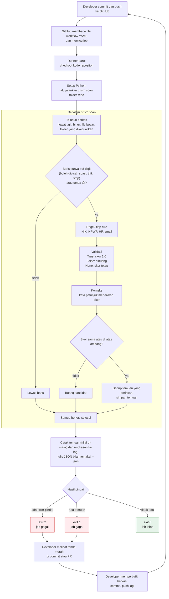
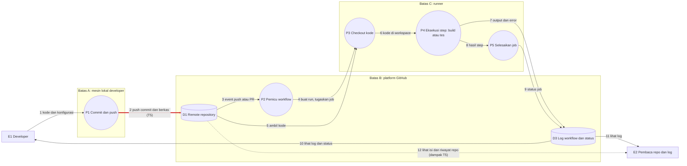
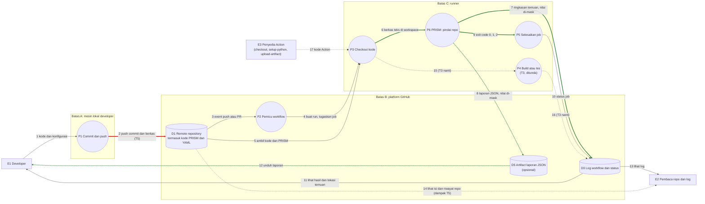

# Rencana Implementasi MVP T5: Pindai Repositori untuk PII

**Dasar:**
- Rancangan metode: [implementasi.md](implementasi.md) (tidak diubah oleh dokumen ini)
- DFD dan LINDDUN: [riset-privacy-scanner-cicd.md](../research/riset-privacy-scanner-cicd.md)
- Persiapan awal: [sebelum-implementasi.md](sebelum-implementasi.md)

**Catatan:**
- MVP hanya mengerjakan **T5** (PII di berkas repositori).
- T3 (PII di log keluaran tes) dikerjakan **setelah** MVP selesai.
- Data yang dicari: NIK, NPWP, nomor HP, email.
  - Keempatnya termasuk data pribadi umum butir f Pasal 4 ayat (3): "dikombinasikan untuk mengidentifikasi seseorang" ⚠️ (interpretasi, cocokkan dengan teks UU).
  - **Belum dicakup:** data umum butir a–e (nama lengkap, jenis kelamin, kewarganegaraan, agama, status perkawinan) dan data pribadi spesifik. Data umum a–e direncanakan sebagai tahap 2 setelah MVP.
- Secret dan token tidak dicakup.
- ⚠️ = belum diverifikasi atau belum diuji.

---

## 1. Tujuan dan batas MVP

**MVP selesai bila:**
1. Perintah `prism scan <folder>` mendeteksi NIK, NPWP, HP, dan email di berkas teks.
2. Nilai PII tidak pernah tampil utuh di laporan (4 karakter terakhir saja).
3. Exit code benar: 0 bersih, 1 ada temuan, 2 error pindai.
4. Workflow GitHub Actions jalan saat push dan pull request. Job merah bila ada temuan, hijau bila bersih. Ada tangkapan layar sebagai bukti.
5. Laporan JSON tersedia sebagai artifact.
6. Ada data uji sintetis dengan label. Precision, recall, FPR, dan waktu pindai sudah tercatat.
7. Tes otomatis lulus.

**Masuk MVP:**

| Bagian | Isi |
|---|---|
| Sumber | Berkas teks di working tree hasil checkout |
| Jenis data | NIK, NPWP, HP, email |
| Penilaian | Regex, validasi, kata konteks, skor, ambang |
| Keluaran | Teks di log job (dibaca manusia), JSON sebagai artifact terpisah (dibaca program), exit code. Contoh ada di bagian 6, setelah langkah 9 |
| CI | Satu workflow (push dan pull request) |
| Evaluasi | Precision, recall, FPR, waktu pada data sintetis |

**Di luar MVP:**

| Bagian | Dikerjakan kapan |
|---|---|
| Pindai log keluaran tes (T3) | Setelah MVP |
| Riwayat git dan metadata commit | Di luar cakupan |
| Secret, token, kredensial | Di luar cakupan |
| Severity | Batasan |
| Pengecualian per temuan (`prism:allow`, allow list) dan konfigurasi (FR-07, FR-08) | Setelah MVP |
| Nomor kartu kredit | Belum diputuskan |
| Data umum butir a–e (nama lengkap, jenis kelamin, kewarganegaraan, agama, status perkawinan) | Tahap 2, setelah MVP |
| NER, Presidio atau Betterleaks sebagai dependensi | Tidak dipakai. Keduanya hanya pembanding |
| Package atau GitHub Action yang bisa dipakai ulang | Setelah MVP |
| Mode `--mode log` pada CLI | Ditambah saat T3 |

---

## 2. Alur T5

Dari push sampai developer memperbaiki:



**Yang perlu diingat dari alur ini:**
- Log dan JSON ditulis pada **semua hasil** (0, 1, atau 2). JSON hanya ada bila `--json` dipakai.
- Push **tidak ditolak** oleh GitHub. Push sudah terjadi sebelum CI berjalan.
- CI hanya **mendeteksi**: job menjadi merah dan lokasi temuan ada di log.
- PII yang sudah ter-push tetap ada di riwayat git. Memperbaiki lewat commit baru tidak menghapusnya dari riwayat (di luar cakupan).
- Merge PR baru terblokir bila repo mengaktifkan *required status checks* ⚠️ (cek dokumentasi GitHub).
- Workflow perlu jalan juga saat push ke branch (`on: push`), bukan hanya saat PR dibuka. Dengan begitu developer tahu sebelum membuat PR.

---

## 3. DFD sebelum dan sesudah ada PRISM

DFD ini penyederhanaan dari DFD riset utama (bagian 5.2). Hanya elemen yang berkaitan dengan T5 yang digambar. Batas kepercayaan sama: **A** mesin lokal, **B** platform GitHub, **C** runner. Garis putus-putus berarti opsional atau kondisional.

### 3.1 Sebelum ada PRISM



| No | Alur | Data | Catatan untuk T5 |
|---|---|---|---|
| 1 | E1 ke P1 | Kode dan konfigurasi | Titik awal T5: PII masuk ke berkas |
| 2 | P1 ke D1 | Commit, isi berkas, metadata | **T5.** PII ter-push dan tersimpan di riwayat |
| 3 | D1 ke P2 | Event push atau PR | - |
| 4 | P2 ke P3 | Perintah membuat run | - |
| 5 | D1 ke P3 | Kode repositori | - |
| 6 | P3 ke P4 | Kode di workspace | - |
| 7 | P4 ke D3 | Output dan error step | Jalur T3 (di luar MVP) |
| 8 | P4 ke P5 | Hasil step | - |
| 9 | P5 ke D3 | Status job | Job hijau walau berkas berisi PII |
| 10 | D3 ke E1 | Log dan status | Developer tidak diberi tahu soal PII |
| 11 | D3 ke E2 | Log | - |
| 12 | D1 ke E2 | Isi dan riwayat repo | Dampak T5: pembaca repo melihat PII |

**Kondisi sebelum PRISM:** PII di berkas ter-push, job tetap hijau, dan tidak ada yang memberi tahu developer.

### 3.2 Sesudah ada PRISM

Elemen baru: **P6** (PRISM pindai repo) dan **D5** (artifact laporan JSON). Elemen sama dengan sebelumnya tidak diubah.



Garis merah tebal = alur T5. Garis hijau = alur baru karena PRISM.

| No | Alur | Data | Status |
|---|---|---|---|
| 1 sampai 4 | Sama seperti sebelumnya | - | Tidak berubah |
| 5 | D1 ke P3 | Kode repositori **dan kode PRISM** | Berubah: PRISM ikut diambil dari repo |
| 6 | P3 ke P6 | Berkas teks di workspace | **Baru** |
| 7 | P6 ke D3 | Ringkasan temuan: jenis, lokasi, nilai di-mask, skor | **Baru** |
| 8 | P6 ke D5 | Laporan JSON (di-mask) | **Baru**, opsional |
| 9 | P6 ke P5 | Exit code 0, 1, atau 2 | **Baru.** Menentukan status job |
| 10 | P5 ke D3 | Status job | Berubah: merah bila ada temuan atau error |
| 11 | D3 ke E1 | Hasil dan lokasi temuan | Berubah: developer diberi tahu |
| 12 | D5 ke E1 | Laporan JSON | **Baru**, opsional |
| 13, 14 | D3 dan D1 ke E2 | Log, isi repo | Tidak berubah |
| 15, 16 | P3 ke P4 ke D3 | Build/tes dan log | Ditunda untuk T3 |
| 17 | E3 ke P3 | Kode Action pihak ketiga | Sama dengan DFD riset utama (alur 5a). Menambah Action baru (`setup-python`, `upload-artifact`) |

### 3.3 Perubahan dan efeknya pada T5

| Hal | Sebelum | Sesudah |
|---|---|---|
| PII di berkas yang ter-push | Tidak diperiksa | Diperiksa di CI setiap push dan PR |
| Status job | Hijau | Merah bila ada temuan (exit 1) atau error pindai (exit 2) |
| Developer tahu ada PII | Tidak | Ya: lokasi (berkas, baris) ada di log job |
| Bukti terstruktur | Tidak ada | Laporan JSON sebagai artifact |
| Push | Berhasil | **Tetap berhasil** |
| PII di riwayat git | Ada | **Tetap ada** |
| Pembaca repo bisa melihat PII | Ya | **Ya, sampai diperbaiki** |
| Merge PR | Bebas | Terblokir hanya bila *required status checks* aktif ⚠️ |

**Risiko baru karena PRISM dan penanganannya:**

| Risiko | Penanganan |
|---|---|
| Laporan PRISM sendiri memuat PII utuh (di log atau artifact) | Nilai selalu di-mask 4 karakter terakhir. Tidak ada opsi menampilkan utuh |
| Pindai gagal terbaca sebagai bersih | Exit code 2 terpisah dari 0 |
| Action pihak ketiga (`setup-python`, `upload-artifact`) | Dicatat di DFD sebagai E3. Pin versi ⚠️ |
| Repo berisi data uji PII sintetis yang ikut terpindai | Folder uji dikecualikan di CI (langkah 12) |

---

## 4. Keputusan MVP

| Hal | Pilihan MVP | Alasan |
|---|---|---|
| Bahasa | Python, hanya library standar (`argparse`, `re`, `os`, `json`, `dataclasses`) | Ringan dan mudah dipasang di runner (K-09) |
| Cara menjalankan | `PYTHONPATH=src python -m prism scan <folder>` | Paling sederhana untuk pemula. `pyproject.toml` ditunda |
| Opsi CLI | `--min-score` (default 0,4 ⚠️), `--exclude <folder>` (boleh berulang), `--json`, `--output <berkas>` | Seperlunya |
| Skor validasi | `True` jadi 1,0. `False` dibuang. `None` skor tetap | Sama dengan Presidio. Alasan di bawah |
| Konteks | Kata petunjuk dicari di baris yang sama, ±40 karakter ⚠️. Skor baru = `max(skor + 0,35; 0,4)`, maksimal 1,0 | Sama dengan contoh dokumentasi Presidio (0,01 jadi 0,4) |
| Prefilter baris | Lanjut bila jumlah karakter digit di baris ≥ 8 (walau dipisah spasi, titik, atau strip) atau ada `@` | HP (`0812-3456-7890`) dan NPWP bertitik tidak punya 8 digit berurutan, jadi syarat "berurutan" akan melewatkannya |
| Dedup | Temuan beririsan: skor tertinggi, lalu terpanjang, lalu urutan rule (NIK sebelum NPWP) | Perlu untuk NPWP 16 digit yang sama dengan NIK |
| Laporan | 4 karakter terakhir, sisanya `*`. Selalu aktif | NFR-04 |
| Exit code | 2 jika ada error pindai (didahulukan). Jika tidak, 1 jika ada temuan. Jika tidak, 0 | Gagal pindai tidak boleh terlihat bersih. Keduanya tetap menggagalkan job |
| Berkas dilewati | `.git`, biner (ekstensi umum atau ada byte nol), file di atas 1 MB ⚠️, folder `--exclude` | Sederhana dan cukup untuk repo kecil |
| Python di CI | Samakan dengan lokal (3.13) | Hindari beda perilaku |

**Mengapa validasi lolos langsung 1,0:**
- Data di CSV biasanya punya kata `nik` di baris judul, bukan di baris nilai. Konteks per baris tidak menjangkaunya.
- Bila NIK valid hanya dilaporkan dengan kata konteks, NIK di CSV terlewat.
- Pilihan lain (valid tetap 0,3, naik hanya dengan konteks) diuji kemudian (uji U5 di implementasi.md bagian 8).

**Catatan ketidaksesuaian di implementasi.md (bagian 6):** satu paragraf menyebut NIK yang lolos validasi tapi tanpa kata konteks berskor 0,3 dan tidak dilaporkan, sedangkan tabel langkah 4 menyebut `True` jadi 1,0. MVP memakai versi kedua. Dokumen itu sebaiknya disesuaikan nanti.

---

## 5. Struktur file target

```
PRISM/
├── .github/workflows/privacy-scan.yml
├── src/prism/
│   ├── __init__.py
│   ├── __main__.py        # titik masuk: python -m prism
│   ├── cli.py             # argumen dan exit code
│   ├── scanner.py         # telusuri folder, prefilter, baca berkas
│   ├── rules.py           # Rule dan rule NIK, NPWP, HP, email
│   ├── engine.py          # regex, validasi, konteks, ambang, dedup
│   └── report.py          # mask, teks, JSON
├── tests/                 # test_rules.py, test_engine.py, test_report.py, test_cli.py
├── data/synthetic/        # data uji sintetis
├── data/labels/           # ground_truth.csv
├── evaluation/scripts/    # make_dataset.py, evaluate.py
├── evaluation/results/    # hasil evaluasi
└── docs/research/format-pii-indonesia.md
```

---

## 6. Langkah implementasi

Kerjakan **berurutan**. Tiap langkah punya hasil yang harus ada sebelum lanjut. Jangan menambah fitur di luar daftar.

### Fase A. Persiapan

**Langkah 1. Verifikasi format PII dari sumber resmi** (±75 menit)
- Kerjakan:
  - Cari format NIK: struktur 16 digit, kode wilayah, tanggal lahir (+40 untuk perempuan), daftar kode provinsi.
  - Cari format NPWP: 15 digit lama dan 16 digit baru.
  - Cari format nomor HP Indonesia: awalan `+62` dan `08`, panjang total.
  - Format email: pola umum.
  - Pakai sumber resmi (Dukcapil, Dirjen Pajak; untuk HP cari sumber regulator telekomunikasi ⚠️), bukan blog.
- Hasil: `docs/research/format-pii-indonesia.md` berisi tabel jenis, format, aturan validasi, contoh sintetis valid dan tidak valid, dan daftar kode provinsi lengkap dengan sumbernya.
- Cek berhasil: setiap angka dan aturan punya sumber.

**Langkah 2. Pahami pipeline: workflow merah dan hijau** (±45 menit)
- Kerjakan:
  1. Buat `.github/workflows/privacy-scan.yml` dengan `on: [push, pull_request]`, step `actions/checkout`, dan satu step `run: exit 1`.
  2. Push. Lihat job merah.
  3. Ganti menjadi `exit 0`. Push. Lihat job hijau.
  4. Amati bahwa commit tetap masuk walau job merah.
- Hasil: tangkapan layar job merah dan hijau.
- Cek berhasil: kamu bisa menjawab "apa yang membuat job merah?" (exit code selain 0).
- Catatan: bila branch punya PR terbuka, tiap push memicu dua job (satu dari `push`, satu dari `pull_request`). Itu normal ⚠️.

### Fase B. CLI inti

**Langkah 3. Kerangka CLI** (±60 menit)
- Kerjakan:
  - Buat `src/prism/__main__.py` dan `cli.py` dengan `argparse`: `prism scan <path>`.
  - Jika path tidak ada, cetak pesan ke stderr dan keluar dengan kode 2.
  - Jika path ada, baca satu berkas dan cetak jumlah barisnya. Keluar dengan kode 0.
- Cek berhasil:
  - `PYTHONPATH=src python -m prism scan sample.txt; echo $?` menampilkan 0.
  - Path salah menampilkan 2.

**Langkah 4. Telusuri folder dan prefilter** (±75 menit)
- Kerjakan di `scanner.py`:
  - Telusuri folder dengan `os.walk`.
  - Lewati `.git`, folder `--exclude`, berkas biner (ekstensi umum atau ada byte nol di 1 KB pertama), dan berkas di atas 1 MB.
  - Baca teks UTF-8 dengan `errors="replace"`.
  - Per baris: lanjut hanya bila jumlah karakter digit ≥ 8 (walau dipisah spasi, titik, atau strip, seperti `0812-3456-7890`) atau ada tanda `@`.
  - Berkas yang gagal dibaca dihitung sebagai error.
  - Cetak ringkasan: jumlah berkas diperiksa, dilewati, error, dan baris diperiksa.
- Cek berhasil:
  - pada folder uji kecil, angka ringkasan sesuai hitungan manual
  - tes: baris `0812-3456-7890`, `+62 812 3456 7890`, dan `01.234.567.8-901.000` lolos prefilter

**Langkah 5. Rule pertama: NIK dengan regex saja** (±45 menit)
- Kerjakan di `rules.py` dan `engine.py`:
  - Buat dataclass `Rule(id, regex, base_score, context, validate)`.
  - Buat rule NIK: `(?<!\d)\d{16}(?!\d)`, skor awal 0,3.
  - Mesin mencari kandidat: (rule, nilai, baris, kolom, skor).
  - CLI mencetak lokasi (`berkas:baris:kolom`) dan keluar dengan kode 1 bila ada kandidat.
- Cek berhasil: berkas berisi satu angka 16 digit menghasilkan exit 1. Berkas bersih menghasilkan exit 0.
- Cetak nilai lewat fungsi `mask()` sederhana sejak langkah ini (4 karakter terakhir, sisanya `*`). Nilai utuh tidak pernah dicetak, termasuk saat belajar. Gunakan **data sintetis saja**.
- Skor awal 0,3 belum berpengaruh di langkah ini karena ambang baru ada di langkah 8. Setelah langkah 6, NIK selalu berskor 1,0 atau dibuang.

**Langkah 6. Validasi NIK** (±60 menit)
- Kerjakan:
  - Buat `validate_nik(nilai) -> True/False`:
    - digit 7–8 bernilai 1–31 (laki-laki) atau 41–71 (perempuan)
    - digit 9–10 bernilai bulan 01–12
    - 2 digit pertama ada di daftar provinsi (dari langkah 1)
    - 4 digit terakhir bukan `0000`
  - Di mesin: `True` jadi skor 1,0, `False` kandidat dibuang.
  - Tulis tes: NIK valid laki-laki, valid perempuan, tanggal salah, bulan salah, provinsi salah, urut `0000`.
- Cek berhasil: `pytest` untuk tes ini lulus.

**Langkah 7. Tambah rule NPWP, HP, email** (±90 menit)
- Kerjakan:
  - **NPWP:** pola 15 digit bertitik. Skor awal 0,5. NPWP 16 digit ikut rule NIK.
  - **HP:** `(?:\+62|62|0)8\d{8,11}` dengan pemisah opsional (spasi atau `-`) dan batas bukan-digit di kiri dan kanan (`(?<!\d)` dan `(?!\d)`). Skor awal 0,4. Validasi panjang total. Kata konteks: `hp`, `telp`, `telepon`, `wa`, `whatsapp`, `kontak`.
  - **Email:** pola email umum. Skor awal 0,5. Tanpa validasi (`None`). Kata konteks: `email`, `surel`, `mail`.
  - Sesuaikan semua regex dan validasi dengan hasil langkah 1.
- Cek berhasil: satu berkas uji berisi tiap jenis terdeteksi dengan jenis yang benar.

**Langkah 8. Konteks, ambang, dan dedup** (±75 menit)
- Kerjakan di `engine.py`:
  - **Konteks:** cari kata petunjuk (huruf kecil) di baris yang sama, ±40 karakter dari kandidat. Bila ada, skor baru = `max(skor + 0,35; 0,4)`, maksimal 1,0.
  - **Ambang:** buang skor di bawah `--min-score` (default 0,4).
  - **Dedup:** bila dua temuan beririsan, pilih skor tertinggi, lalu yang terpanjang, lalu urutan rule.
- Tulis tes: HP dengan dan tanpa kata `telp`, email dengan dan tanpa `email`, dan satu kasus irisan NIK vs NPWP 16 digit.
- Cek berhasil: tes lulus.

**Langkah 9. Laporan dan exit code final** (±75 menit)
- Kerjakan di `report.py` dan `cli.py`:
  - **Mask:** rapikan `mask()` dari langkah 5 (4 karakter terakhir, sisanya `*`), lalu pakai di teks dan JSON.
  - **Teks:** `berkas:baris:kolom  rule  skor=…  nilai-mask`, lalu satu baris ringkasan.
  - **JSON** (`--json`, `--output`): `{schema_version, findings[], scan{}}` sesuai contoh di implementasi.md bagian 7.
  - **Exit code:** 2 bila ada error pindai, jika tidak 1 bila ada temuan, jika tidak 0.
  - Pastikan nilai utuh **tidak** muncul di laporan, pesan error, maupun log.
- Cek berhasil:
  - tes mask dan JSON lulus
  - tes "nilai utuh tidak muncul di keluaran" lulus
  - tiga exit code terbukti lewat tes CLI

**Contoh keluaran** (rancangan, bukan keluaran nyata, semua nilai sintetis).

Log job saat ada temuan (exit 1):

```
Run PYTHONPATH=src python -m prism scan . --exclude data/synthetic --exclude tests --json --output prism-report.json
Memindai: .
Berkas: 41 diperiksa, 7 dilewati, 0 error

app/seed_users.csv:12:34   nik    skor=1.00  ************0001
docs/kontak.md:5:20        hp     skor=0.75  ********7890
config/app.yaml:8:14       email  skor=0.50  ******************test

3 temuan (nik 1, hp 1, email 1). Laporan JSON: prism-report.json
Error: Process completed with exit code 1.
```

Baris terakhir adalah pesan bawaan GitHub saat step keluar dengan kode bukan 0 ⚠️.

Log job saat bersih (exit 0):

```
Memindai: .
Berkas: 41 diperiksa, 7 dilewati, 0 error
0 temuan.
```

Log job saat error pindai (exit 2):

```
Memindai: .
Berkas: 40 diperiksa, 7 dilewati, 1 error
ERROR config/legacy.dat: tidak bisa dibaca (Permission denied)
0 temuan. Pindai tidak lengkap.
Error: Process completed with exit code 2.
```

`prism-report.json` untuk run pertama:

```json
{
  "schema_version": 1,
  "findings": [
    {"rule_id": "nik", "score": 1.0,
     "location": {"file": "app/seed_users.csv", "line": 12, "column": 34},
     "match": {"value": "************0001"}},
    {"rule_id": "hp", "score": 0.75,
     "location": {"file": "docs/kontak.md", "line": 5, "column": 20},
     "match": {"value": "********7890"}},
    {"rule_id": "email", "score": 0.5,
     "location": {"file": "config/app.yaml", "line": 8, "column": 14},
     "match": {"value": "******************test"}}
  ],
  "scan": {"mode": "repo", "files": 41, "skipped": 7, "lines": 1284,
           "findings": 3, "errors": 0, "min_score": 0.4}
}
```

Perbedaan log job dan JSON:

| Aspek | Log job | `prism-report.json` |
|---|---|---|
| Dibaca oleh | Manusia, di halaman Actions | Program atau skrip (misalnya `evaluate.py`) |
| Dibuat oleh | Dicetak PRISM. GitHub menyimpannya otomatis | Ditulis PRISM bila ada `--json --output`. Tersimpan di GitHub hanya bila diunggah sebagai artifact |
| Cara membuka | Klik run, lalu step | Klik run, bagian *Artifacts*, unduh |
| Nilai PII utuh | Tidak (di-mask) | Tidak (di-mask) |

### Fase C. Data uji dan tes

**Langkah 10. Data uji sintetis dan label** (±105 menit)
- Kerjakan:
  - Buat `evaluation/scripts/make_dataset.py` (Faker `id_ID` sebagai bahan nama dan email).
  - Hasilkan berkas di `data/synthetic/`: CSV, YAML, Markdown, dan kode dengan komentar.
  - Isi **positif**: NIK, NPWP, HP, dan email palsu.
  - Isi **negatif / pengecoh**: angka 16 digit yang tidak valid, nomor rekening, ID transaksi, timestamp, UUID.
  - NIK positif dibuat dengan generator sendiri yang mengikuti aturan langkah 6, bukan langsung dari Faker ⚠️ (Faker `id_ID` mungkin menghasilkan NIK yang tidak lolos validasi).
  - Tulis label di `data/labels/ground_truth.csv`: `berkas, baris, jenis, positif atau negatif`.
- Cek berhasil:
  - semua NIK positif lolos `validate_nik`
  - jumlah positif dan negatif tercatat
  - tidak ada data asli orang

**Langkah 11. Tes otomatis** (±60 menit)
- Kerjakan:
  - Lengkapi `tests/` dengan pytest: validasi NIK, mask, prefilter, dedup, struktur JSON, exit code.
  - Folder `tests/` dikecualikan di CI (langkah 12), jadi nilai uji sintetis boleh ditulis langsung di berkas tes.
  - Tes dijalankan lokal. Menjalankannya juga di CI itu opsional dan bukan syarat MVP.
- Cek berhasil: `PYTHONPATH=src pytest` hijau.

### Fase D. CI

**Langkah 12. Workflow nyata** (±50 menit)
- Kerjakan: ganti isi `privacy-scan.yml` dengan:
  1. `on: [push, pull_request]`
  2. `actions/checkout`
  3. `actions/setup-python` (versi sama dengan lokal)
  4. Pindai: `PYTHONPATH=src python -m prism scan . --exclude data/synthetic --exclude tests --exclude evaluation/results --json --output prism-report.json`
  5. `actions/upload-artifact` untuk `prism-report.json` dengan `if: always()`
- Pin versi ketiga Action ⚠️ (cek versi terbaru di dokumentasi sebelum dipakai).
- Sebelum push pertama, jalankan pindai yang sama secara lokal dan lihat apakah dokumen di `docs/` memicu temuan. Contoh: `docs/planning/implementasi.md` memuat angka 16 digit contoh kartu kredit. Angka itu kemungkinan dibuang validasi provinsi (kode 41 tampaknya bukan provinsi ⚠️), tetapi pastikan lewat pindai lokal. Tambahkan `--exclude docs` bila perlu.
- `if: always()` pada upload membuat artifact JSON ada di setiap run, termasuk yang hijau. Bila ingin lebih hemat, ganti ke `if: failure()`.
- Cek berhasil:
  1. Push berkas bersih: job hijau.
  2. Buat branch percobaan, tambahkan satu berkas berisi NIK sintetis: job merah, lokasi tampil di log, nilai di-mask, JSON ada di artifact.
  3. Hapus berkas percobaan: job hijau lagi.
  4. Simpan tangkapan layar.

### Fase E. Evaluasi dan dokumentasi

**Langkah 13. Evaluasi** (±90 menit)
- Kerjakan di `evaluation/scripts/evaluate.py`:
  - Jalankan PRISM pada `data/synthetic/` (tanpa `--exclude`) dan ambil JSON.
  - Cocokkan dengan `ground_truth.csv` per (berkas, baris, jenis): hitung TP, FP, FN.
  - Hitung precision, recall, dan FPR (pengecoh yang salah terdeteksi dibagi jumlah pengecoh).
  - Ukur waktu pindai.
  - Tulis ke `evaluation/results/`, lengkap dengan `--min-score` dan tanggal.
- Cek berhasil: angka keluar dan bisa diulang dengan hasil yang sama (NFR-07).

**Langkah 14. Dokumentasi dan demo** (±45 menit)
- Kerjakan:
  - Tulis di `README.md`: cara menjalankan lokal, cara kerja CI, contoh keluaran, dan batasan.
  - Lengkapi tangkapan layar merah dan hijau.
- Cek berhasil: orang lain bisa menjalankan `prism scan` dari README tanpa bertanya.

---

## 7. Ringkasan urutan dan waktu

| Fase | Langkah | Hasil utama | Waktu |
|---|---|---|---|
| A | 1. Format PII resmi | `format-pii-indonesia.md` | 75 mnt |
| A | 2. Workflow merah dan hijau | Tangkapan layar | 45 mnt |
| B | 3. Kerangka CLI | `prism scan` dan exit code | 60 mnt |
| B | 4. Telusuri dan prefilter | Ringkasan berkas dan baris | 75 mnt |
| B | 5. Rule NIK (regex) | Deteksi pertama | 45 mnt |
| B | 6. Validasi NIK | Tes lulus | 60 mnt |
| B | 7. NPWP, HP, email | Empat rule | 90 mnt |
| B | 8. Konteks, ambang, dedup | Skor dan penyaringan | 75 mnt |
| B | 9. Laporan dan exit code | Teks, JSON, mask | 75 mnt |
| C | 10. Data sintetis dan label | `data/` terisi | 105 mnt |
| C | 11. Tes otomatis | `pytest` hijau | 60 mnt |
| D | 12. Workflow nyata | Merah dan hijau di CI | 50 mnt |
| E | 13. Evaluasi | Precision, recall, FPR, waktu | 90 mnt |
| E | 14. Dokumentasi | README, bukti | 45 mnt |
| | **Total** | | **±16 jam** |

- Langkah 1 harus selesai sebelum langkah 6 dan 7 (aturan validasi butuh sumber resmi).
- Langkah 10 boleh dikerjakan paralel dengan langkah 7 sampai 9.
- Bila waktu mepet, urutan prioritas: langkah 1 sampai 6, 9, 12, lalu sisanya.

---

## 8. Risiko dan hal yang perlu diputuskan

- **Format PII belum diverifikasi sumber resmi.** Langkah 6 dan 7 bergantung pada langkah 1.
- **Konteks per baris tidak menjangkau judul kolom CSV.** Itu sebabnya validasi lolos langsung 1,0 (bagian 4). Perlu diuji.
- **NIK dan NPWP 16 digit sama.** Dedup memilih NIK. Jenis temuan NPWP 16 digit tidak akan muncul. Ini diterima untuk MVP.
- **Repo berisi data uji PII sintetis.** Folder `data/synthetic`, `tests`, dan `evaluation/results` dikecualikan di CI lewat `--exclude`. Ini bukan fitur pengecualian per temuan (FR-08), jadi FR-08 tetap ditunda.
- **Email contoh (`example.com`) ikut dilaporkan.** Tanpa daftar pengecualian domain di MVP. Data uji sebaiknya memakai domain lain agar label konsisten.
- **Berkas non-UTF-8 atau sangat besar** bisa membuat temuan terlewat. Dihitung sebagai dilewati dan dilaporkan dalam ringkasan.
- **Versi GitHub Actions** perlu dicek ke dokumentasi resmi sebelum dipin.
- **CI hanya mendeteksi.** PII sudah ter-push saat job berjalan (bagian 2).
- **Setelah MVP:**
  - T3: pindai berkas log keluaran tes (`--mode log`)
  - tahap 2: data umum butir a–e (nama lengkap, jenis kelamin, kewarganegaraan, agama, status perkawinan) lewat kunci-nilai, kamus nilai, dan pembaca CSV. Hati-hati dengan kunci umum seperti `name`, yang muncul di banyak konfigurasi dan bukan nama orang
  - uji kesesuaian U1–U6 dengan Presidio dan Betterleaks
  - sinkronisasi dokumen lain dengan cakupan PII saja
