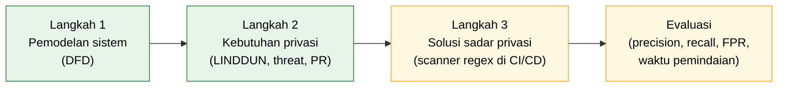
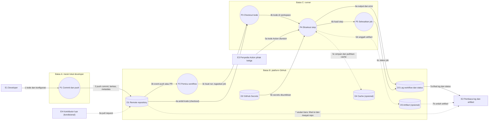
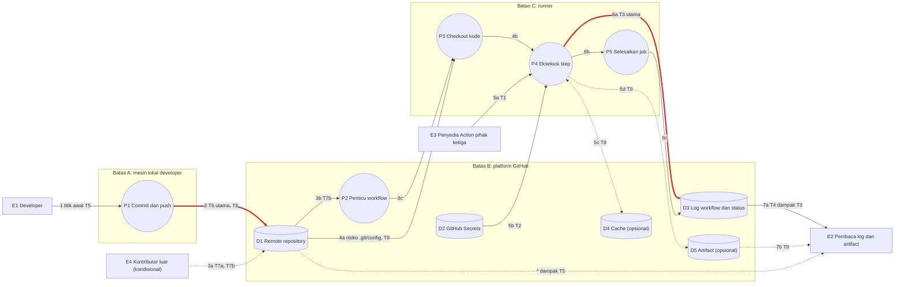
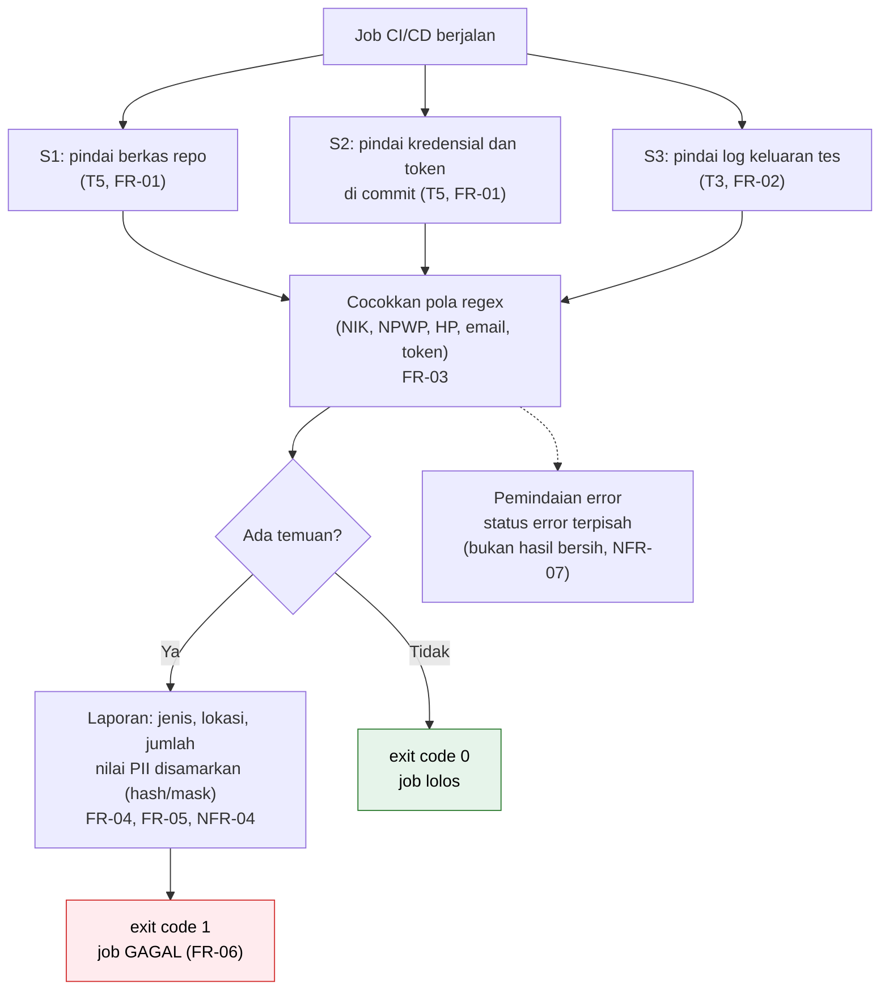
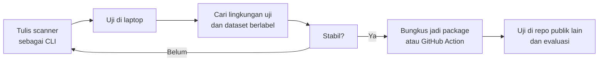

# Ringkasan Riset: Automated Privacy Check di Pipeline CI/CD

> Dokumen ini merangkum seluruh riset, analisis, keputusan, dan sumber untuk proyek skripsi.
> Diagram ditulis dalam format **Mermaid**. File ini bisa dirender langsung di GitHub, VS Code (ekstensi Markdown Preview Mermaid Support), Obsidian, atau di https://mermaid.live.
> Terakhir disusun: 2 November 2026.

## Daftar Isi

1. [Informasi Proyek](#1-informasi-proyek)
2. [Status dan Progres](#2-status-dan-progres)
3. [Proses Bimbingan](#3-proses-bimbingan)
4. [Kerangka Privacy by Design](#4-kerangka-privacy-by-design)
5. [Langkah 1: Pemodelan Sistem (DFD)](#5-langkah-1-pemodelan-sistem-dfd)
6. [Data yang Dilindungi](#6-data-yang-dilindungi)
7. [Langkah 2: Analisis Ancaman LINDDUN](#7-langkah-2-analisis-ancaman-linddun)
8. [Privacy, Functional, dan Non-functional Requirements](#8-privacy-functional-dan-non-functional-requirements)
9. [Langkah 3: Pemilihan Metode dan Tool](#9-langkah-3-pemilihan-metode-dan-tool)
10. [Keputusan Desain Scanner](#10-keputusan-desain-scanner)
11. [Rencana Evaluasi](#11-rencana-evaluasi)
12. [Pertanyaan Terbuka dan Langkah Berikutnya](#12-pertanyaan-terbuka-dan-langkah-berikutnya)
13. [Sumber Riset](#13-sumber-riset)
14. [Catatan Penyusunan](#14-catatan-penyusunan)

---

## 1. Informasi Proyek

**Judul:** Pengembangan Tool Automated Privacy Check dalam Pipeline CI/CD untuk Deteksi Dini Kebocoran Data Pribadi (PII)

**Dosen pembimbing:** Warsun Najib, Dr., S.T., M.Sc.

**Bentuk luaran:** prototipe

**Deskripsi proyek:**
Membuat atau mengintegrasikan tool pemindai otomatis (scanner) ke dalam pipeline CI/CD (GitHub Actions atau Jenkins). Tool ini mendeteksi secara dini apakah kode yang ditulis developer berpotensi membocorkan data pribadi, misalnya:

- menulis log data sensitif secara polos,
- tidak mengenkripsi kolom tertentu,
- menyimpan token di repositori.

Jika ditemukan pelanggaran Privacy by Design (PbD), pipeline otomatis gagal (fail).

**Target luaran (versi laporan):**

1. Merancang dan mengimplementasikan prototipe PII berformat Indonesia serta kredensial berpola terbatas pada repositori.
2. Prototipe berjalan pada step GitHub Action dan menandai job gagal (fail) saat ditemukan indikasi kebocoran, dengan laporan tanpa PII utuh.
3. Menyusun draf artikel ilmiah sebagai dokumentasi hasil perancangan, implementasi, dan evaluasi sistem.

**Format artikel:** IMRaD (Introduction, Methodology, Results and Discussion, Conclusion). Template kampus membebaskan struktur cerita.

---

## 2. Status dan Progres

### Ringkasan progres

Sampai saat ini, progres berfokus pada riset dan analisis:

- Menentukan pasal UU PDP yang relevan: Pasal 1 ayat 1, 4, dan 16 (catatan riset juga mencakup Pasal 16 ayat 2, 35-39, dan 46-47).
- Menentukan ruang lingkup: pendekatan berbasis regex, GitHub Actions sebagai platform CI/CD, serta jenis PII yang mudah dikenali regex (NIK, NPWP, nomor telepon, email, secret/token).
- Atas arahan dosen, dilakukan analisis awal dengan konsep Privacy by Design: pemodelan sistem (DFD) dan analisis ancaman privasi (LINDDUN).
- Implementasi scanner dan integrasi ke pipeline CI/CD **belum dimulai**.

### Tahapan pekerjaan

| No | Tahapan | Target / output | Status | Keterangan |
|----|---------|-----------------|--------|------------|
| 1 | Studi literatur dan analisis ancaman privasi | Kebutuhan privasi dan daftar PII yang rentan | Sudah | DFD, analisis LINDDUN, dan prioritas ancaman sudah disusun. Draf privacy requirements, FR, dan NFR selesai. |
| 2 | Pemilihan metode/tool | Perbandingan 3 tool dan keputusan metode | Sedang | Gitleaks, Presidio, dan GitHub secret scanning sudah dibandingkan. Tersisa menentukan metode yang sesuai dan format PII Indonesia. |
| 3 | Implementasi scanner dan integrasi GitHub Action | Scanner mendeteksi 3 skenario dan menggagalkan pipeline | Belum | Belum dimulai. |
| 4 | Evaluasi dan draf jurnal | Hasil evaluasi dan draf jurnal | Sedang | Draf yang sudah dikerjakan: bab pendahuluan dan analisis sistem menurut PbD. |

### Capaian proyek

**Estimasi capaian: 25%** dari target akhir (scanner berjalan di CI/CD dan draf artikel ilmiah).

- Capaian saat ini berupa riset, penentuan ruang lingkup, dan analisis awal, belum berupa produk.
- Target luaran 1 (deteksi tiga bentuk pelanggaran) dan 2 (pipeline gagal otomatis) belum diimplementasikan.
- Target luaran 3 (draf artikel dan pemetaan ke UU PDP) baru tahap awal: draf pendahuluan, analisis sistem berdasarkan PbD, dan metodologi.

---

## 3. Proses Bimbingan

| No | Arahan dosen pembimbing | Tindak lanjut mahasiswa |
|----|--------------------------|--------------------------|
| 1 | Riset melompat: langkah 1 (pemodelan sistem) dan langkah 2 (kebutuhan privasi, terutama LINDDUN) dari siklus PbD/DFD terlewat, sedangkan riset sebagian besar ada di langkah 3 (solusi). | Mempelajari paper LINDDUN (Liao et al., 2026) dan berencana memasukkan DFD + analisis LINDDUN ke bab Introduction sebelum memperkenalkan scanner. |
| 2 | Pilih metode dengan mengidentifikasi 3-5 tool yang sudah ada, buat tabel perbandingan, lalu pilih yang terbaik. | Sudah mencoba Gitleaks dan mempelajari mesin regex-nya. |
| 3 | Gambar arsitektur dari mesin lokal sampai git server sebagai DFD, lalu analisis ancamannya. | Dikerjakan sebagai fokus perencanaan sistem (hasilnya ada di bagian 5 dan 7). |

**Arahan putaran kedua:**

- Buat diagram setelah tool ada.
- Buat skenario ancaman yang memang bisa terjadi.
- Identifikasi fokus dan data prioritas tinggi.
- Fokus pada proses CI/CD sebagai pembanding.
- Struktur artikel yang direncanakan: Introduction, bab baru (LINDDUN + analisis data flow), Methodology, Results, Conclusion.

---

## 4. Kerangka Privacy by Design

Dosen menekankan bahwa riset harus mengikuti siklus lengkap, tidak langsung loncat ke solusi.

Hijau = sudah dikerjakan (analisis). Kuning = sedang/belum (solusi dan evaluasi).

---

## 5. Langkah 1: Pemodelan Sistem (DFD)

### 5.1 Deskripsi sistem

Sistem yang dimodelkan adalah alur pengembangan perangkat lunak dari mesin developer sampai pipeline CI/CD di GitHub Actions.

- Developer menulis kode dan konfigurasi di mesin lokal, lalu commit dan push ke remote repository di GitHub.
- Push (atau pull request) memicu GitHub memeriksa event dan filter workflow, membuat workflow run, dan menugaskan job ke runner.
- Di runner, kode di-checkout lalu step dijalankan berurutan: build atau tes, Action (termasuk Action pihak ketiga), dan perintah `run`.
- Step dapat memakai secrets, menyimpan atau memakai cache, dan menghasilkan artifact.
- Output step dan pesan kesalahan tercatat di log workflow. Job selesai dengan status berhasil, gagal, atau dibatalkan.
- Log dan artifact dapat dibaca pihak yang punya akses, bergantung pada repositori publik atau privat.

### 5.2 Diagram DFD

Legenda: garis tebal = alur selalu ada. Garis putus-putus = opsional atau kondisional. Persegi = entitas luar. Lingkaran = proses. Silinder = data store. Nomor pada garis merujuk ke tabel aliran (5.4).

### 5.3 Tabel elemen DFD

| Kode | Jenis | Nama | Keterangan | Batas |
|------|-------|------|------------|-------|
| E1 | Entitas luar | Developer | Menulis kode dan konfigurasi, melakukan push | Luar |
| E2 | Entitas luar | Pembaca log dan artifact | Pihak yang bisa membaca log dan mengunduh artifact. Siapa saja, tergantung repositori publik atau privat | Luar |
| E3 | Entitas luar | Penyedia Action pihak ketiga | Pembuat Action yang dirujuk workflow | Luar |
| E4 | Entitas luar (kondisional) | Kontributor luar | Pengaju pull request. Relevan jika repositori open source atau menerima kontribusi dari luar | Luar |
| P1 | Proses | Commit dan push (diringkas) | Gabungan add, commit, push di mesin lokal | A |
| P2 | Proses | Pemicu workflow | GitHub memeriksa event dan filter, membuat workflow run, menugaskan job ke runner | B |
| P3 | Proses | Checkout kode | Mengambil kode dari repository ke runner | C |
| P4 | Proses | Eksekusi step | Menjalankan build atau tes, Action, dan perintah `run` secara berurutan | C |
| P5 | Proses | Selesaikan job | Menetapkan status berhasil, gagal, atau dibatalkan | C |
| D1 | Data store | Remote repository | Kode, konfigurasi, riwayat commit, dan metadata commit | B |
| D2 | Data store | GitHub Secrets | Kunci rahasia yang dirujuk workflow | B |
| D3 | Data store | Log workflow dan status | Output step, pesan kesalahan, status job | B |
| D4 | Data store (opsional) | Cache | Berkas yang dipakai ulang, misalnya unduhan dependensi. Ada jika workflow memakainya | B |
| D5 | Data store (opsional) | Artifact | Keluaran run, misalnya laporan tes atau berkas diagnostik. Ada jika workflow memakainya | B |

**Batas kepercayaan:** A = mesin lokal developer. B = platform GitHub. C = runner.

### 5.4 Tabel aliran data dan threat-nya

| No | Aliran | Deskripsi | Threat dan kejadiannya |
|----|--------|-----------|-------------------------|
| 1 | E1 ke P1 (dan konfigurasi git lokal ke P1) | Developer menulis kode dan konfigurasi lalu add dan commit. Nama dan email commit diambil dari konfigurasi git lokal. | Belum ada threat tersendiri. Ini titik awal T5, yaitu saat developer memasukkan PII atau token ke berkas yang di-commit. |
| 2 | P1 ke D1 | Push mengirim commit, isi berkas, dan metadata ke remote repository. | **T5 (utama):** PII atau token ter-push karena disimpan di berkas, dan riwayat git menyimpannya walau berkas dihapus kemudian. **T6 (sekunder):** akun developer diambil alih sehingga commit atau workflow berbahaya masuk ke repositori. |
| 3a | E4 ke D1 | Kontributor luar mengajukan pull request berisi perubahan kode. | **T7a (utama, kondisional):** PR memuat PII karena repositori menerima kontribusi luar. **T7b (sekunder):** nama branch atau judul PR disisipkan ke perintah workflow tanpa sanitasi sehingga kode penyerang dijalankan. |
| 3b | D1 ke P2 | Event push atau PR dikirim ke pemicu yang mencocokkannya dengan filter workflow. | Tidak ada threat khusus. Relevan hanya pada T7b bila nilai event dipakai langsung di perintah. |
| 3c | P2 ke P3 | GitHub membuat run dan menugaskan job ke runner. | Tidak ada threat khusus. |
| 4a | D1 ke P3 | Runner mengambil kode dari repositori ke workspace (checkout). | Tidak ada threat sendiri. Secara default checkout menyimpan token di `.git/config`, yang dapat bocor bila folder itu ikut diunggah sebagai artifact (T9). |
| 4b | P3 ke P4 | Kode di workspace tersedia untuk dijalankan oleh step. | Tidak ada threat khusus. |
| 5a | E3 ke P4 | Kode Action pihak ketiga diunduh dan dijalankan saat step berjalan. | **T1 (sekunder):** Action disusupi karena dirujuk lewat tag yang dapat dipindahkan. Kodenya lalu membaca secrets, workspace, dan log di runner. |
| 5b | D2 ke P4 | Secrets disuntikkan ke step yang merujuknya. | **T2 (sekunder):** secrets dicuri oleh kode yang berjalan di runner (Action disusupi atau workflow berbahaya) lewat pembacaan variabel lingkungan atau memori proses. |
| 5c | P4 dan D4 | Step menyimpan dan memulihkan cache dependensi (hanya bila dipakai). | **T8 (sekunder):** berkas berisi PII atau token ikut tersimpan di cache, dan pihak berakses baca dapat memulihkan isinya. |
| 5d | P4 ke D5 | Step mengunggah artifact seperti laporan tes (hanya bila dipakai). | **T9 (sekunder):** berkas yang diunggah memuat PII atau token, termasuk laporan scanner sendiri bila berisi nilai PII. |
| 6a | P4 ke D3 | Output step dan pesan kesalahan ditulis ke log workflow. | **T3 (utama):** PII tercetak ke log karena aplikasi atau tes mencetak data nyata, sedangkan GitHub hanya menyamarkan nilai yang terdaftar sebagai secret. |
| 6b | P4 ke P5 | Hasil step diteruskan untuk menentukan status job. | Tidak ada threat khusus. |
| 6c | P5 ke D3 | Status job disimpan bersama log. | Tidak ada threat khusus. |
| 7a | D3 ke E2 | Pembaca melihat atau mengunduh log dan status. | **T4 (sekunder, dampak T3):** pihak dengan akses baca, termasuk pengguna yang login pada repositori publik, membaca PII atau secrets yang sudah ada di log. |
| 7b | D5 ke E2 | Pembaca mengunduh artifact. | **T9 (sekunder):** isi artifact yang memuat PII atau token terbaca pihak berakses baca sampai artifact kedaluwarsa. |
| * | D1 ke E2 (usulan baru) | Pembaca dengan akses baca melihat isi dan riwayat repositori. | Jalur dampak T5 (sekunder): PII atau token di repositori terbaca pihak yang tidak berhak, terutama pada repositori publik. |

---

## 6. Data yang Dilindungi

Berdasarkan UU PDP Pasal 4, plus satu kategori di luar UU PDP.

### 6.1 Data pribadi umum

| Jenis (Pasal 4) | Contoh bentuk di pipeline | Bisa muncul di |
|-----------------|---------------------------|----------------|
| Nama lengkap | Nama di data uji, di log, di nama atau metadata commit | D1, D3, D4, D5 |
| Jenis kelamin | Kolom atau field di skema atau data uji | D1, D3, D5 |
| Kewarganegaraan | Field di data uji atau konfigurasi | D1, D3 |
| Agama | Field di data uji | D1, D3 |
| Status perkawinan | Field di data uji | D1, D3 |
| Data pribadi yang dikombinasikan untuk mengidentifikasi seseorang | NIK, NPWP, nomor telepon, email, atau gabungan beberapa atribut | D1, D3, D4, D5, input pull request |

### 6.2 Data pribadi spesifik

| Jenis (Pasal 4) | Contoh bentuk di pipeline | Bisa muncul di |
|-----------------|---------------------------|----------------|
| Data dan informasi kesehatan | Field diagnosis, riwayat penyakit, nomor rekam medis | D1, D3, D5 |
| Data biometrik | Data atau templat sidik jari dan wajah | D1, D4, D5 |
| Data genetika | Hasil tes genetika | D1, D5 |
| Catatan kejahatan | Riwayat pidana seseorang | D1, D3 |
| Data anak | Data pribadi anak di aplikasi | D1, D3, D5 |
| Data keuangan pribadi | Nomor rekening, nomor kartu, saldo, riwayat transaksi | D1, D3, D5 |
| Data lainnya sesuai peraturan UU | Ditentukan kemudian | - |

### 6.3 Di luar UU PDP

| Jenis | Contoh bentuk di pipeline | Bisa muncul di |
|-------|---------------------------|----------------|
| Token dan secrets | Token API, kunci akses | D1, D3, D4, D5 |

### 6.4 Pasal UU PDP yang dipelajari

Dari catatan riset, pasal yang sudah dibaca dan diringkas: **Pasal 1 ayat 1, Pasal 4, Pasal 16 ayat 2, Pasal 35-39, dan Pasal 46-47**. Laporan progres menyebut Pasal 1 ayat 1, 4, dan 16 sebagai pasal utama.

> Isi ringkasan per pasal tidak tersimpan di project ini. Silakan tempel ringkasanmu sendiri di sini agar dokumen lengkap.

**Jenis PII yang dipilih untuk scanner** (karena punya format yang bisa dikenali regex): NIK, NPWP, nomor telepon Indonesia, email, dan secret/token.

---

## 7. Langkah 2: Analisis Ancaman LINDDUN

### 7.1 Tujuh kategori LINDDUN

| Kode | Kategori | Artinya |
|------|----------|---------|
| L | Linking | Menghubungkan potongan data atau tindakan untuk tahu lebih banyak tentang seseorang |
| I | Identifying | Mengetahui identitas seseorang lewat kebocoran, deduksi, atau inferensi |
| N | Non-repudiation | Suatu tindakan atau klaim bisa dikaitkan ke seseorang sehingga tidak bisa disangkal |
| D | Detecting | Menyimpulkan keterlibatan seseorang lewat pengamatan |
| DD | Data disclosure | Pengumpulan, penyimpanan, pemrosesan, atau pembagian data pribadi secara berlebihan |
| U | Unawareness and Unintervenability | Individu kurang diberi tahu, dilibatkan, atau diberdayakan atas pemrosesan datanya |
| NC | Non-compliance | Menyimpang dari praktik terbaik, standar, atau peraturan |

### 7.2 Matriks LINDDUN

Keterangan: ● = kategori utama, ○ = sekunder (kemungkinan), - = tidak relevan menurut analisis awal. Semua pemetaan masih awal dan perlu divalidasi.

| Threat | Lokasi DFD | L | I | N | D | DD | U | NC |
|--------|------------|---|---|---|---|----|---|----|
| T1 | E3 → P4 | - | - | - | - | ● | ● | - |
| T2 | D2 → P4 | - | - | - | - | ● | - | - |
| T3 | P4 → D3 | ○ | ● | - | - | ● | ○ | ○ |
| T4 | D3 → E2 | - | ● | - | ○ | ● | - | ○ |
| T5 | P1 → D1 | ● | ● | - | - | ● | - | ● |
| T6 | E1/P1 → D1 | - | - | ○ | - | ● | - | - |
| T7 | E4 → D1 | - | ● | - | - | ● | ● | - |
| T8 | P4 ↔ D4 | - | ● | - | - | ● | ● | - |
| T9 | P4 → D5 → E2 | - | ● | - | - | ● | - | - |

> **Catatan rekonstruksi:** gambar matriks asli tidak ikut terbaca saat dokumen ini disusun. Tabel di atas direkonstruksi dari kolom "Kategori LINDDUN" pada tabel ringkasan threat (7.3): kategori sebelum tanda titik koma dianggap utama (●), sesudahnya sekunder (○), dan bila tidak ada titik koma semuanya dianggap utama. Tanda `?` pada N di T6 berarti belum diyakini, ditampilkan sebagai ○. **Mohon cocokkan dengan matriks aslimu** dan perbaiki bila berbeda.
>
> Dari catatan awal: tanda "-" tidak boleh diartikan sebagai bukti bahwa kategori lain pasti tidak relevan.

### 7.3 Ringkasan threat

| ID | Lokasi DFD | Threat yang diidentifikasi | Kategori LINDDUN | Contoh kasus / bukti | Relevansi skripsi |
|----|------------|----------------------------|------------------|----------------------|-------------------|
| T1 | E3 → P4 | Action pihak ketiga yang disusupi dapat membaca data di runner. | DD, U\* | tj-actions, reviewdog, Trivy | Konteks ancaman supply chain. Perlu validasi cakupan. |
| T2 | D2 → P4 | Secrets yang tersedia di runner dapat dicuri oleh kode berbahaya. | DD\* | tj-actions, reviewdog, Trivy | Ancaman pendukung jika secrets membuka akses ke data pribadi. |
| T3 | P4 → D3 | PII seperti NIK, email, dan nomor HP tercetak ke log workflow. | DD, I; L, U, NC\* | Skenario kebocoran melalui output workflow | **Fokus utama** scanner untuk mendeteksi PII pada log. |
| T4 | D3 → E2 | Pihak yang tidak berhak membaca log yang berisi informasi pribadi. | DD, I; D, NC\* | tj-actions sebagai konteks risiko akses terhadap keluaran workflow | Dampak lanjutan T3, tetapi akses log perlu dianalisis tersendiri. |
| T5 | P1 → D1 | PII atau token ikut ter-push ke repositori. Metadata commit juga dapat mengidentifikasi developer. | DD, I, L, NC\* | Skenario kebocoran berkas dan metadata commit | **Fokus utama** scanner untuk memeriksa berkas repositori. |
| T6 | E1/P1 → D1 | Akun developer diambil alih untuk memasukkan workflow berbahaya. | DD\*; N? | GhostAction | Ancaman keamanan pendukung. Pemetaan N perlu didiskusikan. |
| T7 | E4 → D1 | Pull request mengandung PII atau memicu workflow yang dapat mengekspos data dan secrets. | DD, I, U\* | Trivy, AsyncAPI, TanStack | Kondisional, bergantung pada konfigurasi workflow dan sumber kontribusi. |
| T8 | P4 ↔ D4 | Cache berisi PII atau kredensial yang dapat diakses pihak lain. | DD, I, U\* | Ultralytics, Angular, TanStack | Opsional, bergantung pada penggunaan cache. |
| T9 | P4 → D5 → E2 | Artifact hasil workflow mengandung PII dan dapat diunduh pihak lain. | DD, I\* | Belum ada kasus terverifikasi dalam penelusuran awal | Opsional. Memerlukan bukti tambahan. |

\* = pemetaan awal yang masih perlu divalidasi. `?` = kategori yang belum diyakini.

### 7.4 DFD dengan lokasi threat

Garis merah tebal = alur yang menjadi **fokus scanner** (T5 di alur 2, T3 di alur 6a).

### 7.5 Prioritas threat

| Prioritas | Threat | Peran |
|-----------|--------|-------|
| Fokus utama scanner | T3 (PII di log), T5 (PII/token di repositori) | Inti prototipe |
| Dampak lanjutan | T4 (pembaca log), jalur `*` (pembaca repo) | Menjelaskan mengapa T3 dan T5 berbahaya |
| Pendukung / konteks | T1, T2, T6 | Konteks supply chain dan keamanan umum |
| Opsional | T8 (cache), T9 (artifact) | Bergantung pada penggunaan fitur |
| Kondisional / diabaikan | T7 (PR kontributor luar) | Diabaikan dengan asumsi tidak ada kontributor di luar tim |

---

## 8. Privacy, Functional, dan Non-functional Requirements

### 8.1 Privacy requirements

| ID | Privacy requirement | Threat terkait | Tujuan |
|----|---------------------|----------------|--------|
| PR-01 | Data pribadi harus terlindungi dari pengungkapan yang tidak diperlukan selama proses pengembangan dan eksekusi pipeline CI/CD. | T1, T3, T4, T5, T7, T8, T9 | Mengurangi risiko terungkapnya data pribadi melalui berbagai komponen pipeline. |
| PR-02 | Akses terhadap data pribadi yang tersimpan atau diproses dalam pipeline harus dibatasi kepada pihak yang berwenang. | T1, T2, T4, T6, T7, T8, T9 | Mengurangi kemungkinan data pribadi diakses oleh pihak yang tidak berhak. |
| PR-03 | Penggunaan dan penyimpanan data pribadi dalam repositori maupun komponen pipeline harus sesuai dengan kebutuhan pemrosesan. | T3, T5, T8, T9 | Mengurangi penyimpanan atau penyebaran data pribadi yang tidak diperlukan. |
| PR-04 | Pemrosesan data pribadi dalam pipeline harus memperhatikan transparansi dan kemampuan individu untuk mengetahui pemrosesan datanya. | T1, T3, T7 | Mengurangi risiko pemrosesan data yang tidak diketahui oleh subjek data. |
| PR-05 | Pengelolaan data pribadi dalam proses pengembangan dan pipeline CI/CD harus memperhatikan prinsip serta kewajiban perlindungan data yang berlaku. | T3, T4, T5, T7, T8, T9 | Menjadi dasar untuk mengevaluasi kesesuaian praktik pengelolaan data dengan ketentuan perlindungan data. |

> Pemetaan threat di atas adalah usulan awal, bukan hasil validasi final. PR-04 khususnya perlu penjelasan lebih lanjut tentang pihak yang bertanggung jawab memberikan transparansi kepada subjek data.

**Matriks threat × privacy requirement** (turunan dari tabel di atas):

| Threat | PR-01 | PR-02 | PR-03 | PR-04 | PR-05 |
|--------|:-----:|:-----:|:-----:|:-----:|:-----:|
| T1 | x | x | | x | |
| T2 | | x | | | |
| T3 | x | | x | x | x |
| T4 | x | x | | | x |
| T5 | x | | x | | x |
| T6 | | x | | | |
| T7 | x | x | | x | x |
| T8 | x | x | x | | x |
| T9 | x | x | x | | x |

### 8.2 Functional requirements

| ID | Functional requirement | Prioritas | Dasar |
|----|------------------------|-----------|-------|
| FR-01 | Tool harus dapat memeriksa berkas yang ditentukan dalam cakupan pemindaian untuk menemukan indikasi data pribadi. | Utama | T5 |
| FR-02 | Tool harus dapat memeriksa keluaran pipeline yang tersedia untuk menemukan indikasi data pribadi. | Utama, jika akses teknis memungkinkan | T3 |
| FR-03 | Tool harus dapat mengidentifikasi temuan berdasarkan jenis pola atau kategori data yang terdeteksi. | Utama | Mendukung T3 dan T5 |
| FR-04 | Tool harus dapat menampilkan lokasi temuan agar developer dapat meninjau dan menindaklanjutinya. | Utama | Mendukung FR-01 dan FR-02 |
| FR-05 | Tool harus dapat menghasilkan ringkasan hasil pemindaian, termasuk jumlah dan status temuan. | Utama | Mendukung evaluasi hasil |
| FR-06 | Tool harus dapat memberikan status hasil pemeriksaan yang dapat digunakan untuk menentukan kelanjutan pipeline. | Utama | Mendukung pencegahan kebocoran sebelum proses berlanjut |
| FR-07 | Tool harus dapat dikonfigurasi untuk menentukan cakupan pemindaian dan respons terhadap temuan. | Tambahan | Mendukung fleksibilitas penggunaan |
| FR-08 | Tool dapat menyediakan mekanisme pengecualian untuk temuan yang telah ditinjau dan dinyatakan bukan PII. | Tambahan | Mengurangi temuan berulang yang tidak relevan |

### 8.3 Non-functional requirements

| ID | Non-functional requirement | Usulan kriteria evaluasi |
|----|----------------------------|--------------------------|
| NFR-01 | **Integrability.** Tool harus mudah diintegrasikan ke pipeline CI/CD yang didukung. | Integrasi dapat dilakukan melalui konfigurasi workflow dan dokumentasi tanpa perubahan besar pada aplikasi yang diuji. |
| NFR-02 | **Performance.** Proses pemindaian harus cukup efisien untuk penggunaan dalam pipeline. | Waktu pemindaian diukur pada beberapa ukuran dataset dan dilaporkan sebagai hasil pengujian. |
| NFR-03 | **Detection effectiveness.** Tool harus mampu mendeteksi pola PII yang termasuk dalam cakupannya. | Precision, recall, dan false positive rate dievaluasi menggunakan dataset uji yang memiliki label. |
| NFR-04 | **Security.** Tool harus meminimalkan risiko mengekspos kembali data sensitif ketika menghasilkan laporan. | Laporan tidak menampilkan nilai PII secara utuh jika tidak diperlukan. Data sensitif tidak dikirim ke layanan eksternal tanpa kebutuhan dan izin yang jelas. |
| NFR-05 | **Usability.** Hasil pemindaian harus mudah dipahami developer. | Pengguna dapat menemukan lokasi temuan, memahami jenis temuan, dan menentukan tindakan berikutnya melalui laporan. |
| NFR-06 | **Maintainability.** Tool harus mudah dipelihara ketika pola PII atau kebutuhan pemindaian berubah. | Pola deteksi dan konfigurasi dapat diperbarui tanpa perlu mengubah keseluruhan implementasi. |
| NFR-07 | **Reliability.** Tool harus memberikan hasil dan status eksekusi yang konsisten. | Pengujian berulang pada input yang sama menghasilkan temuan yang konsisten, dengan kegagalan pemindaian dibedakan dari hasil bersih. |

---

## 9. Langkah 3: Pemilihan Metode dan Tool

Arahan dosen: identifikasi 3-5 tool yang sudah ada, buat tabel perbandingan, pilih yang terbaik.

**Keputusan metode:** regex dipilih dibanding AI/ML karena (1) keterbatasan waktu, (2) PII Indonesia punya format yang jelas, dan (3) hasil F1 yang lebih baik untuk kasus ini. Platform CI/CD: GitHub Actions (sudah familiar).

### 9.1 Tool yang dibandingkan

| Tool | Gambaran | Yang sudah ditemukan | Status riset |
|------|----------|----------------------|--------------|
| **Gitleaks** | Scanner secret untuk repositori git | Sudah dicoba langsung. Memakai mesin regex **RE2** (Go `regexp`; ada binding bahasa lain). | Dicoba dan dipelajari mesin regex-nya |
| **Microsoft Presidio** | Framework deteksi dan anonimisasi PII | Sedang diteliti dari dokumentasi (presidio.dataprivacystack.org): cara menganalisis, mendeteksi, dan menganonimkan; tempat hasil anonimisasi disimpan; tempat berjalan; teknologi tiap langkah. Dugaan awal urutan 5 langkah: regex → NER (ML) → checksum → context word → anonymization (**perlu diverifikasi** ke dokumentasi). | Dokumen riset terpisah sudah dibuat |
| **GitHub secret scanning** | Fitur bawaan GitHub | Dibaca dari docs.github.com (halaman secret scanning). | Dokumen riset terpisah (dikerjakan setelah Presidio) |
| **Betterleaks** | Tool scanner (github.com/betterleaks/betterleaks) | Dugaan: lanjutan dari Gitleaks (**belum diverifikasi**). | Dokumen riset terpisah (ketiga) |

> Isi detail tiap dokumen tool tidak tersimpan di project ini. Silakan tempel kesimpulan perbandingan (misalnya: jenis deteksi, dukungan PII Indonesia, cara berjalan di CI/CD, lisensi, kelebihan dan kekurangan) di tabel ini.

### 9.2 Temuan penting dari perbandingan

- Ditemukan **tool setara** untuk deteksi PII: Presidio (belum diperiksa lebih jauh).
- Yang tersisa dari tahap ini: menentukan metode yang sesuai dan **format PII Indonesia** (NIK, NPWP, nomor HP Indonesia).
- Scanner akan **dibuat dari nol** dengan regex.
- Belum jelas apakah kredensial termasuk PII, karena hanya mengidentifikasi seseorang secara tidak langsung (lihat 12.1).

---

## 10. Keputusan Desain Scanner

### 10.1 Skenario yang dipilih

Deskripsi proyek menyebut tiga bentuk pelanggaran (log sensitif polos, kolom tak terenkripsi, token di repositori). Setelah riset, skenario yang dipilih:

| Skenario | Deskripsi | Threat | Lokasi DFD |
|----------|-----------|--------|------------|
| S1 | PII di berkas repositori | T5 | P1 → D1 |
| S2 | Kredensial/token di commit | T5 | P1 → D1 |
| S3 | PII di log keluaran tes | T3 | P4 → D3 |

Catatan: skenario "kolom tak terenkripsi" dari deskripsi dosen belum masuk S1-S3 (lihat pertanyaan terbuka).

### 10.2 Keputusan teknis

- Scanner **berbasis regex**, karena PII punya format.
- Flavor regex: **Go RE2 atau Python** (belum diputuskan).
- Jika ditemukan kebocoran PII (T3 atau T5): **exit code 1 (failure)**.
- Laporan/log menampilkan data temuan dalam bentuk **hash** agar tidak bisa dicuri dari log (tanda tanya: masih perlu dikonfirmasi, lihat 12).
- **T7 diabaikan** (dengan asumsi tidak ada kontributor asing di luar tim).
- Scanner dibuat sebagai **program CLI**.
- Diuji dulu di **laptop**; perlu mencari lingkungan uji.
- Setelah stabil, dibungkus menjadi **package / GitHub Action**, agar bisa diuji di repositori publik orang lain dan dipakai ulang.
- Untuk S3: yang dipindai adalah **berkas log yang benar-benar dihasilkan** (bukan hanya kode sumber), supaya nilai PII yang tercetak benar-benar tertangkap. Ini membutuhkan aplikasi contoh yang bisa dijalankan dan step tes di CI/CD yang menghasilkan log sebelum dipindai.
- Istilah "tes" di rencana berarti **menguji akurasi dan presisi scanner** (evaluasi skripsi), terpisah dari tes workflow GitHub Actions milik aplikasi developer.

### 10.3 Alur kerja scanner (rancangan awal)

> Rancangan awal berdasarkan catatan keputusan, belum final.

### 10.4 Peta jalan implementasi

### 10.5 Keterkaitan threat, requirement, dan scanner

| Threat fokus | Skenario | FR utama | NFR terkait | PR terkait |
|--------------|----------|----------|-------------|------------|
| T5 (PII/token di repo) | S1, S2 | FR-01, FR-03, FR-04, FR-05, FR-06 | NFR-03, NFR-04 | PR-01, PR-03, PR-05 |
| T3 (PII di log) | S3 | FR-02, FR-03, FR-04, FR-05, FR-06 | NFR-03, NFR-04, NFR-07 | PR-01, PR-03, PR-04, PR-05 |

---

## 11. Rencana Evaluasi

- **Detection effectiveness (NFR-03):** precision, recall, dan false positive rate pada dataset uji berlabel.
- **Performance (NFR-02):** waktu pemindaian pada beberapa ukuran dataset.
- **Reliability (NFR-07):** input yang sama menghasilkan temuan yang sama; kegagalan pemindaian dibedakan dari hasil bersih.
- **Security (NFR-04):** laporan tidak memuat nilai PII utuh.
- **Integrability (NFR-01):** integrasi cukup lewat konfigurasi workflow dan dokumentasi.
- **Sistem uji:** masih dicari (contoh yang dipikirkan: aplikasi domain keuangan atau rumah sakit yang punya data berformat Indonesia). Uji awal di laptop, lalu di repositori publik lain setelah dibungkus sebagai package/GitHub Action.
- Ganti kata "sebagian besar" pada target luaran dengan **metrik terukur** (precision/recall).

---

## 12. Pertanyaan Terbuka dan Langkah Berikutnya

### 12.1 Yang perlu dibahas dengan dosen

1. **Target luaran tidak cocok dengan temuan riset.** Poin revisi: cakupan skenario kolom tak terenkripsi, pemindaian output log aplikasi, definisi tingkat keparahan (severity) untuk menggagalkan pipeline, artikel bertahap, dan metrik terukur sebagai ganti "sebagian besar".
2. **Apakah kredensial/token termasuk PII?** Token hanya mengidentifikasi seseorang secara tidak langsung, dan berada di kategori "di luar UU PDP". Perlu diputuskan perannya dalam artikel.
3. **PR-04:** siapa pihak yang bertanggung jawab memberi transparansi kepada subjek data.
4. **Pemetaan N pada T6** (non-repudiation) perlu didiskusikan.
5. **T9:** belum ada kasus terverifikasi, perlu bukti tambahan atau diturunkan prioritasnya.
6. **Kebutuhan studi tambahan:** apakah perlu mencari paper terpisah tentang threat, atau cukup LINDDUN sebagai dasar solusi (LINDDUN dimaksudkan sebagai dasar, bukan kontribusi utama).

### 12.2 Keputusan teknis yang belum final

| Hal | Opsi / catatan |
|-----|----------------|
| Flavor regex | Go RE2 atau Python. RE2 menjamin waktu pencocokan linear tetapi tidak mendukung lookahead dan backreference. Python `re` mendukung keduanya tetapi rawan backtracking berlebihan. |
| Bahasa implementasi | Belum dinyatakan (terkait pilihan flavor regex dan bentuk package). |
| Bentuk laporan | **Hash vs masking.** Hash tanpa salt pada nilai berformat tetap (NIK 16 digit, nomor HP) bisa ditebak lewat brute force karena ruang nilainya kecil. Alternatif: masking sebagian (mis. tampilkan 4 karakter terakhir) atau HMAC dengan kunci rahasia. Layak dibahas karena menyangkut NFR-04 dan T9 (laporan scanner sendiri bisa ikut terunggah sebagai artifact). |
| Definisi severity | Level temuan mana yang menggagalkan pipeline. |
| Lingkungan uji | Aplikasi sampel dan dataset berlabel belum ditentukan. |
| Mekanisme pengecualian | FR-08 (daftar pengecualian untuk false positive) bersifat tambahan. |

### 12.3 Langkah berikutnya (dari catatan)

1. Matangkan bab **Introduction** (DFD + LINDDUN sebelum memperkenalkan scanner) untuk didiskusikan dengan dosen (target 7 hari).
2. Lengkapi tabel perbandingan tool (bagian 9.1) dan tarik keputusan metode.
3. Tentukan format PII Indonesia dan pola regex (NIK, NPWP, nomor HP, email, token).
4. Putuskan flavor regex dan bahasa implementasi.
5. Cari lingkungan uji dan dataset berlabel.
6. Mulai implementasi CLI, lalu bungkus menjadi GitHub Action.

---

## 13. Sumber Riset

### 13.1 Paper dan regulasi

| Sumber | Dipakai untuk |
|--------|---------------|
| Liao et al. (2026). *A LINDDUN-based Privacy Threat Modeling Framework for GenAI*. arXiv:2603.06051 (Maret 2026) | Referensi LINDDUN dan DFD; dasar analisis ancaman |
| Çakar, Lee, Davis (2026). *Towards the Systematic Testing of Regular Expression Engines* | Referensi untuk memahami mesin regex (RE2 dan lainnya) |
| UU No. 27 Tahun 2022 tentang Pelindungan Data Pribadi (UU PDP): Pasal 1 ayat 1, 4, 16 ayat 2, 35-39, 46-47 | Definisi data pribadi, jenis data (umum/spesifik), prinsip pemrosesan, kewajiban pengamanan |
| GDPR | Disebut sebagai pembanding di catatan riset (rincian belum tersimpan) |

### 13.2 Tool dan dokumentasi

| Sumber | Dipakai untuk |
|--------|---------------|
| Gitleaks (github.com/gitleaks/gitleaks) | Perbandingan tool; mesin regex RE2 |
| Microsoft Presidio, dokumentasi: presidio.dataprivacystack.org | Perbandingan tool; cara analisis, deteksi, anonimisasi |
| GitHub secret scanning, dokumentasi: docs.github.com (halaman secret scanning) | Perbandingan tool |
| Betterleaks: github.com/betterleaks/betterleaks | Perbandingan tool (dugaan kelanjutan Gitleaks) |
| Dokumentasi GitHub Actions | Memahami alur workflow, runner, secrets, cache, artifact, log |

### 13.3 Insiden dan kasus nyata (dari tabel threat)

| Insiden | Dipakai untuk threat |
|---------|----------------------|
| tj-actions | T1, T2, T4 |
| reviewdog | T1, T2 |
| Trivy | T1, T2, T7 |
| GhostAction | T6 |
| AsyncAPI | T7 |
| TanStack | T7, T8 |
| Ultralytics | T8 |
| Angular | T8 |

> URL atau referensi tiap insiden belum tercatat di project ini. Sebelum masuk artikel, lengkapi dengan sumber primernya (advisory resmi, postmortem vendor, atau laporan keamanan).

---

## 14. Catatan Penyusunan

- Dokumen ini disusun dari: dokumen DFD/LINDDUN, dokumen requirements (PR/FR/NFR), laporan progres, catatan bimbingan, dan catatan pemikiran yang kamu berikan, ditambah catatan riset di project.
- **Matriks LINDDUN** (7.2) direkonstruksi dari tabel ringkasan threat karena gambar aslinya tidak terbaca. Periksa ulang.
- **Diagram DFD** (5.2 dan 7.4) digambar ulang dalam Mermaid dari tabel elemen dan tabel aliran. Konfigurasi git lokal pada alur 1 ditulis sebagai bagian label karena tidak ada sebagai elemen sendiri di tabel elemen.
- **Diagram di bagian 4, 10.3, dan 10.4** adalah visualisasi dari catatan keputusan; bukan hasil yang sudah divalidasi dosen.
- Bagian yang diberi catatan "belum tersimpan" (ringkasan pasal UU PDP, detail tiap tool, URL insiden) sengaja dibiarkan kosong agar tidak mengarang isi.
- Semua pemetaan threat ke kategori LINDDUN dan ke requirement masih **usulan awal** (bertanda \*).
