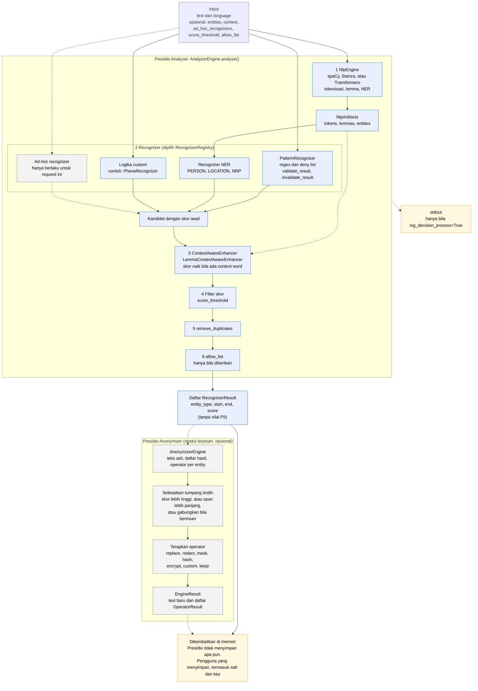
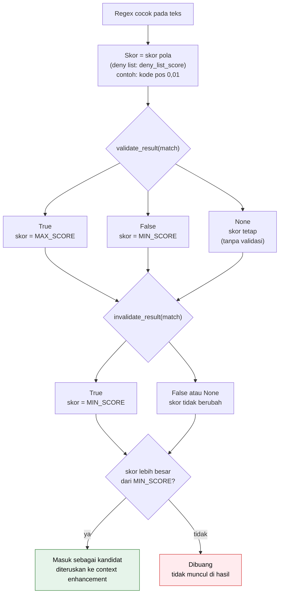

# Riset Tool: Microsoft Presidio

> Sumber utama: dokumentasi resmi presidio.dataprivacystack.org dan repositori github.com/data-privacy-stack/presidio (termasuk kode sumber `pattern_recognizer.py`, `analyzer_engine.py`, `phone_recognizer.py`). Dicek ulang pada 10 November 2026.
> Klaim yang tidak bisa dipastikan diberi tanda ⚠️. Bagian berlabel **Relevansi PRISM** adalah analisis sendiri, bukan kutipan dokumentasi.
> Kode sumber dibaca dari branch `main`, jadi perilakunya bisa berbeda pada versi lama yang dipasang lewat pip. Catat versi saat eksperimen.

## 1. Ringkasan

| Aspek | Isi |
|---|---|
| Jenis | Library/SDK Python (FAQ: "a library or SDK rather than a service"). Ada opsi REST API lewat Docker |
| Pengelola | Data Privacy Stack. Beranda: "has transitioned to a community-owned project". FAQ: bukan produk resmi perusahaan mana pun, tanpa garansi atau SLA |
| Lisensi | MIT (halaman GitHub). Tidak disebut di beranda dokumentasi |
| Yang dideteksi | PII di teks (Analyzer). Juga gambar (Image Redactor) dan data tabular/JSON (Structured) |
| Cara deteksi | Recognizer: regex, NER (spaCy/Stanza/Transformers), validasi/checksum, logika custom. Skor dinaikkan oleh context word |
| Keluaran | Objek `RecognizerResult` di memori: `entity_type`, `start`, `end`, `score`. Bukan file, bukan exit code |
| Penyimpanan hasil | Tidak ada. Pengguna yang menyimpan |
| Jaminan | "There is no guarantee that Presidio will find all sensitive information" |
| Python | 3.11, 3.12, 3.13, 3.14 (halaman Installation) |

## 2. Modul

| Modul | Fungsi |
|---|---|
| Presidio Analyzer | Mendeteksi PII di teks. Tidak mengubah teks |
| Presidio Anonymizer | Mengganti PII yang sudah terdeteksi dengan operator |
| Presidio Image Redactor | Menghapus PII di gambar (OCR + deteksi PII) |
| Presidio Structured | Mendeteksi PII di DataFrame pandas dan JSON, lalu menyamarkannya per sel atau kolom |

## 3. Alur deteksi

Lima teknik di catatan awal (regex, NER, checksum, context word, anonimisasi) benar, tetapi **bukan lima tahap berurutan**.

| Hal | Hasil verifikasi |
|---|---|
| Regex dan NER | Recognizer terpisah yang berjalan sendiri-sendiri |
| Checksum | Bagian dari recognizer regex lewat `validate_result` (lihat bagian 5) |
| Context word | Dipakai setelah recognizer menghasilkan kandidat |
| Anonimisasi | Modul terpisah yang menerima teks asli dan daftar hasil Analyzer |

**Urutan di `AnalyzerEngine.analyze()`** (dari kode sumber `analyzer_engine.py`):

| No | Tahap | Keterangan |
|---|---|---|
| 1 | NLP engine | Tokenisasi, lemma, NER. Menghasilkan `NlpArtifacts` |
| 2 | Recognizer | Semua recognizer terpilih berjalan, masing-masing mengembalikan kandidat dengan skor |
| 3 | Context enhancement | `LemmaContextAwareEnhancer` menaikkan skor bila ada context word |
| 4 | Filter skor | `score_threshold`. Dijalankan **sebelum** deduplikasi |
| 5 | Deduplikasi | `remove_duplicates` |
| 6 | Allow list | Hanya bila `allow_list` diberikan (`allow_list_match` default `"exact"`) |
| 7 | Pemetaan offset | Hanya bila teks dinormalisasi |

**Parameter `analyze()`:** `text`, `language`, `score_threshold=None`, `entities`, `context`, `ad_hoc_recognizers`, `allow_list`, `allow_list_match="exact"`, `regex_flags=DOTALL|MULTILINE|IGNORECASE`.
- Bila `score_threshold` kosong, dipakai ambang per-recognizer, lalu ambang bawaan engine (0).
- Halaman Analyzer sendiri tidak mendokumentasikan `score_threshold`. Hanya FAQ yang menyebut "acceptance threshold".
- Halaman Analyzer menyebut alurnya tidak dijelaskan eksplisit. Urutan di atas berasal dari kode.

### Diagram 1: alur kerja Presidio

Garis putus-putus = opsional atau kondisional. Diagram digambar dari dokumentasi dan kode sumber (bukan gambar resmi Presidio). Tahap bernomor mengikuti tabel di atas, kecuali tahap 7 (pemetaan offset) yang tidak digambar.

## 4. Teknologi per tahap

### NLP engine
- spaCy (default), Stanza, atau Hugging Face Transformers. NER juga bisa dipasang sebagai `EntityRecognizer` terpisah, sehingga beberapa model bisa jalan bersamaan.
- Mode Transformers tetap butuh model spaCy kecil (`en_core_web_sm`) untuk token dan lemma. Model Transformers dan Stanza dimuat lazy.
- Entity dari NER/logika custom: PERSON, LOCATION, NRP.
- ⚠️ Belum dicek ulang: opsi `NerModelConfiguration` (`alignment_mode`, `aggregation_strategy`, `labels_to_ignore`, `low_confidence_score_multiplier`), `model_to_presidio_entity_mapping`, dan model contoh `StanfordAIMI/stanford-deidentifier-base`.

### Regex (PatternRecognizer)
- Class `Pattern` (nama, regex, skor) dan `PatternRecognizer`. Mendukung juga **deny list**.
- Skor awal mencerminkan kekuatan pola. Contoh tutorial: kode pos 5 digit diberi 0,01.
- Recognizer bisa dibuat lewat kode Python, **YAML** (`add_recognizers_from_yaml`), atau **ad-hoc** (`ad_hoc_recognizers` di request `/analyze`, hanya berlaku untuk request itu).
- Flag regex: per recognizer lewat konstruktor, atau global lewat `RecognizerRegistry` (`global_regex_flags`).
- Recognizer bawaan diberi `country_code` agar deployment bisa dibatasi per negara.

### Validasi/checksum
- Method `validate_result` dan `invalidate_result` di `PatternRecognizer` (base class mengembalikan `None`, harus di-override).
- Semantik **terkonfirmasi dari kode sumber** (bukan dari halaman dokumentasi, yang tidak menjelaskannya):

| Hasil | Efek |
|---|---|
| `validate_result` = `True` | Skor menjadi `MAX_SCORE` |
| `validate_result` = `False` | Skor menjadi `MIN_SCORE`, lalu kandidat **dibuang** (hanya skor `> MIN_SCORE` yang dikembalikan) |
| `validate_result` = `None` | Skor tetap sesuai pola. Artinya tanpa validasi |
| `invalidate_result` = `True` | Skor dipaksa `MIN_SCORE`, mengalahkan hasil validasi. Kandidat dibuang |

### Diagram 2: nasib satu kandidat di PatternRecognizer

Digambar dari kode `pattern_recognizer.py`. Nilai numerik `MAX_SCORE` dan `MIN_SCORE` didefinisikan di `EntityRecognizer` dan tidak dibaca pada pengambilan ini. Context enhancement dan `score_threshold` terjadi sesudah tahap ini (lihat Diagram 1).

**Cara membacanya:** `invalidate_result` dijalankan setelah `validate_result`, sehingga `True` dari invalidasi selalu mengalahkan skor maksimum dari validasi. Karena perbandingan memakai "lebih besar dari" (strict), kandidat yang berakhir tepat di `MIN_SCORE` dibuang. Inilah mekanisme yang bisa dipakai untuk membuang angka 16 digit yang bukan NIK (tanggal lahir atau kode wilayah tidak valid).

- Entity bercentang **checksum** menurut tabel Supported Entities: CREDIT_CARD, CRYPTO, IBAN_CODE, MEDICAL_LICENSE (global); US_NPI, UK_NHS, ES_NIF, ES_NIE, IT_FISCAL_CODE, IT_VAT_CODE, PL_PESEL, SG_UEN, AU_ABN/ACN/TFN/MEDICARE, IN_AADHAAR, IN_VEHICLE_REGISTRATION, NG_NIN, PH_TIN, CA_SIN, SE_ORGANISATIONSNUMMER, SE_PERSONNUMMER, ZA_ID_NUMBER, TR_NATIONAL_ID, DE_TAX_ID, DE_SOCIAL_SECURITY, DE_HEALTH_INSURANCE.
- Tidak semua entity bercentang: US_SSN hanya "Pattern match and context". FI_PERSONAL_IDENTITY_CODE dan TH_TNIN memakai logika custom, bukan checksum.
- ⚠️ Nama algoritma di catatan awal (Luhn untuk CA_SIN/ZA_ID_NUMBER/kartu kredit, ISO 7064 Mod 11,10 untuk DE_TAX_ID, dll.) tidak tertulis di halaman Supported Entities yang dibaca. Cek di kode masing-masing recognizer sebelum dikutip.

### Context word
- `LemmaContextAwareEnhancer`: membandingkan lemma kata di sekitar hasil dengan context word recognizer.
- Default `context_similarity_factor = 0.35`, `min_score_with_context_similarity = 0.4`. Kode pos naik dari 0,01 ke 0,4. Dengan faktor 0,45 menjadi 0,46.
- Context juga bisa dikirim lewat parameter `context` di request (misalnya nama kolom), walau kata itu tidak ada di teks.
- Batasan (halaman Analyzer): enhancer default tidak mendukung context word lebih dari satu kata.
- Context word **tidak bebas bahasa**, sedangkan deteksi regex bebas bahasa (halaman Languages).

### Anonimisasi

| Operator | Fungsi | Dibalik? |
|---|---|---|
| `replace` | Ganti dengan `new_value`. Default `<ENTITY_TYPE>` | Tidak disebut |
| `redact` | Hapus PII | Tidak disebut |
| `mask` | Tutup sebagian dengan karakter (`chars_to_mask`, `masking_char`, `from_end`) | Tidak disebut |
| `hash` | `sha256` (default) atau `sha512`, dengan salt | Tidak disebut |
| `encrypt` | Enkripsi dengan key | Ya, lewat `decrypt` |
| `custom` | Fungsi lambda yang mengembalikan string | Tergantung fungsi |
| `keep` | Biarkan | Tidak berlaku |
| `surrogate_ahds` | Pengganti dari Azure Health Data Services (butuh `presidio-anonymizer[ahds]`) | Tidak disebut |

- Tanpa konfigurasi operator, default-nya `replace`.
- **Hash:** sejak versi 2.2.361 salt acak secara default. Nilai yang sama menghasilkan hash berbeda kecuali salt konsisten diberikan. Salt minimal 128 bit. Presidio tidak menyimpan state.
- **Tumpang tindih:** overlap penuh, skor lebih tinggi menang (sama: arbitrer). Satu di dalam yang lain, yang lebih panjang menang walau skornya lebih rendah. Beririsan sebagian: keduanya diganti dan hasilnya digabung.
- Keluaran: `EngineResult` (`text` dan daftar `OperatorResult`).

## 5. Penyimpanan hasil dan log

- Presidio tidak menyimpan hasil ke file atau database. FAQ tidak menyebut lokasi penyimpanan sama sekali.
- `RecognizerResult` hanya memuat tipe, posisi, dan skor, **tanpa nilai PII** (analisis sendiri dari daftar field).
- **Decision process:** mati secara default. Aktif dengan `AnalyzerEngine(log_decision_process=True)`. Ditulis ke `sys.stdout` lewat `StreamHandler`. Ada `correlation_id` (header respons `x-correlation-id`). Trace menampilkan `original_score`, `score`, `score_context_improvement`, `supportive_context_word`, `validation_result`.
- Peringatan resmi: "Decision-process traces explain why PIIs were detected, but not why they were not detected!"
- ⚠️ Entri pertama trace memuat "NLP artifacts (entities, tokens, lemmas, keywords)". Token berarti potongan teks asli, jadi kemungkinan nilai PII ikut tercetak ke stdout bila fitur ini dinyalakan. Itu inferensi dari deskripsi field, belum diuji.

## 6. Berjalan di mana

| Cara | Keterangan |
|---|---|
| Paket Python (pip) | Berjalan di proses Python sendiri |
| REST API lewat Docker | Analyzer dan Anonymizer (dan Image Redactor) masing-masing jadi service HTTP |
| Dari sumber | `docker-compose up --build`, atau `python app.py` setelah clone repositori |

- Endpoint contoh: `/analyze`, `/anonymize`, `/deanonymize`. Port host 5001 (anonymizer), 5002 (analyzer), 5003 (image redactor). Di dalam container 3000.
- **Image Docker (terkonfirmasi di halaman Installation):** `ghcr.io/data-privacy-stack/presidio-analyzer`, `-anonymizer`, `-image-redactor`. Image lama di `mcr.microsoft.com/presidio-*` "are no longer updated". Halaman menyarankan pin tag rilis.
- **Autentikasi:** tidak ada bawaan "by design". Pasang di lapisan lain dan jangan buka ke jaringan tak tepercaya.
- ⚠️ Belum dicek ulang: model NLP berjalan lokal dan teks hanya keluar bila memasang remote recognizer (Azure AI Language), serta daftar contoh deployment (Kubernetes, Spark, App Service, Data Factory, Fabric).
- Halaman FAQ tidak membahas CI/CD, performa, atau kebutuhan resource. Satu-satunya angka performa di dokumentasi (halaman developing recognizers): "Anything above 100ms per request with 100 tokens is probably not good enough" (panduan untuk recognizer baru).

## 7. Instalasi (halaman Installation, situs baru)

- `pip install presidio_analyzer presidio_anonymizer`, ditambah satu NLP engine.
- spaCy (default): `python -m spacy download en_core_web_lg`.
- Transformers: `pip install "presidio_analyzer[transformers]"` plus `en_core_web_sm`. Stanza: `pip install "presidio_analyzer[stanza]"`.
- GPU opsional (`spacy[cuda12x]`). Image Redactor butuh OCR (default Tesseract).
- ⚠️ Ukuran unduhan model dan waktu instal di runner GitHub Actions tidak disebut dokumentasi. Ukur sendiri.

## 8. Presidio Structured

- Memakai Analyzer untuk menemukan kolom atau key JSON yang berisi PII, lalu Anonymizer untuk menyamarkannya.
- Data: DataFrame pandas (default) dan JSON (`JsonDataProcessor`). Objek bersarang dalam list belum didukung oleh `JsonAnalysisBuilder`.
- Tiga strategi pemilihan entity per kolom: most common (default), highest confidence, mixed (`mixed_strategy_threshold`).
- Halaman memberi peringatan: "sensitive data might not be automatically detected in some cases".
- Pengembangan lanjutan yang disebut: teks bebas campur terstruktur, deteksi berdasarkan nama kolom, PySpark.

## 9. Entity yang didukung

- **Global:** CREDIT_CARD, CRYPTO, DATE_TIME, EMAIL_ADDRESS, IBAN_CODE, IP_ADDRESS, MAC_ADDRESS, NRP, LOCATION, PERSON, PHONE_NUMBER, MEDICAL_LICENSE, URL, **UUID** (UUID tidak ada di catatan awal).
- **Negara (18):** AS, Inggris, Spanyol, Italia, Polandia, Singapura, Australia, India, Finlandia, Korea, Nigeria, Filipina, Kanada, Swedia, Afrika Selatan, Thailand, Turki, Jerman. Cocok dengan catatan awal.
- **Indonesia: tidak ada.** Tidak ada NIK, NPWP, atau entity telepon Indonesia di tabel.
- **PHONE_NUMBER:** "Custom logic, pattern match and context". Halaman menyebut `PhoneRecognizer` bisa diperluas untuk negara tertentu lewat `supported_regions`, tetapi tidak menyebut apakah +62 didukung.
  Dari kode sumber `phone_recognizer.py`: `DEFAULT_SUPPORTED_REGIONS = ("US", "GB", "DE", "FR", "IL", "IN", "CA", "BR")`, skor `0.4`, memakai library `phonenumbers`, context word `phone, number, telephone, cell, cellphone, mobile, call`. **ID tidak termasuk.** Kode berkomentar bahwa `phonenumbers.SUPPORTED_REGIONS` bisa dipakai untuk semua region. ⚠️ Belum diuji apakah `supported_regions=("ID",)` mendeteksi nomor `08...` dan `+62...`.
- **Bahasa:** konfigurasi bawaan hanya Inggris. Halaman Languages tidak menyebut Bahasa Indonesia. Menambah bahasa butuh model NLP bahasa itu dan recognizer/context word per bahasa. ⚠️ Belum dicek apakah ada model spaCy/Stanza untuk Bahasa Indonesia.
- Entity medis (MEDICAL_*) berasal dari model NER, bukan checksum. ⚠️ Nama class `MedicalNERRecognizer` belum dicek ulang.

## 10. Keterbatasan (dari dokumentasi)

- Tidak ada jaminan semua PII terdeteksi.
- Tiap recognizer bisa menghasilkan false positive dan false negative. Ada trade-off di antara keduanya.
- Saran FAQ untuk false positive: naikkan acceptance threshold, hapus recognizer yang tidak perlu, ubah logika recognizer, atau ganti dengan layanan pihak ketiga.
- Context enhancer default hanya satu kata.
- REST API tanpa autentikasi bawaan.
- Tanpa state, jadi konsistensi hash antar panggilan menjadi tanggung jawab pengguna.
- Evaluasi memakai repo terpisah `presidio-research` (precision dan recall). FAQ menyebut repo itu juga punya generator data PII sederhana.
- Tanpa garansi atau SLA. Repo dan registry sudah berpindah (dari Microsoft ke Data Privacy Stack), jadi tautan lama bisa usang.

## 11. Koreksi terhadap catatan awal

| Catatan awal | Hasil verifikasi |
|---|---|
| Kelima step tidak berurutan | ✅ Terkonfirmasi. Urutan eksekusi sebenarnya ada di bagian 3 |
| Semantik hasil `None`/`False` berasal dari PR dan paket pihak ketiga (non-resmi) | **Sekarang terkonfirmasi dari kode sumber resmi.** `True` skor maksimum, `False` kandidat dibuang, `None` skor tetap. Ditambah `invalidate_result` yang tidak ada di catatan awal |
| "Instalasi dari mirror lama, perlu dicek ulang" | ✅ Sudah dicek ke situs baru. Python 3.11 sampai 3.14 |
| "Satu artikel pihak ketiga menyebut image pindah ke ghcr.io/data-privacy-stack" | ✅ **Terkonfirmasi di dokumentasi resmi.** Image MCR lama tidak diperbarui lagi |
| "Awalnya Microsoft, kini komunitas Data Privacy Stack" | ✅ Beranda dan halaman GitHub tidak menyebut Microsoft. Lisensi MIT (tidak ada di catatan awal) |
| "Indonesia tidak ada di daftar" | ✅ Terkonfirmasi. Ditambah nuansa: ada `PhoneRecognizer` generik, tetapi region bawaannya tidak memuat ID |
| Entity global | Kurang `UUID` |
| Nama algoritma checksum | ⚠️ Tidak terlihat di halaman yang dibaca |
| "Acceptance threshold" | ✅ FAQ benar. Halaman Analyzer tidak mendokumentasikannya. Di kode: `score_threshold` default `None` |
| Nilai default context (0,35; 0,4; 0,46) | ✅ Terkonfirmasi |
| Operator, hash salt 2.2.361, salt 128 bit, aturan overlap | ✅ Terkonfirmasi |
| Port 5002 dan 5001, container 3000 | ✅ Terkonfirmasi. Image redactor 5003 (tidak ada di catatan awal) |
| Tanpa autentikasi, log decision process ke stdout, `correlation_id` | ✅ Terkonfirmasi |
| Structured: "halaman detail belum dibaca" | Sekarang dibaca (bagian 8) |
| Opsi `NerModelConfiguration`, contoh deployment, remote recognizer Azure, `MedicalNERRecognizer` | ⚠️ Belum dicek ulang |

## 12. Kelebihan, kekurangan, dan celah untuk PRISM

> Bagian ini analisis sendiri berdasarkan fakta di atas.

### Yang relevan (kelebihan Presidio)

| Poin | Penjelasan |
|---|---|
| Desain hampir sama dengan rencana PRISM | Regex + validasi + context + ambang skor + daftar pengecualian adalah arsitektur yang sama dengan rancangan PRISM. Sumber rujukan desain yang kuat |
| Validasi semantik tersedia | `validate_result` menerima kode Python bebas. Cek tanggal lahir dan kode wilayah NIK mudah ditulis, dan `False` otomatis membuang kandidat. **Berbeda dengan Betterleaks**, celah "tanpa validasi semantik" tidak berlaku di sini |
| Hasil tanpa nilai PII | `RecognizerResult` hanya offset dan skor. Selaras dengan NFR-04 |
| Allow list | `allow_list` dengan `allow_list_match` memetakan langsung ke FR-08 |
| Evaluasi | `presidio-research` memakai precision dan recall, seperti rencana evaluasi PRISM |
| Operator `mask` dan `hash` | Referensi untuk keputusan bentuk laporan (masking vs hash vs HMAC) |
| Deteksi PERSON/LOCATION lewat NER | Kemampuan yang tidak mungkin dicapai regex. Di luar cakupan PRISM, tetapi bisa disebut sebagai trade-off pilihan regex |

### Celah yang bisa menonjolkan PRISM

| No | Celah | Dasar | Kekuatan argumen | Catatan |
|---|---|---|---|---|
| P1 | Tidak ada recognizer PII Indonesia (NIK, NPWP) | Tabel Supported Entities, Indonesia tidak ada | **Tinggi dan terverifikasi** | Argumen paling aman |
| P2 | Nomor +62 tidak terdeteksi secara default | `DEFAULT_SUPPORTED_REGIONS` tidak memuat ID (kode sumber `main`) | Sedang. Mudah ditutup dengan konfigurasi | ⚠️ Uji dengan `supported_regions=("ID",)` agar adil |
| P3 | Bukan alat CI/CD: tidak ada CLI, penelusuran berkas, nomor baris, laporan, atau exit code | Presidio menganalisis string dan mengembalikan objek | **Tinggi** | Perlu pembungkus (offset karakter ke nomor baris, laporan, exit code). Klaimnya adalah integrasi, bukan algoritma deteksi |
| P4 | Bobot dependensi dan waktu setup di runner | Butuh NLP engine dan model spaCy (`en_core_web_lg` default) | Sedang. **Harus diukur** | Ukuran dan waktu tidak ada di dokumentasi. Cocok untuk NFR-01 dan NFR-02 |
| P5 | Tidak mendeteksi token/kredensial | Entity bawaan tidak memuat pola API key (CRYPTO adalah alamat kripto) | Sedang | S2 tidak tercakup |
| P6 | Bahasa dan context word berbasis Inggris | Halaman Languages, konfigurasi bawaan Inggris | Sedang | Context word Indonesia (`nik`, `ktp`, `telepon`) harus dibuat sendiri. ⚠️ Model bahasa Indonesia belum dicek |
| P7 | Trace decision process bisa mencetak token ke stdout | Deskripsi field trace | Rendah. Fitur opsional dan inferensi | ⚠️ Uji dahulu. Relevan bagi T3 dan T9 |
| P8 | Hash bawaan memakai salt acak per panggilan | Dokumentasi Anonymizer | Rendah sampai sedang | Hasil tidak stabil antar-run, tidak cocok dengan NFR-07 tanpa salt tetap. Menegaskan perlunya HMAC berkunci tetap di PRISM |
| P9 | Proyek komunitas tanpa SLA, repo dan registry berpindah | Beranda, FAQ, Installation | Rendah | Pin versi pada eksperimen |

**Yang sebaiknya tidak diklaim PRISM:**
- Mesin deteksinya lebih canggih dari Presidio. Presidio lebih matang, dan konsep skor + validasi + context sama.
- Presidio "tidak bisa" memvalidasi NIK. Bisa, lewat `validate_result`.
- Presidio tidak bisa mendeteksi PII Indonesia sama sekali. Yang benar: tidak ada bawaan, tetapi bisa ditambah lewat recognizer custom (kode, YAML, ad-hoc).

**Jawaban untuk pertanyaan penguji "kenapa tidak pakai Presidio dengan recognizer NIK?"** Kontribusi PRISM ada pada (1) aturan PII Indonesia siap pakai, (2) integrasi CI/CD dengan gating exit code dan laporan aman, (3) kebutuhan dependensi yang ringan, dan (4) evaluasi pada skenario S1 sampai S3. Poin (3) hanya sahih bila terbukti lewat pengukuran.

## 13. Relevansi untuk skenario PRISM

| Skenario | Dukungan Presidio | Catatan |
|---|---|---|
| S1: PII di berkas repositori | ⚠️ Mekanisme ada, tetapi harus dibungkus | Perlu penelusur berkas, konversi offset ke nomor baris, dan recognizer Indonesia |
| S2: Token di berkas/commit | ❌ Tidak dirancang untuk itu | Pembanding S2 adalah Betterleaks dan GitHub secret scanning |
| S3: PII di log keluaran | ✅ Cocok secara mekanis (teks biasa) | Berkas log diberikan sebagai argumen, sesuai keputusan scope. Sama-sama butuh pembungkus |

**Posisi di tabel perbandingan tool (bagian 9.1 riset utama):**

| Tool | Jenis | Berjalan di runner | PII Indonesia | Validasi semantik | Gating exit code |
|---|---|---|---|---|---|
| Presidio | Library Python | Ya, sebagai paket (butuh pembungkus) | Tidak ada bawaan | Ya (`validate_result`) | Tidak bawaan |
| Betterleaks | CLI scanner secret | Ya | Tidak ada bawaan ⚠️ | Terbatas ke filter Expr (belum diuji) | Ya (1) |
| GitHub secret scanning | Fitur platform | Tidak | Tidak | Tidak | Tidak (push protection) |

## 14. Yang masih perlu dicek

- [ ] Eksperimen kunci: tulis `PatternRecognizer` NIK + `validate_result` dan ukur precision, recall, FPR pada dataset berlabel yang sama dengan PRISM. **Menentukan apakah PRISM beda secara deteksi atau hanya secara pengemasan.**
- [ ] Ukur waktu `pip install` + unduh model + analisis di runner GitHub Actions, dibandingkan PRISM (NFR-01, NFR-02). Coba juga `en_core_web_sm`, dan apakah `AnalyzerEngine` bisa jalan tanpa NER.
- [ ] `PhoneRecognizer` dengan `supported_regions=("ID",)`: apakah `08...` dan `+62...` terdeteksi.
- [ ] Apakah trace `log_decision_process=True` mencetak nilai PII.
- [ ] Nama algoritma checksum per recognizer (di kode, bukan halaman entity).
- [ ] Model spaCy/Stanza untuk Bahasa Indonesia, dan cara menambah context word Indonesia.
- [ ] Halaman yang belum dibaca: Allow-list, Encryption, tutorial rule-based, halaman Transformers NER.
- [ ] Versi pip yang dipakai dan kecocokannya dengan perilaku di branch `main`.

## Sumber

**Resmi (dicek 10 Nov 2026):**
- [Beranda](https://presidio.dataprivacystack.org/)
- [Analyzer](https://presidio.dataprivacystack.org/analyzer/)
- [Anonymizer](https://presidio.dataprivacystack.org/anonymizer/)
- [Decision process](https://presidio.dataprivacystack.org/analyzer/decision_process/)
- [Developing recognizers](https://presidio.dataprivacystack.org/analyzer/developing_recognizers/)
- [Adding recognizers](https://presidio.dataprivacystack.org/analyzer/adding_recognizers/)
- [Languages](https://presidio.dataprivacystack.org/analyzer/languages/)
- [Context words (tutorial 6)](https://presidio.dataprivacystack.org/tutorial/06_context/)
- [Supported entities](https://presidio.dataprivacystack.org/supported_entities/)
- [Installation](https://presidio.dataprivacystack.org/installation/)
- [Structured](https://presidio.dataprivacystack.org/structured/)
- [FAQ](https://presidio.dataprivacystack.org/faq/)
- [Repositori (branch main)](https://github.com/data-privacy-stack/presidio): `pattern_recognizer.py`, `analyzer_engine.py`, `phone_recognizer.py`

**Non-resmi / belum dibaca ulang:** [PR #1990 di repo Presidio](https://github.com/microsoft/presidio/pull/1990) (repo sudah pindah organisasi), paket [presidio-sg-recognizers](https://pypi.org/project/presidio-sg-recognizers/), mirror dokumentasi lama microsoft.github.io (instalasi dan tutorial regex, kini digantikan situs baru).
